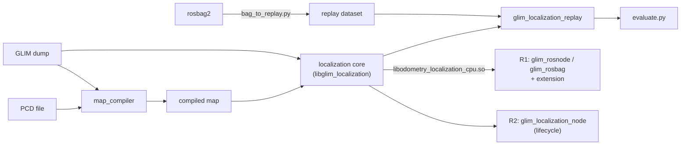

# glim_localization

LiDAR-IMU localization on a prebuilt 3D map, built on top of [GLIM](https://github.com/koide3/glim) and [gtsam_points](https://github.com/koide3/gtsam_points).

> **Status: under development, CPU only.** The core, the offline tools and both ROS 2 integrations work on synthetic data and pass CI. Real-data evaluation is limited (see [Limitations](#limitations)). The interfaces may still change.

## Overview

- Replaces GLIM's odometry module with a localization module that adds scan-to-map VGICP factors (unary factors against fixed map submaps) to GLIM's tightly coupled LiDAR-IMU fixed-lag smoother.
- Loads maps directly from GLIM dump directories, or from maps compiled by `map_compiler` (from a GLIM dump or a PCD file).
- ROS 2 integration via a GLIM extension module (R1, for evaluation) and a dedicated lifecycle node (R2, for deployment).
- GLIM itself is not modified; this repository links against it.



Design: [docs/DESIGN.md](docs/DESIGN.md). Plan: [docs/IMPLEMENTATION_PLAN.md](docs/IMPLEMENTATION_PLAN.md). Progress and measurements: [docs/PROGRESS.md](docs/PROGRESS.md).

### Progress

| Phase | Content | State |
| --- | --- | --- |
| 0 to 2 | Docker environment, repository skeleton, MapManager and map I/O | Done |
| 3 | CPU localization odometry, quality monitoring (INITIALIZING / TRACKING / DEGRADED / LOST) | Done |
| 4 | Offline replay, bag conversion, evaluation, evaluation mapper | Done |
| 5 | ROS 2: glim_ros2 layer, msgs, IMU gap policy, publisher and TF, R1 extension, R2 lifecycle node | Done |
| 5 | Launch file, YAML parameter file, RViz config | **Not done** (#1) |
| 6 | `map_compiler` PCD input | Done |
| 6 | README | This file |

Not done yet (open issues):

- Phase 5: launch file, parameter YAML and RViz config (#1).
- GPU (CUDA) version of the odometry module (#2).
- Relocalizer: multi-hypothesis refinement of `/initialpose` and global relocalization (#3).
- `map_compiler` PLY input and 2D OccupancyGrid export (#4); PCD follow-ups such as `binary_compressed` input (#12).
- Evaluation on real data against an independent reference (#5) and in simulation (#9).
- Optional wheel odometry fusion (#14).
- Follow-ups for robustness, the IMU gap policy, the publisher and the R2 node (#6, #8, #10, #13).

## Requirements

- Docker with Compose. Builds and tests run in an Ubuntu 24.04 + ROS 2 Jazzy image (`docker/Dockerfile`). Builds outside this image are not supported.
- The image pins GLIM (commit `1a197c9`), glim_ros2 (commit `4d4ec52`, with a build-only patch that drops the cv_bridge dependency), GTSAM 4.3.0 and gtsam_points 1.2.2, all built for CPU (`BUILD_WITH_CUDA=OFF`). See [docs/DEPENDENCIES.md](docs/DEPENDENCIES.md).
- A LiDAR with an IMU. LiDAR-only input is not supported.

> [!NOTE]
> **Headless.** The image has no GUI: no GLIM viewer, no Iridescence, no OpenCV and no RViz. The build and tests check that the GLIM libraries and ours do not link GUI libraries. Visualize from another machine on the same ROS 2 network if needed.

## Build and test

From the repository root on the host:

```bash
docker compose -f docker/compose.yaml build      # build the image
scripts/docker_run.sh scripts/ci.sh              # dependency check, build, all tests
```

`scripts/docker_run.sh <command>` runs a command in the container. The repository is mounted at `/ws/src/glim_localization`, build outputs go to a Docker volume at `/ws/build`, and the host directory `out/` is mounted at `/ws/out` (use it to exchange data, maps and results). Without a command it opens a shell.

`scripts/ci.sh` runs, in order: `check_deps.sh`, `build_core.sh` (core with plain CMake and its tests, into `/ws/build/core`), `build_colcon.sh` (all packages, into `/ws/build/colcon/install`), `test_colcon.sh`, `test_interfaces.sh`, `test_python.sh` and `test_replay_e2e.sh`. Each script can also be run alone. `build_colcon.sh` reuses the core build directory of `build_core.sh`, so run that first, with the same `CCACHE_DIR` setting (a different compiler launcher recompiles the shared core). `build_core.sh` and `test_colcon.sh` run the tests in parallel with `CTEST_JOBS` jobs (default: the CPU count).

> [!NOTE]
> `test_colcon.sh` unsets `ROS_DOMAIN_ID`. Each ROS test reserves a free domain ID for its run, so parallel tests do not see each other's topics.

`scripts/ci_local.sh [--force]` is a host-side wrapper of the same checks that reuses a recorded pass for the same tree and image, and skips docs-only changes.

GitHub Actions runs `scripts/ci.sh` in an image tagged with `scripts/image_inputs_hash.sh`, the hash of the repository files the image bakes in. It pulls `ghcr.io/<owner>/glim_localization:<hash>` when it exists and builds it otherwise; pushes to `main` publish a missing image after the checks pass. The published image is rebuilt from the layer cache, not copied from the tested run. The tag identifies the image inputs, not the image content, so base image and apt updates reach it only when an input changes (or after the tag is deleted on GHCR). The C++ builds use a ccache saved from `main` (at most 500 MB). Draft pull requests are skipped until they are marked ready for review.

To use ccache locally, set `GLIM_LOC_CCACHE_DIR` to a host directory when calling `scripts/docker_run.sh`. It is mounted as given, so its files are owned by the container user (root), and the path must not contain `:`.

Unless prefixed with `scripts/docker_run.sh`, the commands below run inside the container (`scripts/docker_run.sh` with no arguments opens a shell there) after `scripts/ci.sh` or the build scripts have run.

## Map preparation

Localization takes either a GLIM dump directory (from a GLIM mapping run) or a compiled map. `map_compiler` writes a compiled map: a slimmed dump without frame data plus a `map_index.json` with the submap poses and bounding boxes. It is also the way to build a map from a PCD file:

```bash
# From a GLIM dump (or a compiled map)
/ws/build/core/tools/map_compiler /ws/out/glim_dump /ws/out/map

# From a PCD file (x, y, z in the map frame)
/ws/build/core/tools/map_compiler /ws/out/map.pcd /ws/out/map --grid-size 50 --voxel-size 0.1
```

PCD options (rejected for dump input):

| Option | Meaning | Default |
| --- | --- | --- |
| `--grid-size <m>` | Tile edge along x and y, at least 1 | 20 |
| `--voxel-size <m>` | Voxel downsampling before tiling, 0 disables it, otherwise at least 0.01 | 0 |
| `--k-neighbors <n>` | Neighbours for covariance estimation, 5 to 1000 | 10 |

PCD input reads `DATA ascii` and `binary` with x, y, z as F4 or F8; other fields are ignored. Localization uses up to `map_max_submaps` (default 5) tiles nearest to the robot, so 20 m tiles cover only about 40 x 40 m. For long-range LiDAR use `--grid-size` 50 to 100, or raise `map_max_submaps`.

## Offline replay and evaluation

No ROS is needed. The replay reads a simple dataset (`meta.json`, `imu.csv`, `points/*.bin`; format in [DESIGN 6.5](docs/DESIGN.md#65-offline-replay-phase-4)). Python tools run from the venv in the image:

```bash
alias py='env -u PYTHONPATH $GLIM_LOC_PYTHON'
```

### Synthetic end to end

```bash
scripts/docker_run.sh scripts/test_replay_e2e.sh
```

Generates a 12 s synthetic map and dataset, localizes from an offset initial pose on the GLIM dump and on a PCD map, and checks accuracy (0.1 m, 1 deg after 3 s), determinism and exit codes. Results are in `out/phase4_e2e/`.

### Real bag

```bash
# 1. Convert a rosbag2 (sqlite3 or mcap) to a replay dataset
py scripts/bag_to_replay.py <bag_dir> --out /ws/out/dataset [--points-topic /points] [--imu-topic /imu] [--acc-scale 9.80665] [--gt traj.txt]

# 2. Localize
/ws/build/core/tools/glim_localization_replay --data /ws/out/dataset --config glim_localization/config \
  --map /ws/out/map --out /ws/out/run --init-pose x y z qx qy qz qw [--init-stamp <s>]

# 3. Evaluate against a reference trajectory (TUM, T_world_imu); traj_gt.txt is written only by --gt in step 1
py scripts/evaluate.py --est /ws/out/run/traj_localization.txt --gt /ws/out/dataset/traj_gt.txt \
  --frames /ws/out/run/frames.csv --out /ws/out/run [--settle 3] [--max-trans 0.1] [--max-rot-deg 1] [--plot]
```

- `bag_to_replay.py`: per-point time is detected as GLIM does (override with `--time-field`, `--time-mode`, `--time-scale`). `--acc-scale` is required when the accelerations look like units of g. Livox `CustomMsg` is not supported.
- `glim_localization_replay`: `--init-pose` is `T_world_imu` in the map frame. Other options: `--init-vel`, `--start`, `--end`, `--max-frames`, `--max-imu-gap` (default 0.05 s), `--on-imu-gap abort|reset`, `--min-tracking-ratio` (default 0.9). Outputs: `traj_localization.txt` (TUM), `frames.csv`, `summary.json`, `replay_args.json`. Exit codes: 0 ok, 1 runtime failure (including LOST or a low tracking ratio), 2 bad arguments, config, map or initial pose, 3 invalid dataset (including IMU gaps), 4 no pose.
- `evaluate.py`: ATE and RPE with evo (no realignment) and processing time statistics; writes `eval.json` and `eval.txt`, and exits 1 when a threshold or the pose coverage (`--min-coverage`, default 0.9) is not met.
- Set `T_lidar_imu` in `config_sensors.json` of a copied config for your sensor; the shipped configs use identity.

`glim_localization_mapper` and `scripts/smoke_os1_128.sh` build a GLIM map and a reference trajectory from a replay dataset for a real-data consistency check. They are evaluation tools, not a supported mapper; build maps for real use with GLIM.

## ROS 2

Source the colcon install first: `source /ws/build/colcon/install/setup.bash`. Run one localization (R1 or R2) per process.

### R1: GLIM extension (evaluation)

`libglim_localization_extension.so` is loaded by glim_ros2's `glim_rosnode` / `glim_rosbag`, using the config in `share/glim_localization_ros2/config/r1`. Copy it and set `odometry_estimation.map_path` in `config_odometry_localization_cpu.json` (and `T_lidar_imu` in `config_sensors.json`):

```bash
cp -r "$(ros2 pkg prefix glim_localization_ros2)/share/glim_localization_ros2/config/r1" /ws/out/r1_config
# edit /ws/out/r1_config/config_odometry_localization_cpu.json: "map_path": "/ws/out/map"
ros2 run glim_ros glim_rosnode --ros-args -p config_path:=/ws/out/r1_config
ros2 run glim_ros glim_rosbag <bag_dir> --ros-args -p config_path:=/ws/out/r1_config   # offline
```

Topics are on the GLIM node (`/glim_ros/pose`, ...). The initial pose comes from `/initialpose` (base pose in the map frame), or from `init_T_world_imu` (IMU pose in the map frame, `[x, y, z, qx, qy, qz, qw]`) added under `odometry_estimation` in `config_odometry_localization_cpu.json`; the shipped config does not set it. R1 has no services.

> [!WARNING]
> Do not add GLIM's `librviz_viewer.so` or `libstandard_viewer.so` to `extension_modules`: they publish a conflicting TF.

### R2: lifecycle node (deployment)

`glim_localization_node` (node name `glim_localization`, also a component `glim_localization_ros2::LocalizationNode`):

```bash
ros2 run glim_localization_ros2 glim_localization_node --ros-args -p map_path:=/ws/out/map
ros2 lifecycle set /glim_localization configure   # reads the config, loads the map, creates the services
ros2 lifecycle set /glim_localization activate    # starts the odometry and the subscriptions
ros2 service call /glim_localization/initialize glim_localization_msgs/srv/Initialize \
  "{pose: {header: {frame_id: map}, pose: {pose: {position: {x: 0.0, y: 0.0, z: 0.0}, orientation: {w: 1.0}}}}}"
```

ROS parameters:

| Parameter | Default | Meaning |
| --- | --- | --- |
| `config_path` | `config/r2` | GLIM-style config directory; a relative path is taken from the package share |
| `map_path` | (empty) | GLIM dump or compiled map; overrides `odometry_estimation.map_path` |
| `max_init_pose_delay` | 0.2 | Largest accepted delay [s] of a stamped initial pose behind the last input frame |

Everything else comes from the JSON files: input topics, QoS and time offsets from `glim_ros` in `config_ros.json` (default `/points` and `/imu`), the publisher settings from `localization_ros`, and the odometry settings from `config/r1/config_odometry_localization_cpu.json`. `config/r2/config.json` refers to the `r1` files, so copy the whole `config` directory to customize it.

Lifecycle: configure fails and leaves the node unconfigured on a missing config or an unreadable map. Input before activate is ignored. Deactivate stops processing; the next activate starts a new run. The services exist only while the node is configured and answer `success=false` while inactive.

### Topics, services and TF (R1 and R2)

| Name | Type | Notes |
| --- | --- | --- |
| points, imu (in) | `sensor_msgs/PointCloud2`, `sensor_msgs/Imu` | Topic names from `config_ros.json` |
| `/initialpose` (in) | `geometry_msgs/PoseWithCovarianceStamped` | Base pose in the map frame, applied as given (no yaw search) |
| `~/pose` | `geometry_msgs/PoseWithCovarianceStamped` | Base pose in the map frame, LiDAR rate. Covariance is zero (not estimated) |
| `~/odometry` | `nav_msgs/Odometry` | Pose and twist of the base |
| `~/status` | `glim_localization_msgs/LocalizationStatus` | State, inlier ratio, tiles, map factors, residual, processing time, reset count and reason |
| `/diagnostics` | `diagnostic_msgs/DiagnosticArray` | OK, WARN for DEGRADED, ERROR for LOST |
| `~/initialize` (R2) | `glim_localization_msgs/srv/Initialize` | Sets the pose. `success` means accepted, applied at the next frame. `global_search=true` returns `success=false` (#3) |
| `~/relocalize` (R2) | `std_srvs/srv/Trigger` | Restarts from the newest estimate; refused unless TRACKING or DEGRADED with an estimate no older than `max_init_pose_delay` and no reset pending |

States: `INITIALIZING` (started or reset) -> `TRACKING` -> `DEGRADED` (low inlier ratio, map weight lowered) -> `LOST` (left only by an external initialization). In LOST, no pose, odometry or `map->odom` is published; `odom->base_link` continues in `internal_odom`.

`tf_mode` in `localization_ros`: `internal_odom` (default; publishes `map->odom` and `odom->base_link`), `external_odom` (publishes only `map->odom`, using `odom->base_link` from another source), `none` (no TF). Also set `base_frame_id` and `T_base_imu` there. Details are in [DESIGN 6](docs/DESIGN.md#6-ros-2-support).

## Limitations

- **CPU only.** The GPU version is not written (#2). On one 10 Hz OS1-128 sequence (Docker, arm64) the mean was about 93 ms per frame for a 100 ms period, with p99 spikes over 1 s, and the ratio of processing time to data length varied between runs (1.06 and 0.64); real-time capability is not established.
- **Not yet verified:** accuracy on real data against an independent reference (the only real-data run, one OS1-128 sequence, compares with GLIM's own trajectory: ATE translation RMSE about 0.023 to 0.025 m, a consistency figure, not accuracy); real robots and real-time sensor input; most measurements so far ran in the Docker image on arm64, and amd64 has less coverage; a multithreaded component container; PCD maps from a real mapping pipeline (for example sdf2map, #9); integration with Nav2 or an external EKF.
- No launch file, parameter YAML or RViz config yet (planned, #1). `~/aligned_points`, `~/map` and an IMU-rate odometry are not published.
- No initial pose search: `/initialpose` and `~/initialize` are applied exactly. No global relocalization (#3).
- Right after the node becomes active, the first messages can be missed (cause not confirmed; DDS discovery is suspected). In R2 set the first pose with `~/initialize`, which replies; otherwise publish `/initialpose` after the node is matched, or resend it.
- IMU gaps in ROS (`on_imu_gap: reset` in the shipped config): a gap up to `imu_gap_reset_max` (0.5 s) resets the estimate from its own prediction; a longer gap goes LOST until an external initialization. The replay tool defaults to `--on-imu-gap abort` (exit code 3).
- Degenerate directions are not detected, and pose covariance is not estimated. Objects thinner than a voxel can bias the estimate.
- Map input: no PLY, no compressed PCD, no 2D map export (#4, #12).

## License

MIT. Portions are derived from GLIM / glim_ros2 (MIT, Copyright (c) 2024 koide3). See `LICENSE`.

Provenance and licenses of the pinned C++ dependencies (GTSAM, BSD-3-Clause; gtsam_points, GLIM, and glim_ros2, MIT) are in [docs/DEPENDENCIES.md](docs/DEPENDENCIES.md). It does not cover the ROS base image, the Ubuntu packages, or the Python tooling.
