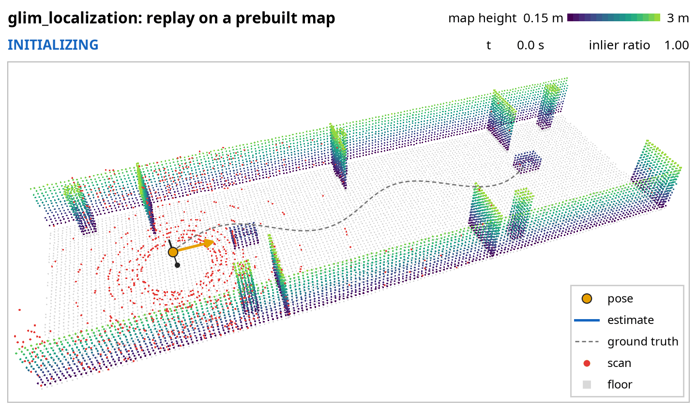
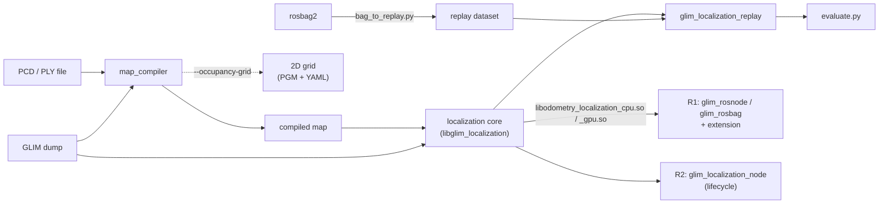

# glim_localization

LiDAR-IMU localization on a prebuilt 3D map, built on top of [GLIM](https://github.com/koide3/glim) and [gtsam_points](https://github.com/koide3/gtsam_points). Instead of forking GLIM, it uses GLIM as a library: GLIM itself is not modified, and a localization module replaces GLIM's odometry module, adding scan-to-map VGICP factors against a fixed, prebuilt map to GLIM's tightly coupled LiDAR-IMU fixed-lag smoother. The core library is ROS-independent and drives an offline replay tool as well as two ROS 2 integrations: a GLIM extension module (R1, for evaluation) and a dedicated lifecycle node (R2, for deployment).



*Offline replay on synthetic data, top-down view of a slice from 1 m to 3 m (sensor height and above; low boxes in the corridor are not drawn): each scan (red) is placed on the prebuilt map (gray) by the estimated pose (orange dot and heading). Regenerate with [`scripts/render_demo.py`](docs/replay.md#demo-animation).*

> **Status: under development. CPU by default; the GPU module (CUDA image) is tested on synthetic data only.** The core, the offline tools and both ROS 2 integrations work on synthetic data and pass CI. Real-data evaluation is limited (see [Limitations](#limitations)). The interfaces may still change. Details: [Status and limitations](docs/status.md), [PROGRESS](docs/PROGRESS.md), [open issues](https://github.com/atinfinity/glim_localization/issues).

## Features

- Replaces GLIM's odometry module with a localization module that adds scan-to-map VGICP factors (unary factors against fixed map submaps) to GLIM's tightly coupled LiDAR-IMU fixed-lag smoother.
- Loads maps directly from GLIM dump directories, or from maps compiled by `map_compiler` (from a GLIM dump, a PCD file or a PLY file). `map_compiler` can also export a 2D occupancy grid (map_server PGM + YAML) for Nav2.
- ROS 2 integration via a GLIM extension module (R1, for evaluation) and a dedicated lifecycle node (R2, for deployment).
- GLIM itself is not modified; this repository links against it.
- Quality monitoring with the states INITIALIZING, TRACKING, DEGRADED and LOST, published on `~/status` and `/diagnostics`.
- Offline replay without ROS, bag conversion and evaluation (ATE, RPE, timing) for reproducible tests.
- Headless Docker build (Ubuntu 24.04 + ROS 2 Jazzy), CPU by default, with an optional CUDA image for the GPU odometry module.



## Getting started

You need Docker with Compose. From the repository root on the host:

```bash
docker compose -f docker/compose.yaml build      # build the image
scripts/docker_run.sh scripts/ci.sh              # dependency check, build, all tests
scripts/docker_run.sh scripts/test_replay_e2e.sh # synthetic replay and evaluation, results in out/phase4_e2e/
```

Then, with your own PCD map in `out/` and inside the container (`scripts/docker_run.sh` opens a shell), compile the map and start the ROS 2 node. The guide covers the initial pose and the sensor config:

```bash
/ws/build/core/tools/map_compiler /ws/out/map.pcd /ws/out/map --grid-size 50 --voxel-size 0.1
source /ws/build/colcon/install/setup.bash
ros2 launch glim_localization_ros2 localization.launch.py map_path:=/ws/out/map
```

The step-by-step guide, including real bags and setting the initial pose, is [docs/getting_started.md](docs/getting_started.md).

## Documentation

| Page | Content |
| --- | --- |
| [Getting started](docs/getting_started.md) | Step-by-step first run: build, tests, synthetic replay, your own map and bag, live ROS 2 |
| [Build and test](docs/build.md) | Requirements, Docker image, CI scripts, ccache, CUDA variant and GPU configs |
| [Map preparation](docs/maps.md) | GLIM dumps, `map_compiler` and its PCD and PLY options, 2D occupancy grid export for Nav2 |
| [Offline replay and evaluation](docs/replay.md) | Replay datasets, bag conversion, `glim_localization_replay`, `evaluate.py` |
| [Simulation evaluation](docs/sim_eval.md) | Gazebo world with exact ground truth, `scripts/sim_eval.sh` (manual, not in CI) |
| [ROS 2](docs/ros2.md) | Launch files, R1 extension, R2 lifecycle node, parameters, topics, services, TF |
| [Status and limitations](docs/status.md) | Progress, open work and known limitations |
| [Design](docs/DESIGN.md) | Architecture and design decisions |
| [Dependencies](docs/DEPENDENCIES.md) | Pinned dependencies, provenance and licenses |
| [Implementation plan](docs/IMPLEMENTATION_PLAN.md) | Phases and their state |
| [Progress](docs/PROGRESS.md) | History, verification results and measurements |
| [Contributing](CONTRIBUTING.md) | Issues, pull requests and the development workflow |

## Limitations

- Real-time capability and accuracy on real data are not established; the GPU module is tested on synthetic data only.
- No global relocalization ([#3](https://github.com/atinfinity/glim_localization/issues/3)). The [initial pose yaw search](docs/ros2.md#initial-pose-yaw-search) is off by default, needs a position close to the true one and is verified on synthetic data only.
- `~/aligned_points` ([#18](https://github.com/atinfinity/glim_localization/issues/18)) and an IMU-rate odometry are not published; pose covariance is not estimated.
- Map input: no compressed PCD ([#12](https://github.com/atinfinity/glim_localization/issues/12)). The 2D occupancy grid uses one height band for the whole map, so it suits roughly flat sites; it is checked against map_server's loading rules in a test, but not with a running Nav2 stack.
- A LiDAR with an IMU is required; LiDAR-only input is not supported.

The full list is in [Status and limitations](docs/status.md#limitations).

## License

MIT. Portions are derived from GLIM / glim_ros2 (MIT, Copyright (c) 2024 koide3). See `LICENSE`.

Provenance and licenses of the pinned C++ dependencies (GTSAM, BSD-3-Clause; gtsam_points, GLIM, and glim_ros2, MIT) are in [docs/DEPENDENCIES.md](docs/DEPENDENCIES.md). It does not cover the ROS base image, the Ubuntu packages, or the Python tooling.

## Acknowledgements

This package builds on [GLIM](https://github.com/koide3/glim), [glim_ros2](https://github.com/koide3/glim_ros2) and [gtsam_points](https://github.com/koide3/gtsam_points) by koide3, and on [GTSAM](https://github.com/borglab/gtsam). If you use it, please cite it as described in [CITATION.cff](CITATION.cff), and cite GLIM.
