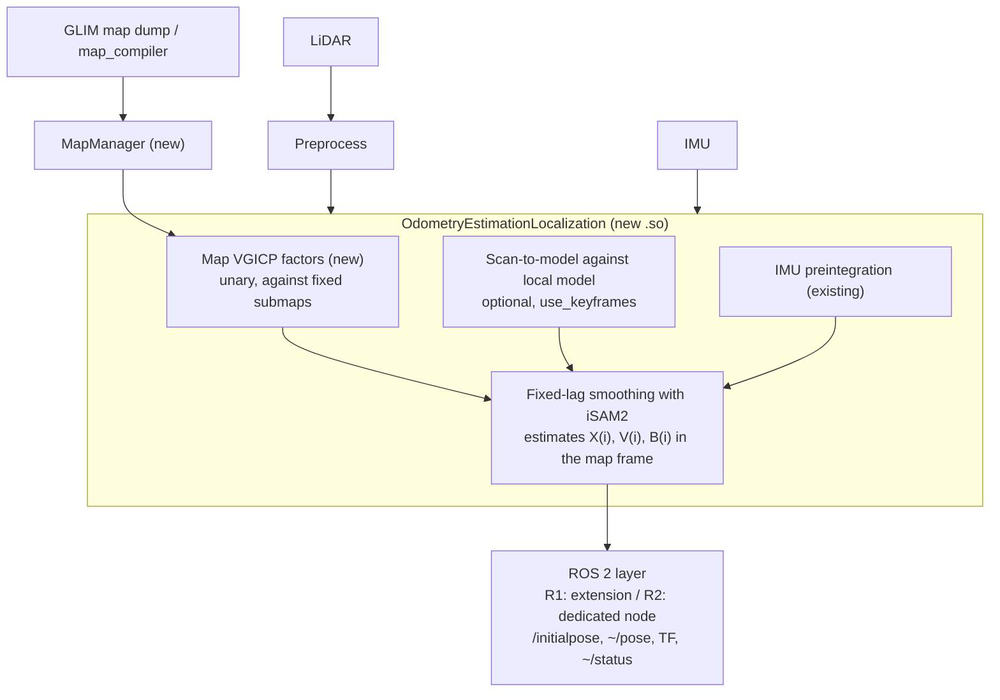
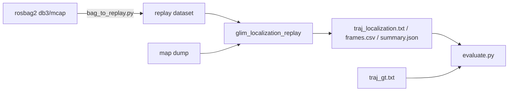

# Design: a localization-only package based on GLIM

Investigated: koide3/glim master (commit `1a197c9`, 2026-10-08, v1.2.2), koide3/glim_ros2 (Docker pins commit `4d4ec52`, 2026-08-14, 1.2.2), koide3/gtsam_points (v1.2.2)

## 1. Conclusion

- The GLIM odometry module is a plugin that can be replaced through the `so_name` setting. The GPU odometry already uses "unary VGICP factors against keyframes with fixed poses".
  Replacing these keyframes with **submaps of the prebuilt map (fixed poses)** gives tightly coupled IMU map-matching localization.
- Approach A (tightly coupled) is adopted: create a new odometry module that inherits `OdometryEstimationIMU`, and disable sub_mapping / global_mapping.
- GLIM itself is not modified. This is a separate repository that links to `glim` / `gtsam_points`.
- glim and gtsam_points are both MIT licensed. Copied parts keep their copyright notice.

## 2. GLIM parts to reuse

| Part | Location | Use |
| --- | --- | --- |
| Odometry replacement | glim_ros2 `src/glim_ros/glim_ros.cpp` L103–111 (`so_name` → `OdometryEstimationBase::load_module`) | Specify our own `.so` in the config |
| Disabling sub/global mapping | same, L113–135 | Empty `sub_mapping.so_name`, `enable_global_mapping:false` |
| Tightly coupled IMU fixed-lag smoothing | `OdometryEstimationIMU` (IMU integration, deskew, covariance estimation, iSAM2 fixed lag, initialization) | Inherit it and implement `create_factors()` |
| Unary matching factor | GPU: `create_unary_factor` in `odometry_estimation_gpu.cpp` (`IntegratedVGICPFactorGPU(fixed_pose, X(i), voxelmap, frame)`), CPU: `IntegratedVGICPFactor(gtsam::Pose3(), X(i), voxelmap, frame)` | Make the target a map submap |
| Initial pose | `odometry_estimation_imu.cpp` L66–69 (setting `init_T_world_imu` / `init_v_world_imu` skips the estimation) | Pass the initial pose in map coordinates |
| Map data | `GlobalMapping::save` → `graph.bin`, `values.bin`, `traj_*.txt`, `%06d/` (`SubMap::save`: `T_world_origin` etc. in `data.txt`, point clouds with `save_compact`) | Read with `SubMap::load()` and overwrite `T_world_origin` with `X(i)` in `values.bin` |
| Voxel map | `gtsam_points::GaussianVoxelMapCPU/GPU`, `iVox` | Multi-resolution voxels per submap |
| Global registration | `gtsam_points/registration/ransac.hpp`, `graduated_non_convexity.hpp` | Relocalization (planned, optional feature) |
| Extension | `ExtensionModuleROS2::create_subscriptions`, `OdometryEstimationCallbacks` | ROS input and output (R1) |

Note for the planned GPU module: the keyframe-related members of `OdometryEstimationGPU` (`keyframes` etc.) are **private**. They cannot be replaced by inheritance, so the implementation has to be copied and modified.

## 3. Architecture



### Factors added for each frame i

| Factor | Connects | Source |
| --- | --- | --- |
| ImuFactor | X(i-1), V(i-1), X(i), V(i), B(i-1) | Existing |
| Bias random walk | B(i-1), B(i) | Existing |
| Relative pose from the local model (only with `use_keyframes`) | X(i-1), X(i) | Derived from the upstream CPU version. `PriorFactor` removed |
| Map VGICP (unary) | X(i) ← fixed T_world_origin_j | **New** |
| Initial pose prior (weak) | X(0), V(0), B(0) | Existing (only the weight changes. The mapping-time `init_pose_damping_scale=1e10` is not used) |

With the CPU default (`use_keyframes: false`), the map factors are the only scan constraints, and outside the map the state is propagated by the IMU alone.

## 4. Modules (new, modified, reused)

| Module | Kind | Source / existing parts used | Role | Status |
| --- | --- | --- | --- | --- |
| Odometry module (`libodometry_localization_cpu.so`) | Modified | Copies `odometry_estimation_cpu.cpp/.hpp`. Inherits `OdometryEstimationIMU` | Adds map factors to `create_factors()`, an option to disable keyframes, a weaker initial prior, adds `reset()` | Implemented |
| GPU odometry module (`libodometry_localization_gpu.so`) | Modified | Copies `odometry_estimation_gpu.cpp/.hpp`. Inherits the shared base `OdometryEstimationLocalization` | Same map factors, status and resets as the CPU module, on GPU voxel maps (§5.7) | Implemented (`BUILD_WITH_CUDA=ON` only). Tile prefetch and a memory-based budget are planned ([#23](https://github.com/atinfinity/glim_localization/issues/23)) |
| MapManager | New | `SubMap::load`, `GaussianVoxelMapCPU` | Map loading, nearby submap selection, voxel generation | Implemented (whole map resident in host memory). The GPU module keeps a bounded LRU of GPU tiles (§5.7) |
| MapFactorBuilder | New | Unary constructor of `IntegratedVGICPFactor` | Map factor generation, overlap and inlier ratios, weight control | Implemented (CPU) |
| Relocalizer | New | Unary `IntegratedVGICPFactor`, `LevenbergMarquardtOptimizerExt` (later RANSAC / GNC of gtsam_points) | Multi-hypothesis yaw refinement for /initialpose, optional global relocalization | Yaw search around a given pose implemented (§5.3, opt-in). Global relocalization planned ([#3](https://github.com/atinfinity/glim_localization/issues/3)) |
| ROS 2 package | New | `ExtensionModuleROS2`, `OdometryEstimationCallbacks`, input handling of `GlimROS` (modified) | R1 (extension) and R2 (lifecycle node) | Implemented (no launch, YAML parameter or RViz files yet) |
| map_compiler | New | `SubMap::load`, `PointCloudCPU::save_compact` | Slimming and indexing GLIM dumps, building maps from PCD or PLY, 2D occupancy grid export | Implemented |
| Tests and evaluation | New | Offline replay tool, evo | Accuracy and processing time evaluation | Implemented. GLIM is pinned to a fixed commit; CI against newer GLIM versions is not set up |
| Config files | Modified | `config.json`, `config_odometry_cpu.json` | Adds map parameters, disables sub/global mapping | Implemented (CPU) |
| glim / gtsam_points / glim_ros2 | Reused | — | Used as is, as dependencies | — |

## 5. Detailed design

### 5.1 MapManager

- Input: a GLIM dump. `%06d/` is read with `SubMap::load()`, and `T_world_origin` is overwritten with `X(i)` from `values.bin`.
- `map_compiler` (offline): strips frame data, keeps the covariances from the dump (or recomputes them with `--recompute-covariances`, see below), and writes `map_index.json` (center coordinates, BBox). A mode that splits a PCD or PLY point cloud into a grid and writes the same format is also provided, and any input can also be exported as a 2D occupancy grid for Nav2.
- Voxels: multi-resolution `GaussianVoxelMap` per submap (e.g. 0.5 / 1.0 / 2.0 m).
- Selection: get the submaps within radius R (e.g. 60 m) of the predicted pose with a KD-tree, and take up to K (e.g. 5) nearest first. Submaps whose overlap ratio (`gtsam_points::overlap`) is below a threshold are excluded.
- Memory: the whole map is loaded and stays resident in host memory. The GPU module streams tiles to the GPU within a byte budget, with prefetch along the predicted path (§5.7); streaming tiles from disk into host memory is not implemented ([#23](https://github.com/atinfinity/glim_localization/issues/23)).
- API: `load(path)`, `query(T_world_imu, radius, k) -> std::vector<MapTile::ConstPtr>`, `MapTile = { id, T_world_origin, points, voxelmaps, bbox_min, bbox_max }`. After loading, the map is shared as an immutable snapshot and is thread-safe.

Points settled by the Phase 2 implementation:

- Exclusion by overlap ratio needs the current scan, so it is done in the Phase 3 map factor generation, not in `query`.
- The slim dump is `map_index.json` and `%06d/{data.txt,points_compact.bin,covs_compact.bin}`. The authoritative pose is in `map_index.json` (`data.txt` is rounded to 6 significant digits).
- Upstream `SubMap::save` writes a format that cannot be read back when frames is empty, so the slim dump also keeps one origin frame.
- Upstream `SubMap::load` dereferences null on a point cloud without covariances, so the covariance file is checked to exist before calling it.
- PCD input: `map_compiler <file.pcd> <output_dir> [--grid-size 20] [--voxel-size 0] [--k-neighbors 10]` reads x, y, z (`DATA ascii`, `binary` or `binary_compressed`; other fields ignored), optionally voxel-downsamples, estimates per-point covariances with `gtsam_points::estimate_covariances` over the whole cloud (k nearest neighbours, so tile edges see their neighbours), and splits the points into a 2D grid along world x and y. Each non-empty cell becomes a submap with identity rotation and its origin at the centroid of its points. The output is the same compiled map (`source: "pcd"` in `map_index.json`), loaded by `load_map` unchanged.
  - Bounds: `--grid-size` >= 1 m, `--voxel-size` 0 (off) or >= 0.01 m, `--k-neighbors` 5 to 1000, all finite. Repeated field names (other than PCL's `_` padding) are rejected, and binary reading requires a little-endian host (`static_assert`). A missing `.pcd` path is reported as "file not found".
  - `binary_compressed` ([#12](https://github.com/atinfinity/glim_localization/issues/12)): PCL's layout, two little-endian `uint32` (compressed and uncompressed size), then an LZF stream of field-major data (all values of one field, then the next) without the `_` padding fields. The LZF decoder (`lzf_decompress`, `map/pcd_map.hpp`) is written here, because PCL and liblzf are not in the image; it bounds-checks every literal run and back reference and requires the exact uncompressed size. The uncompressed size must equal POINTS times the packed point size (so at most 4 GiB, as in PCL), and both sizes are checked against the file and the largest LZF expansion (88 times) before allocating. sdf2map, the map tool of the simulation evaluation, writes `binary` or `ascii`, not `binary_compressed`; the format matters for PCL-based maps such as Autoware's.
  - Limits: `gtsam_points::estimate_covariances` takes the point count as an `int`, so a cloud with more than `INT_MAX` points after downsampling fails with an error (and so does `--recompute-covariances` on such a submap). The compiler holds the whole cloud in memory, roughly 300 bytes per point. Streaming the cloud and estimating covariances per tile with a neighbour margin are not implemented ([#12](https://github.com/atinfinity/glim_localization/issues/12)).
  - Downsampling runs around the cloud's bounding-box centre, because `gtsam_points::voxelgrid_sampling` packs voxel coordinates into 21 bits per axis and silently merges points beyond about ±2^20 voxels from the origin (±105 km at 0.1 m) into made-up ones. A cloud wider than about 2^21 voxels fails with an error that asks for a larger voxel size.
  - Tile size and coverage: tiles are disjoint, and MapManager uses at most `map_max_submaps` (default 5) tiles nearest to the robot by centroid (within `map_search_radius`). With the default 20 m grid that is only about 40 x 40 m around the robot, while GLIM submaps usually cover the whole sensor range. For an outdoor LiDAR with a range of 50 to 100 m, use `--grid-size 50` to `100`, or raise `map_max_submaps`. MapManager is unchanged; selecting tiles by bounding box instead of centroid is deferred ([#12](https://github.com/atinfinity/glim_localization/issues/12)), because it changes the tiles that every map factor sees and needs a replay comparison.
- PLY input: a `.ply` file (extension case-insensitive) takes the PCD path after reading: same options, same voxel downsampling, covariance estimation and tiling, `source: "ply"` in `map_index.json`. The same points as PCD give the same map (tested for ascii and binary). The reader (`read_ply`, `map/ply_reader.hpp`) is written here: PCL is not in the image, and gtsam_points has no PLY reader.
  - Formats: `ascii 1.0` and `binary_little_endian 1.0`. `binary_big_endian` is rejected with an error that says so.
  - The `vertex` element must have scalar `x`, `y`, `z` of type `float`/`float32` or `double`/`float64`. Other vertex properties (intensity, normals, colors, list properties) are skipped. Elements before `vertex` are skipped, including lists; elements after it (faces) are not read.
  - Rejected with an error: a missing first line `ply`, a missing `end_header` or format line, an unknown keyword, type or format, duplicate elements or properties, a missing or non-float x, y or z, an element with a count but no properties, a negative list length, and truncated data. The vertex count is checked against the file size before allocating, as for PCD. Ascii vertices are one per line. Non-finite points are dropped.
- 2D occupancy grid (for Nav2 `map_server`): `--occupancy-grid <prefix> --occupancy-z-min <m> --occupancy-z-max <m> [--occupancy-resolution 0.05]` writes `<prefix>.pgm` and `<prefix>.yaml` from any input (GLIM dump, compiled map, PCD, PLY). The core writes the files itself, so it needs no ROS.
  - Rule: heights are map-frame z. A cell is occupied if it holds a point with `z_min <= z < z_max`, otherwise free if it holds a point with `z < z_min` (the ground or floor seen below the band), otherwise unknown. Points at or above `z_max` (ceilings, tree tops) are ignored. The band is required, because no default height is right for every map (a GLIM map's z = 0 is the first sensor pose, not the ground). No filter is applied: a single point marks a cell occupied, so noise and dynamic objects in the map show up. Voxel downsampling (`--voxel-size`) does not remove isolated outliers, so clean the cloud first (for example with statistical outlier removal).
  - Flat-ground assumption: the band is an absolute map-frame z, the same everywhere. It suits roughly flat sites with a gravity-aligned z axis (GLIM maps are gravity-aligned). On slopes or multi-level sites, one band cuts the ground in some places and misses obstacles in others. PCD and PLY input must be z-up.
  - Grid: cell edges are multiples of the resolution in the map frame, and the grid covers the x, y extent of the points below `z_max`. `origin` is the map-frame position of the lower-left corner of cell (0, 0), with zero yaw. The grid is built from the map's points after downsampling, before anything is written, and is limited to 2^30 cells (for example 1.6 x 1.6 km at 0.05 m). The build uses one byte per cell (a single buffer that first holds the seen flags, then the cell values), and the PGM is one byte per cell.
  - Files: a binary (P5) 8-bit PGM whose top row is the highest y, and a YAML with `image` (the PGM file name, relative to the YAML, as a double-quoted YAML string with `\` and `"` escaped), `mode: trinary`, `resolution`, `origin`, `negate: 0`, `occupied_thresh: 0.65` and `free_thresh: 0.1`. Occupied cells are 0, free cells 254 and unknown cells 205. map_server reads a pixel p as occupancy (255 - p) / 255, so these are 1.0, 0.004 and 0.196, each well clear of the thresholds (the often-used `free_thresh: 0.25` would turn 205 into free). Numbers are written in fixed notation, so every value is a YAML float. Existing grid files, a prefix without a file name (`out/`, `.`, `..`) or with control characters, and a non-empty output directory are refused before anything is read or written. If writing the grid fails after the compiled map was written, the error says that the map is complete.
  - The Python test `scripts/tests/test_map_compiler_occupancy.py` loads the output with the rules of nav2_map_server's map_io (required keys and types, trinary thresholds, the y flip). Loading it in a running map_server is not tested.
- Covariance recomputation for a GLIM dump or a compiled map ([#31](https://github.com/atinfinity/glim_localization/issues/31)): `map_compiler <dump> <output_dir> --recompute-covariances [--k-neighbors 10]` replaces the per-point covariances after loading, with `recompute_covariances` (`map/pcd_map.hpp`). Off by default, so the output without the flag is unchanged.
  - Same estimator as the PCD path: `gtsam_points::estimate_covariances` with k nearest neighbours, k shared with `--k-neighbors` (5 to 1000, default 10, which matches GLIM's per-scan `k_correspondences` default). GLIM estimates covariances per scan in preprocessing and sub-mapping merges the transformed per-scan covariances; it does not run kNN on the submap cloud. Recomputation therefore replaces them with an estimate from the submap's merged points.
  - Neighbourhood: each submap on its own, in its origin frame. GLIM submaps overlap and each covers the sensor range, so a search over the union would mix slightly offset copies of the same surface (the residual misalignment between submaps). A rigid transform keeps the neighbours, so the result equals the world-frame estimate rotated into the origin frame (`R^T * C_world * R`); a test checks this against `build_pcd_submaps` on the same points with a rotated origin. For a map compiled from PCD or PLY (disjoint tiles), points near a tile edge then lose the neighbours across it; recompiling from the cloud is the way to change k there.
  - The clouds are copied (`PointCloudCPU::clone`); normals, intensities and times are kept unchanged (normals are not re-estimated; nothing in this package reads them). A submap with fewer than k points fails the whole run before anything is written, and `submaps` is left unchanged. `source` in `map_index.json` is the input's: `glim_dump` for a dump, and the recorded one for a compiled map.
  - Option checks: `--recompute-covariances` with `.pcd` or `.ply` input is rejected (that path always estimates covariances), `--k-neighbors` with map directory input needs `--recompute-covariances`, and `--grid-size` and `--voxel-size` stay PCD and PLY only. Re-downsampling a dump is not offered.
- `source` in `map_index.json` records where the points came from (`glim_dump`, `pcd` or `ply`). `load_map` reports it (`unknown` if it is missing or not a string), and `map_compiler` passes it on as reported (also `unknown` or another recorded string) when it compiles a compiled map again, so a PCD map compiled again still says `pcd`. It is informational only and never changes how a map is loaded.

### 5.2 Map factors (create_factors)

- The CPU version has no keyframes. Setting `use_keyframes` (default false) to true solves scan-to-model against the upstream local model and adds only `BetweenFactor(X(i-1), X(i))` (support outside the map). The local model's coordinates drift away from the map, so the upstream `PriorFactor` is not added. The key name is kept to match the GPU version.
- For every resolution of each active submap j, add `IntegratedVGICPFactor(T_world_origin_j, X(i), voxelmap_j, frame)`. Submap poses are constants, and no new variables are created.
- Submaps are selected with the IMU-predicted pose, and those whose overlap ratio at the coarsest voxel is below `map_min_overlap` are excluded.
- The weight is `map_factor_weight` (default 1.0). While DEGRADED and LOST it is multiplied by `degraded_weight_scale` (default 0.1).
- Wheel odometry (optional, `wheel_odom_enabled`, default false; [#14](https://github.com/atinfinity/glim_localization/issues/14)): `insert_wheel_odom(stamp, linear, angular)` buffers the twist of the wheel base. For each frame, `create_wheel_factors` (shared by both backends, called from `create_factors`) integrates the twist over `[t(i-1), t(i)]`, moves it to the IMU frame with `wheel_odom_T_imu_base`, and adds `BetweenFactor<Pose3>(X(i-1), X(i))` with sigmas growing with the distance and angle travelled and an optional Huber kernel on the whole 6-DoF whitened error. It is skipped when the samples do not cover the interval (`wheel_odom_max_gap`) or when the wheel motion disagrees with the IMU prediction (slip): the norm of the difference of the two translation vectors over dt above `max(wheel_odom_gate_velocity, wheel_odom_gate_velocity_ratio * speed)`, or the relative rotation over dt above `wheel_odom_gate_angular_velocity`. Without a map constraint a wrong prediction could gate every factor for good, so after `wheel_odom_gate_readmit_frames` consecutive gated frames one factor is added without the gate. A reset clears the wheel buffer, and the buffer restarts by itself after a few samples stamped before the last one (a clock that went back). Disabled, nothing is added and the factors are the same as before.
- Outliers are suppressed only by VGICP ignoring points without correspondences. `set_enable_surface_validation` does not exist in VGICP and is not used.
- Voxels aggregate the mean and covariance of the points, so both faces of an object thinner than a voxel collapse into one plane in the middle, which biases the result along the wall normal (up to 0.29 m with a 0.4 m wall in the synthetic scene). The effect on real data is checked in [#5](https://github.com/atinfinity/glim_localization/issues/5).

### 5.3 Initialization and relocalization

1. The setting `init_T_world_imu` (map coordinates).
2. `/initialpose`: the given pose is the initial guess for scan-to-map registration. With `init_yaw_search` (opt-in), several yaw hypotheses around it are refined by scan-to-map registration on the first scan and the best one is adopted (below). Planned: roll and pitch from the acceleration at rest and the height from the map, instead of taking them from the given pose.
3. Global relocalization (planned, optional): FPFH + RANSAC/GNC between a cloud of several accumulated frames and each submap. Candidate generation can be replaced through an interface (ScanContext etc.).

Phase 3 implements 1 and `reset` with an externally given pose; [#3](https://github.com/atinfinity/glim_localization/issues/3) adds the yaw search of 2. Item 3 is left to [#3](https://github.com/atinfinity/glim_localization/issues/3). When neither `init_T_world_imu` nor `init_v_world_imu` is set, `insert_frame` returns nullptr until a pose comes through `reset`. Setting `init_v_world_imu` without `init_T_world_imu` is rejected at construction, because upstream would then start at the identity pose in the map. The configured state must pass the same checks as `reset`.

Yaw search (`glim_localization/relocalization/`, ROS-independent):

- Which poses: a pose from outside, that is the configured `init_T_world_imu` and resets with reason EXTERNAL that are not `from_current` (`/initialpose`, `~/initialize`, `LocalizationCallbacks::request_reset`, the replay `--init-pose`). `relocalize()` and the IMU gap self-reset start from the estimate and are not searched. A pending search runs on the first frame with at least `init_yaw_search_min_points` (100) points after the pose is applied, before the upstream `insert_frame`; smaller frames are dropped meanwhile (upstream only warns on an empty frame and would start the estimation from it).
- Candidates: `PoseCandidateGenerator::generate(CandidateQuery{hint, frame, map})` returns a list of `PoseCandidate{T_world_imu, yaw_offset}`. `YawCandidateGenerator` turns the hint about world z by 0, +s, -s, +2s, ... up to `init_yaw_search_range_deg` (at 180 deg, +180 is kept and -180 dropped as the same yaw), at the same position. A global relocalizer will implement the same interface with no hint (`set_candidate_generator`); the scoring and selection below stay as they are.
- Scan: the first frame as upstream builds it for the first estimate: points in the IMU frame, covariances from the preprocessed neighbours, no deskewing.
- Scoring (`score_candidate`): the unary VGICP map factors of §5.2 on all voxel levels of the tiles that overlap at the candidate pose (`create_map_factors`), solved alone for the pose with Levenberg-Marquardt (`init_yaw_search_max_iterations`, 10). The tiles are then selected again at the registered pose, and the score is the inlier ratio of §5.4 there (finest voxels), so it means the same as the inlier ratio on `~/status`. A candidate with no overlapping tile, or a non-finite solution, scores 0. Neighbouring candidates often converge to the same pose, so the reported yaw correction is that of the registered pose, not the candidate's offset. The factors are the CPU ones (`IntegratedVGICPFactor`) also in the GPU module: the search runs once per given pose, and CPU factors avoid uploading tiles for poses that are then dropped.
- Selection (`search_candidates`): candidates are scored in order (nearest yaw first). The time budget covers the whole search and is checked inside each registration (`termination_criteria` of the optimizer), so a slow registration cannot overrun it by much; the first candidate, the hint itself, is always scored to the end. The outcome is one of:
  - TRUNCATED: the budget ran out before every candidate was scored. Rejected, since an unscored candidate could be better or as good as the best one.
  - OUT_OF_RANGE: with `init_yaw_search_max_translation` above 0, only registered poses within that distance (xy, z not bounded) of the given pose can be the best or the runner-up. A registered pose beyond it that reaches `init_yaw_search_min_inlier_ratio` and scores at least as high as the best one within it rejects the search: the given pose is further off than stated. One beyond it below either is ignored, so a far pose that scores low (8 m off on the corridor) stays LOW_SCORE. Checked after TRUNCATED and before LOW_SCORE (`decide_candidates`).
  - LOW_SCORE: the best score is below `init_yaw_search_min_inlier_ratio` (0.7), or NaN.
  - AMBIGUOUS: the runner-up, the best candidate whose registered yaw is more than `distinct_yaw_for_step(step)` (two search steps, at most 90 deg) from the best one's, is within `init_yaw_search_min_score_gap` (0.05) of it. Rejected because the scene looks alike from two yaws. The cap at 90 deg keeps a runner-up possible for a step of 90 deg or more, where two steps would leave no candidate far enough away. The check needs candidates that far apart: with range 0 or a range below that separation, only the minimum inlier ratio applies.
  - NO_CANDIDATE: the generator returned nothing to score.
  - ACCEPTED otherwise; ties go to the earlier (nearer) candidate.
- Translation bound (`init_yaw_search_max_translation`, 0 = off by default): the position uncertainty of the given pose. The candidates share the given position, so a given position several metres off can register into a self-consistent wrong pose that the other checks accept (4 m on the synthetic corridor: the wrong pose moved 2.98 m from the given one). With a bound, a pose further off than the bound is rejected by design, even where the search would have found the truth; and a bound at or beyond the distance such a wrong pose moves (3.0 m on the corridor) lets it back in. On the corridor, 2.5 m keeps every accepted pose of the sweep (they move at most 2.0 m) and turns the 4 m wrong convergences into OUT_OF_RANGE ([measurement](progress/2026-11-27-init-search-max-translation.md)). A translation grid around the given position was measured as an alternative and gave no more, at one registration set per grid point.
- Thresholds: on the synthetic corridor map the right yaw scores 0.997 and the runner-up (the 180 deg flip) 0.87 to 0.89; a wrong yaw registered alone scores 0.55 to 0.61, so 0.7 separates them. In a symmetric synthetic room the two half-turn poses score 0.932 and 0.930 and the gap check rejects them. The inlier ratio was kept as the score: a Mahalanobis-gated count and a nearest-neighbour count at 0.2 m did not separate the right yaw better on these maps.
- Budget: 10 s by default. One candidate costs about 30 ms on arm64 and 70 to 80 ms on x86 (synthetic scans, 2 threads; the same with the CPU module and with the GPU module on an RTX 2080 Ti, CUDA 13.1 image, see PROGRESS), so 24 candidates take 0.8 to 1.9 s. Real scans are larger and their timing is not measured; the margin is for them and for a loaded machine (parallel ctest slowed the search 2.5 times). The search is once per given pose, and a truncated search is rejected rather than accepted from a partial result. The step is at least 0.5 deg, which caps the candidates at 720.
- Accepted: the estimation starts from the registered 6-DoF pose of the winner (`MapInitialStateEstimation::set_state`), with the given velocity turned by the same yaw. The first pose is published later by the search time.
- Rejected: the state goes to LOST (`publish_lost`), and every frame is dropped (IMU trimmed as while waiting for a first pose) until the next reset. Within the checks above a bad pose is not accepted silently; a pose that registers well at a wrong yaw with no candidate far enough away for the gap check (range 0 or a small range) passes on the inlier ratio alone. The candidates share the given position, so when the given position is far off (4 m on the synthetic corridor) the true pose may not be among them, and a self-consistent wrong pose can be accepted with nothing to compare it against (§5.4) unless `init_yaw_search_max_translation` bounds how far it may move.
- Status: `init_search` (NONE, ACCEPTED, REJECTED), `init_search_reason` (NONE, TRUNCATED, LOW_SCORE, AMBIGUOUS, NO_CANDIDATE, OUT_OF_RANGE; NONE unless rejected), `init_search_candidates` (scored), `init_search_candidates_total` (generated), `init_search_score`, `init_search_yaw_offset` (rad; for OUT_OF_RANGE, of the match beyond the bound), `init_search_runner_up_score`, `init_search_runner_up_yaw_offset` (for OUT_OF_RANGE, of the best within the bound) and `init_search_time` in `LocalizationStatus`, cleared by every reset; the same fields in the ROS message, the diagnostics (whose message gives the reason for a rejection with the numbers for that reason) and the replay `summary.json` (with `reason` and `truncated`).

Pose reset at runtime: `reset(T_world_imu, v_world_imu, min_stamp)` (thread-safe). Only the latest request is kept, and it is applied at the start of the next `insert_frame`. It rebuilds the frames, the smoother and the local model, returns the state to INITIALIZING and increments `reset_count`. Frames older than `min_stamp` are dropped. Frame ids go back to 0, so downstream uses `reset_count` to tell runs apart. An invalid request (non-finite, not a rigid transform, or a speed above `kMaxResetSpeed` = 100 m/s, since a finite but huge velocity makes the smoother throw and abort) is rejected and the current estimate continues. The IMU bias carries over the newest estimate of the previous run. If that run estimated no frame (two resets in a row), the bias that run started from is used instead of the configured one. Frames in the smoother are discarded without being passed to the marginalization callback. A reset can also be requested from outside through `LocalizationCallbacks::request_reset` (safe from any thread), and the state is received through `on_status`.

### 5.4 Quality monitoring

- Every frame, compute the inlier ratio and the residual of the map factors.
- States: `INITIALIZING → TRACKING → (inlier ratio low for N consecutive frames) → DEGRADED (lower the map factor weight, rely mainly on odometry) → LOST (no pose until an external initialization)`.
- The inlier ratio is the fraction of points that fall in the finest voxels of the tiles in use. The residual is the error per inlier point at the finest resolution (reported only, not used for state transitions).
- Detection of degenerate directions from Hessian eigenvalues and covariance output are not implemented (outside the scope of Phase 3).
- TRACKING does not certify the initial pose. A wrong convergence to a self-consistent pose (for example the synthetic corridor turned by 180 deg, inlier ratio 0.959 against 0.996 at the truth) tracks like the right one. On the robustness sweep, no threshold on the inlier ratio, the residual or the size of the map correction over the first seconds separates wrong runs from passing ones without also failing passing ones, for example map changes ([measurement](progress/2026-11-26-wrong-convergence-signals.md), [#50](https://github.com/atinfinity/glim_localization/issues/50)). A challenger search around the converged estimate does not separate them either. In that corridor the 180 deg alias outscores a correct pose on some scans, and on most scans of a map with objects removed, so a threshold that catches the alias also fails correct runs ([spike](progress/2026-11-27-challenger-spike.md)). The remaining fix is at initialization, in the candidate search ([#3](https://github.com/atinfinity/glim_localization/issues/3)), not in the monitor's thresholds.

### 5.5 Configuration (example)

```json
{
  "odometry_estimation": {
    "so_name": "libodometry_localization_cpu.so",
    "map_path": "/path/to/dump",
    "map_voxel_resolutions": [0.5, 1.0, 2.0],
    "map_search_radius": 60.0,
    "map_max_submaps": 5,
    "map_min_overlap": 0.1,
    "map_factor_weight": 1.0,
    "degraded_weight_scale": 0.1,
    "use_keyframes": false,
    "init_T_world_imu": [0, 0, 0, 0, 0, 0, 1],
    "init_yaw_search": false,
    "init_yaw_search_range_deg": 180.0,
    "init_yaw_search_step_deg": 15.0,
    "init_yaw_search_min_inlier_ratio": 0.7,
    "init_yaw_search_min_score_gap": 0.05,
    "init_yaw_search_time_budget": 10.0,
    "init_yaw_search_max_iterations": 10,
    "init_yaw_search_min_points": 100,
    "init_yaw_search_max_translation": 0.0,
    "wheel_odom_enabled": false,
    "wheel_odom_T_imu_base": [0, 0, 0, 0, 0, 0, 1],
    "degraded_inlier_ratio": 0.3,
    "lost_frames": 50,
    "smoother_lag": 5.0
  }
}
```

`so_name` in `config_sub_mapping` is empty, and `config_ros` has `enable_global_mapping: false`.

### 5.6 GPU (CUDA) build

The GPU module ([#2](https://github.com/atinfinity/glim_localization/issues/2), §5.7) needs gtsam_points built with CUDA, which the CPU image cannot provide (the PPA's `libgtsam-points-dev` has no CUDA, the Mac is arm64, and GitHub-hosted runners have no NVIDIA GPU). So it has a second image and a build mode.

- Image: `docker/Dockerfile.cuda`, a copy of `docker/Dockerfile` with the changes marked `CUDA:`. Same base (`ros:jazzy-ros-base`), plus NVIDIA's CUDA 13.1 apt toolkit (`cuda-nvcc`, `cuda-cudart-dev`, `cuda-cccl`, pinned; repository key fingerprint pinned like the PPA key), `libgtsam-points-cuda13.1-dev=1.2.2` from the koide3 PPA instead of `libgtsam-points-dev` (the two install the same files and must not be installed together), and GLIM and glim_ros2 with `BUILD_WITH_CUDA=ON`. GLIM's GPU odometry at `1a197c9` calls `IndexedSlidingWindow::has_index`, which gtsam_points added after 1.2.2, so the CUDA image also applies `third_party/patches/glim_cuda/` (the same range test through `size()` and `inner_size()`); the CPU image does not build that file. amd64 only. A Python test keeps the shared pins and lines of the two Dockerfiles in sync, and GitHub Actions lints the CUDA Dockerfile (`docker build --check`) without building it.
- Why CUDA 13.1 and the PPA package: gtsam_points 1.2.2 and GLIM `1a197c9` are both tested upstream with CUDA 13.1, and the PPA's CUDA 13.1 build has native SASS for sm_75 to sm_120. A source build of gtsam_points (about 10 to 20 minutes more) is the fallback if the PPA binary proves problematic.
- GPU architectures: `CMAKE_CUDA_ARCHITECTURES` comes from the build argument `CUDA_ARCHITECTURES` (default `75`) through `CUDAARCHS`, and is never `native`: `docker build` sees no GPU. GLIM has no `.cu` files and our package has none yet, so today it only matters for future CUDA sources; the PPA binaries are prebuilt.
- Build mode: the image sets `GLIM_LOC_BUILD_WITH_CUDA=ON`, and `build_core.sh` / `build_colcon.sh` pass it as `BUILD_WITH_CUDA`. Our CMake then requires `GTSAM_POINTS_USE_CUDA` and builds the GPU module, `test_gpu_smoke` and `test_localization_odometry_gpu` (link `CUDA::cudart`); the CPU module, tools and tests build and run unchanged, with `BUILD_WITH_CUDA=OFF` in the CPU image.
- GPU tests: a GPU test calls `GTEST_SKIP` when `cudaGetDeviceCount` finds no device, and ctest reports it as skipped. `GLIM_LOC_REQUIRE_GPU=1` turns the skip into a failure; `ci.sh` sets it when `nvidia-smi` lists a GPU, so a broken device setup on a GPU machine cannot pass as a skip.
- Stale image check: `docker compose run` never rebuilds an existing tag, and the CUDA image is outside `ci_local.sh`'s image check. Like the CPU image, it copies the repository files it bakes in to `/etc/glim_localization/inputs/`. In CUDA mode `ci.sh` runs `check_cuda_image_inputs.sh`, which fails when they differ from the mounted tree.
- Runtime: compose service `dev-cuda` (`scripts/docker_run.sh --cuda`) with all GPUs through a device reservation (`deploy.resources.reservations.devices`; the newer `gpus:` key would make Compose before v2.30 reject the whole file, the CPU service included). The image does not set `NVIDIA_VISIBLE_DEVICES`, so GPUs come only from a device request, also with the `nvidia` default runtime. It also has a separate image tag (`glim_localization:dev-cuda`) and a separate build volume. Verification runs on a maintainer's GPU machine (docs/PROGRESS.md); CI stays CPU-only.

### 5.7 GPU odometry module

- Structure: `OdometryEstimationLocalization` (shared base, built in both images) holds everything that does not depend on the backend: map initial state, map factor bookkeeping, the quality monitor and status, resets, the fail-closed paths and the IMU gap policy. `OdometryEstimationLocalizationCPU` (`libodometry_localization_cpu.so`) and `OdometryEstimationLocalizationGPU` (`libodometry_localization_gpu.so`, `BUILD_WITH_CUDA=ON` only) add the frame representation, the map factors, the keyframe factors and the map quality numbers. The GPU class is a copy of upstream `OdometryEstimationGPU` (keyframe members are private there, §2).
- Map factors: tiles are selected on the CPU exactly as in §5.2 (`select_map_tiles`, overlap on the coarsest CPU voxel map), so both backends use the same tiles. For each selected tile and level, the GPU module adds `IntegratedVGICPFactorGPU(T_world_origin, X(i), voxelmap_gpu, frame_gpu)`; a weight other than 1 wraps it in `WeightedVGICPFactorGPU`, which scales the linearized system like the CPU `WeightedFactor` but is itself a GPU factor, so the smoother still batches it on the GPU (a `WeightedFactor` wrapper would not be).
- GPU tiles ([#23](https://github.com/atinfinity/glim_localization/issues/23)): `GpuTileCache` uploads a tile's points and one `GaussianVoxelMapGPU` per level and keeps them within two limits, `map_gpu_max_tiles` (default 32) and `map_gpu_memory_budget_mb` (default 1024 MiB), evicting the least recently used. The policy is GPU-independent and unit tested in the CPU build: `TileResidency` (byte and count accounting, eviction plans), `select_prefetch_tiles` and `TileStreamer` (uploads injected as a function, a background worker thread).
  - Size: `estimate_tile_device_bytes` predicts a tile's GPU size before the upload, from its points (12 bytes, plus 36 for covariances and so on) and, per level, from the CPU voxel count (52 bytes per voxel and 16 per hash bucket, with gtsam_points' bucket growth). The budget is checked against the estimate, so it is known before anything is allocated; a GPU test keeps the estimate within 0.5x to 2x of `memory_usage_gpu()`.
  - Acquire: each frame acquires all its tiles at once, so they are pinned together: eviction never removes a tile the frame uses, and if one frame's tiles alone exceed the budget they are still uploaded (counted in `over_budget`) and trimmed after the frame. A resident tile is a hit; a missing one is uploaded on the odometry thread's stream (a miss). A tile whose prefetch is still queued is uploaded in the foreground instead; one whose prefetch is running is waited for.
  - Prefetch (`map_gpu_prefetch`, default on): after the map factors, `select_prefetch_tiles` samples the path from the current pose to `p + v * map_gpu_prefetch_lookahead` at half the search radius, takes the tiles `MapManager::query` returns at each sample, and sorts them by distance to the path, then to the current position (up to `map_gpu_prefetch_max_tiles`). Missing ones are queued for a worker thread with its own non-blocking CUDA stream. gtsam_points' voxel map insertion synchronizes on the stream it is given, so the thread, not just the stream, keeps the odometry thread from waiting. Prefetching does not evict the current frame's tiles or other queued tiles and stops at the first tile that does not fit. The worker selects the device that was current when the cache was constructed (`cudaSetDevice`), since a new thread starts on device 0.
  - Failures: a prefetch is speculative, so a failed background upload (for example out of memory for a tile that was only predicted) is dropped, counted (`prefetch_failures`) and logged as a warning, wherever `poll`, `prefetch` or `acquire` finds it. (Before PR [#47](https://github.com/atinfinity/glim_localization/pull/47)'s review it was rethrown from `acquire` and `prefetch`, so it could abort the node.) If the frame needs that tile, `acquire` uploads it in the foreground, and only a failure there throws, so the module still fails closed for tiles it actually uses. Queued prefetches hold their room in the budget and are never evicted; when they leave no room for a frame's tile, `acquire` cancels the queued ones the frame does not need (`prefetch_cancels`) before it gives up on eviction.
  - Errors: `cudaGetLastError` is per thread and sticky until read. Before each upload and before the module creates its streams, an error left over from earlier work is read and logged as such (`clear_earlier_cuda_error`), so it is not blamed on the upload; after the upload the stream synchronization result and `cudaGetLastError` both fail it.
  - An evicted tile stays alive while factors in the smoother window still reference it, so the GPU memory in use can exceed the budget by the tiles of the window. The counters (uploads, prefetched, misses, prefetch waits, prefetch failures, prefetch cancels, evictions, over budget, peak bytes) are logged when the module shuts down.
- Linearization: GLIM's GPU odometry registers a `LinearizationHook` that batches GPU factors. The hook list is copied when the smoother is created in the `OdometryEstimationIMU` constructor, so the module registers it before the base constructor runs.
- Quality: the inlier ratio uses the CPU voxel maps as in §5.4. The residual is evaluated with GPU factors on the finest GPU voxel map, batched with `NonlinearFactorSetGPU`.
- Keyframes: `use_keyframes` (default false) adds upstream's scan-to-keyframe GPU factors and keyframe strategies (`keyframe_update_strategy` OVERLAP, DISPLACEMENT or ENTROPY) with their upstream keys; the keyframes are reset with the pose.
- Configuration: `config_odometry_localization_gpu.json` has the common keys of the CPU file with the same values and meaning, `so_name: libodometry_localization_gpu.so`, the `map_gpu_*` tile keys ([build.md](build.md)), and the upstream GPU keyframe keys. `config/gpu/config.json` (core and replay) and `config/r1_gpu`, `config/r2_gpu` (ROS) select it and share every other file with the CPU configs.
- Backend selection: the replay tool and the R2 node read `so_name` from `config_odometry` (`localization_backend_from_config`) and create the matching class; another module name is an error, and the GPU module in a CPU build is an error (exit 2 in replay, failed configure in R2). R1 loads the module through GLIM's plugin loader as before. The match is exact (a file name, not a path; a missing `so_name` is an error): replay and R2 ignored `so_name` before, so this is a behavior change.
- Fail closed on CUDA errors: gtsam_points 1.2.2 only prints a warning when a CUDA call fails and goes on. The GPU module therefore checks `cudaGetDeviceCount` before the base constructor and `cudaGetLastError` after creating its streams, and `GpuTileCache` synchronizes and checks `cudaGetLastError` after each upload. A failure throws `std::runtime_error`: no device stops construction (replay exit 1, R2 activation fails), and a failed upload (for example out of device memory) throws instead of building factors on invalid device memory. The replay tool turns that into exit 1. In R1 and R2 the odometry runs on GLIM's background thread, so the exception escapes that thread and aborts the whole node process.
- Deviations from upstream `OdometryEstimationGPU`:
  - An unknown `keyframe_update_strategy` throws `std::invalid_argument` (upstream logs an error and leaves the strategy unset).
  - With `ENTROPY`, `update_keyframes_entropy` receives all new factors of the frame, which here include the map factors; upstream's new factors are only the IMU and keyframe factors. The entropy is therefore measured on a graph that also holds the map constraints, so keyframe selection can differ from upstream for the same scans. It only applies with `use_keyframes: true` and `ENTROPY` (both off by default).

## 6. ROS 2 support

Two stages: development and evaluation put an extension on the existing `glim_rosnode` / `glim_rosbag` (R1). Real robots and integration with navigation stacks such as Nav2 use a dedicated lifecycle node (R2). Both use the same ROS-independent core and a shared publisher class.

| Aspect | R1: glim_rosnode + extension | R2: `glim_localization_node` |
| --- | --- | --- |
| Implementation | One extension module | A node whose input handling is based on `GlimROS` (point cloud and IMU conversion, TimeKeeper, QoS) |
| Configuration | GLIM JSON only | A few ROS parameters (`config_path`, `map_path`, `max_init_pose_delay`) + GLIM JSON |
| Lifecycle | None | configure loads the map, activate starts processing |
| Pose reset | Through a shared singleton in the core | The node holds the module directly |
| Offline evaluation | Faster than real time with `glim_rosbag` | `ros2 bag play` + `use_sim_time` |

### Core and ROS 2 boundary

The core (`glim_localization/`) depends only on GLIM, gtsam_points, nlohmann_json and the libraries they use. ament is used only to export the package when it is found. The core has no rclcpp, message, parameter or TF code. All estimation, state and map logic lives in the core, so the offline tools and the core tests run without ROS. The ROS 2 packages have no estimation logic of their own: they convert messages, parameters and services and call the core API.

| Function | Core (ROS-independent) | ROS 2 (`glim_localization_ros2`, `glim_localization_msgs`) |
| --- | --- | --- |
| Estimation | CPU and GPU odometry modules, map VGICP factors, fixed-lag smoothing, IMU preintegration (GLIM) | — |
| Map | MapManager, tiles and nearby-tile selection, GPU tile cache, loading GLIM dumps and compiled maps | `~/map`: one voxel-downsampled cloud of the loaded map (MapPublisher) |
| Sensor input | Preprocessed frames and IMU samples through GLIM's odometry interface | PointCloud2 and Imu conversion, TimeKeeper, QoS: glim_rosnode / glim_rosbag in R1, the GlimROS-based input of the node in R2 |
| Initial pose and resets | `request_reset()` applies a stamped pose at the first frame at or after its stamp; IMU-gap self-reset; LOST | `/initialpose`, `~/initialize`, `~/relocalize`, the late-pose check (`max_init_pose_delay`) |
| Initial pose yaw search (§5.3) | Candidate generation and scan-to-map scoring, the acceptance rules (truncated, out of range, low score, ambiguous), and the result and reason in `LocalizationStatus`; configured by the `init_yaw_search` keys of the odometry JSON config | No ROS parameters (JSON only); the `init_search*` fields of `LocalizationStatus.msg` (including `init_search_reason`) and the diagnostics text that gives the reason for a rejection |
| State and quality | `LocalizationStatus` struct, states INITIALIZING / TRACKING / DEGRADED / LOST, quality monitor, `on_status` callback | `~/status` (`LocalizationStatus.msg`) and `/diagnostics` |
| Pose output | Frame estimates through GLIM's odometry callbacks | `~/pose`, `~/odometry` (angular twist from the gyro), `~/aligned_points` (the scan in the map frame), TF with `tf_mode`, `base_frame_id` and `T_base_imu` (LocalizationPublisher) |
| Process and configuration | GLIM JSON configs (the odometry and map parameters) | R1 extension module, R2 lifecycle node and component, ROS parameters, launch files, RViz config |
| Tools | `map_compiler` (GLIM dump, compiled map, PCD or PLY in; compiled map out; optional 2D occupancy grid as a map_server YAML + PGM file), `glim_localization_replay`, `glim_localization_mapper` | — (Nav2's map_server serves the 2D grid; this package does not publish it) |

- **Status values:** the state, reset-reason, init-search result and init-search reason values of the core status are part of the message. `LocalizationStatus.msg` repeats them as constants. `scripts/test_interfaces.sh` pins the message definition, and `test_message_constants` (in `glim_localization_ros2`) checks that the core enums match it.
- **Python tooling:** the tools in `scripts/` need no ROS installation. `bag_to_replay.py` and `replay_to_bag.py` read and write rosbag2 files with the pure-Python `rosbags` package, and `evaluate.py` uses evo.
- **New code:** estimation, state and map logic goes in the core with a test that runs without ROS. The ROS 2 packages keep only conversion and ROS-facing checks. Their ROS-free helpers (`GyroBuffer`, the late-pose rule in `init_pose_delay.hpp`) are header-only and tested without ROS.

### Package layout (colcon)

```
glim_localization/                  # repository
  glim_localization/                # ROS-independent core (odometry .so, MapManager, map_compiler: GLIM dump, PCD or PLY input, 2D grid export)
  glim_localization_msgs/           # LocalizationStatus.msg, Initialize.srv
  glim_localization_ros2/
    src/localization_publisher.cpp  # publisher and TF class shared by R1 and R2
    src/localization_extension.cpp  # R1: ExtensionModuleROS2
    src/localization_node.cpp       # R2: rclcpp_lifecycle::LifecycleNode (registered as a component)
    src/map_publisher.cpp           # ~/map, shared by R1 and R2
    config/r1/, config/r2/          # GLIM JSON configs for R1 and R2
    config/localization.param.yaml  # R2 ROS parameters (every one, with comments)
    config/localization_r1.param.yaml  # ROS parameters of GLIM's node in R1
    launch/localization.launch.py   # R2: standalone or as a component, autostart
    launch/localization_r1.launch.py   # R1: glim_rosnode, or glim_rosbag with bag:=
    launch/launch_utils.py          # R1 helpers: typed -p values, JSON with comments, the map_path override
    rviz/localization.rviz          # map frame, ~/map, ~/aligned_points, ~/pose, ~/odometry, TF
```

### Inputs and outputs

| Name | Type | Content |
| --- | --- | --- |
| points / imu (subscribed) | sensor_msgs/PointCloud2, Imu | Topic names and QoS are exposed as parameters, with the same keys as GLIM's `config_ros` |
| wheel odometry (subscribed, R1 and R2) | nav_msgs/Odometry | Optional input of `wheel_odom_enabled` (§5.2) on `localization_ros.wheel_odom_topic` (empty, the default: none; set while `wheel_odom_enabled` is false: a warning, no subscription). Only `twist.twist` is used, in `child_frame_id`, which must be the base of `wheel_odom_T_imu_base`; the pose, `header.frame_id` and the covariances are ignored and no TF is looked up. The stamp is the header stamp plus `wheel_odom_time_offset`. A message with another `child_frame_id` than `wheel_odom_child_frame_id` (empty accepts any), a zero stamp or a non-finite value is rejected with a throttled warning; the counts of received, rejected and dropped (by the odometry: out of order) messages are logged when the node stops. R2: QoS `wheel_odom_qos` (sensor_data, depth 200). R1: the extension subscribes through GLIM (`TopicSubscription`, reliable, depth 100, no QoS key; `glim_rosbag` hands bag messages over directly), checks `wheel_odom_enabled` of the loaded odometry when glim_ros2 asks for its subscriptions, and feeds the samples through `LocalizationCallbacks::insert_wheel_odom`; the counts are logged when the extension is destroyed |
| /initialpose (subscribed) | geometry_msgs/PoseWithCovarianceStamped | RViz 2D Pose Estimate. Used as the initial guess for scan-to-map registration, refined by the yaw search of §5.3 when `init_yaw_search` is on |
| ~/initialize (service, R2) | glim_localization_msgs/srv/Initialize | Initialization with a given pose. global_search=true requests global relocalization (returns success=false until [#3](https://github.com/atinfinity/glim_localization/issues/3) implements it). An empty request is rejected. Returns success and score |
| ~/relocalize (service, R2) | std_srvs/Trigger | Relocalization with the current pose as the initial value |
| ~/pose | geometry_msgs/PoseWithCovarianceStamped | base_frame pose in map coordinates (LiDAR rate) |
| ~/odometry | nav_msgs/Odometry | Pose + velocity (LiDAR rate). An IMU-rate predicted version is planned |
| ~/status, /diagnostics | LocalizationStatus, diagnostic_msgs | State, inlier ratio, number of tiles in use, number of map factors, residual, processing time, reset count and the latest reason, and the wheel odometry counters (`wheel_factors`, `wheel_gated`, `wheel_readmitted`, `wheel_missing`, per frame since the last reset; 0 while it is disabled) |
| ~/map | sensor_msgs/PointCloud2 | The loaded map in the map frame, published once and latched (reliable, transient local). One centroid per `map_cloud_voxel` voxel (0.5 m; 0 keeps every point), x/y/z float32; `publish_map: false` turns it off (both in `localization_ros`). R1 publishes it when the extension is loaded, from the map the odometry module already holds (`LocalizationCallbacks::loaded_map()`, so the map is not loaded twice); R2 publishes it at configure, so it is visible while the node is inactive. The build runs there, synchronously: 12 bytes per published point, plus about 40 bytes per occupied voxel while downsampling (with 0 the points go straight into the message). With 0, a map above 10 million points gets a warning; a cloud above 1 GiB (the message limit is 4 GiB, uint32 `row_step`) is not published, with a warning |
| ~/aligned_points | sensor_msgs/PointCloud2 | The deskewed scan of each published frame (`EstimationFrame::frame`, IMU frame, carried as a shared pointer in `FrameEstimate::points_imu`), transformed by its `T_map_imu` into the map frame and stamped with the frame, so a display does not depend on TF timing. x/y/z float32, sensor data QoS. Built (on the odometry thread) only while the topic has a subscriber. `aligned_points_voxel` (0, the default, keeps every point) keeps one centroid per voxel; `publish_aligned_points: false` creates no topic (both in `localization_ros`) |

### TF (`tf_mode`)

| tf_mode | TF published | When to use |
| --- | --- | --- |
| internal_odom (default) | map→odom, odom→base | No other odometry source. map→odom is a fixed anchor that changes only at an external reset, odom→base = anchor · T_map_base ("Publication rules" below) |
| external_odom | map→odom only | Wheel odometry or an EKF publishes odom→base. map→odom = T_map_base · T_odom_base⁻¹ |
| none | None | A downstream estimator (e.g. an EKF) publishes the TF |

#### Publication rules

- **Pairing.** The estimate of a frame is published only together with the status of the same frame. `LocalizationPublisher::on_frame` only stores the frame; `on_status` with `frame_id >= 0` and the same stamp publishes it with that status's state. A stored frame is dropped and counted (`unpaired_frames()`) when a newer frame replaces it or a reset status (`frame_id < 0`) comes before its own status; the frame is from before the reset, and an external reset must re-anchor `odom->base` at a frame after it. A status with `frame_id < 0` comes from a reset (also LOST when the initial pose search then rejects the pose). The core emits the frame callback before its status, so the publisher subscribes `OdometryEstimationCallbacks::on_update_new_frame` (the corrected state, not the IMU prediction of `on_new_frame`) and `LocalizationCallbacks::on_status`.
- **State gate.**

  | state of the frame | `~/pose` | `~/odometry`, `~/aligned_points` | `map->odom` | `odom->base` (internal_odom) |
  | --- | --- | --- | --- | --- |
  | INITIALIZING, TRACKING, DEGRADED | yes | yes | yes | yes |
  | LOST | no | no | no | yes |

  external_odom publishes nothing in LOST. `~/status` is always published, and `/diagnostics` at a change of level at once, otherwise at most once per `diagnostics_period`; a clock that steps back (a bag played again) restarts the period. TF has no covariance and Nav2 ignores it, so only absence is visible to every consumer. `odom->base` continues so that local control keeps a TF; `map->base` goes stale, which is the correct signal. The pose covariance is all zero and means "not estimated"; it is not inflated.
- **Anchor (internal_odom).** `T_odom_base = A * T_map_base` and `map->odom = A^-1`, with `A = I` at the first frame. `A` is recomputed only at the first frame after a status whose `reset_count` changed with reason EXTERNAL, as `A = T_odom_base_last * inverse(T_map_base_new)`, so `odom->base` does not step at an external reset, whatever the pause. An IMU_GAP reset does not re-anchor: the core restarts from its own prediction, bounded by `imu_gap_reset_max`.
  - Guaranteed: no step in `odom->base` at an external reset; `map->odom * odom->base` equals the pose; the motion of `odom->base` between any two frames equals the pose's, also after dropped frames.
  - Not guaranteed: smoothness when the estimate itself moves without a reset (convergence in INITIALIZING, recovery from DEGRADED, a correction). The estimator is tightly coupled, so a correction cannot be separated from motion by pose; such a change enters `odom->base`. This is the definition, not a defect. There is no jump threshold.
- **Stamps.** A frame whose stamp is not newer than the last accepted one is dropped and counted (`stale_frames()`), unless an external reset came since. A status that is not for a frame is stamped with the last accepted frame stamp, or the clock before the first frame. external_odom looks up `odom->base` at the frame stamp floored to 1 us (a double has 238 ns resolution at 1.7e9 s).
- **Twist.** `~/odometry` carries the twist of the base in the base frame: `linear = R_base_imu * (R_map_imu^T * v_map_imu + w_imu x p)` with `p = inverse(T_base_imu).translation()`, and `angular = R_base_imu * w_imu`. `w_imu` is the bias-corrected angular velocity in the IMU frame, supplied with the frame; a frame with a non-finite value is dropped.

#### R2 node: differences from the plan

Where `glim_localization_node` differs from the plan above:

- **Parameters.** Only `config_path` (default `config/r2`; a relative path is taken from the package share), `map_path` (overrides `odometry_estimation.map_path`), `max_init_pose_delay` (default 0.2 s) and `autostart` (default false) are ROS parameters; `config/localization.param.yaml` documents them. Everything else comes from the GLIM JSON files as in R1: topics, QoS and time offsets from `glim_ros` in `config_ros.json` (the GlimROS keys), the publisher and `~/map` settings from `localization_ros`.
- **Autostart.** With `autostart: true` the node configures and activates itself from a one-shot timer once it spins, the same in a process and in a component container. A failed step is logged and leaves the node in the state it reached (unconfigured or inactive); it is not retried.
- **Lifecycle.** configure reads the config, loads the map and creates `~/initialize` and `~/relocalize`; a missing config, a missing or unreadable map, or bad settings fail it and leave the node unconfigured. activate creates the odometry module, `AsyncOdometryEstimation`, the publisher and the subscriptions (input before activate is not seen). deactivate drops the subscriptions and joins the odometry thread; pending input is discarded, and the next activate starts a new run (new anchor, `reset_count` 0). cleanup releases the map and the services. The services exist only while the node is configured (Inactive or Active): while Inactive they answer `success=false`; while Unconfigured (at startup, after cleanup or after a failed configure) they do not exist, so a client waiting for them blocks.
- **Resets.** The node holds the module and calls its `reset()`; `LocalizationCallbacks::request_reset` is not used. `/initialpose` and `~/initialize` take the base pose in the map frame (an empty frame id is taken as the map frame) and are applied exactly; there is no yaw hypothesis search. `~/initialize` returns `success=true` when the pose is accepted (queued), not when it has been applied; `score` is 0. `global_search=true` returns `success=false` ("not implemented", [#3](https://github.com/atinfinity/glim_localization/issues/3)). Of several queued requests the latest wins.
- **Relocalize.** `~/relocalize` calls the core's `relocalize(max_init_pose_delay)`: at the next frame, estimation restarts from the newest estimate (pose and velocity), with the position moved to that frame by the velocity and the orientation turned at the rate between the last two estimates (reason EXTERNAL). The first frame after a reset is held near the reset pose, so without the turn a relocalize while turning shows an error of a few degrees in that frame (4.3 deg in `test_r2_node`). The core reads the estimate on the odometry thread when the reset is applied, so it is the newest one, not the one seen at request time. It fails when a reset is still pending (it would silently replace an accepted `~/initialize`), when the state is not TRACKING or DEGRADED (INITIALIZING, also right after any reset, or LOST), and when the newest estimate is more than `max_init_pose_delay` older than the last frame the odometry has taken (frames were dropped since, for example in an IMU gap). Use `~/initialize` in those cases. The state and age are checked again when the reset is applied: if the odometry went LOST after the request (an IMU fault) or the next frame is more than `max_init_pose_delay` after the newest estimate (the input stalled), the request is dropped with a warning in the log and the frame is handled as without it, so LOST and the IMU gap policy stay in force. The service has already answered success by then, and `~/status` does not report the drop: `reset_count` does not change.
- **Late initial pose (online form of the replay rule in 6.5).** A stamped pose applies at the first frame at or after its stamp that the odometry has not taken yet. When the request arrives, the node compares the stamp with the stamp of the last frame the odometry thread took off its input queue (`OdometryEstimationLocalizationCPU::last_input_frame_stamp()`), whatever happened to that frame: estimated, or dropped while waiting for the first pose, before `min_stamp`, in an IMU gap or while LOST. If that frame is more than `max_init_pose_delay` newer, the request is rejected as too late (`~/initialize` returns `success=false`, `/initialpose` is logged and dropped); a shorter delay is accepted with a warning. A stamp of 0 means the next frame and is always accepted. Frames still in the input queue are not counted, because they also get the pending pose. The check is a lower bound taken at request time: a frame that arrives late after it is not caught. The pose stamp is compared without `points_time_offset`, as in R1.
- **One localization per process.** The core reports through static callback slots, so a process (or a component container) runs one localization, R1 or R2.
- **Early messages can be lost.** The inputs are volatile, so a message sent before the node has matched its publisher is lost. DDS discovery between the node and a newly started publisher can take seconds on a loaded host, even after other nodes already see that publisher ([#20](https://github.com/atinfinity/glim_localization/issues/20): the node got nothing from the first 1.8 s of a bag). The node logs `matched publishers on <topic>: N` at INFO whenever the number of publishers matched to `/imu`, `/points` or `/initialpose` changes (when the RMW supports matched events; otherwise it logs `matched events not supported on <topic>` once), and when it stops (deactivate, shutdown) one line with the IMU samples and clouds received and the frames the publisher dropped (no gyro, unpaired, stale) and the TF lookup failures. An `/initialpose` sent right after its publisher starts can be lost the same way: set the first pose with `~/initialize`, which answers, or send it after the node has matched the publisher.

- The static base→imu/lidar TF comes from robot_state_publisher. A startup warning when it disagrees with GLIM's `T_lidar_imu` is planned but not implemented yet, so keep the two consistent by hand.

> [!WARNING]
> **Do not load glim_ros2's `librviz_viewer.so` in R1.** It would publish the odometry result (here in map coordinates) as odom→base, and the TF would jump and conflict.

### Threads and integration

- Estimation runs on the `AsyncOdometryEstimation` thread. Publication comes from `OdometryEstimationCallbacks::on_update_new_frame` and `LocalizationCallbacks::on_status` ("Publication rules" above). `use_sim_time` is supported.
- Nav2: `~/pose` and the TF are meant to be usable in place of a 2D particle-filter localizer. Not verified. `map_compiler --occupancy-grid` exports a map_server PGM and YAML for the 2D costmaps (§5.1).
- External EKF: `tf_mode: none`, remap `~/pose` to the pose input of the EKF, initialize with `~/initialize`. Not verified; the topic names and service types of the target stack need to be checked.
- Launch files. `localization.launch.py` (R2): `params_file`, `config_path` and `map_path` (empty keeps the `params_file` value), `use_sim_time`, `autostart` (default true), `use_composition` (default false; loads the component into a new `component_container` named `container_name`) and `rviz`. `localization_r1.launch.py` (R1): `bag` (empty runs `glim_rosnode`, otherwise `glim_rosbag <bag>`), `config_path` (default the installed `config/r1`; a relative path is taken from the current directory), `map_path` (R1 reads the map path only from JSON, so a non-empty value makes a temporary copy of the config with `odometry_estimation.map_path` set in the file that `global.config_odometry` of `config.json` names; names outside the config directory are rewritten to reach the same files; the copy is removed when the launch process exits), `params_file` (`config/localization_r1.param.yaml`, the GlimROS and glim_rosbag parameters, passed as typed `-p name:=value` by `launch/launch_utils.py` since `glim_rosbag` takes any existing file argument for a bag), `use_sim_time` and `rviz` (the RViz topics remapped to `/glim_ros/...`). `rviz` defaults to false; `rviz2` is not a package dependency, and when it is missing the launch file warns and starts without it.

## 6.5 Offline replay (Phase 4)

Replays bag-equivalent data without ROS and evaluates the trajectory. The format, reader/writer, runner and tools are all in the ROS-independent core library.



### Dataset format (version 1)

- `meta.json`: `format` = `glim_localization_replay`, `version` = 1, `stamp_definition` = `first_point` (the frame stamp is the acquisition time of the first point), `per_point_time`, `num_frames`, `num_imu`, and `num_wheel_odom` only when `wheel_odom.csv` is written.
- `imu.csv`: header `stamp_ns,acc_x,acc_y,acc_z,gyro_x,gyro_y,gyro_z`, real numbers with 17 digits, stamps strictly increasing. Acceleration in m/s^2, angular velocity in rad/s.
- `points/<stamp ns zero-padded to 19 digits>.bin`: a 32-byte header (`GLRP`, u32 version=1, i64 stamp_ns, u32 num_points, u32 flags, u32 point_step=20, u32 reserved), followed by f32 x, y, z, t, intensity per point (little-endian). `t` is seconds from the stamp in [0, 1), and the minimum is 0.
- Optional `wheel_odom.csv` ([#14](https://github.com/atinfinity/glim_localization/issues/14)): header `stamp_ns,vx,vy,vz,wx,wy,wz`, the twist of the wheel base in the base frame (m/s, rad/s), the same number format and order rules as `imu.csv`. It must match `num_wheel_odom` when the key is present; a key without the file, or a file whose row count disagrees, is invalid (exit code 3). Datasets without it stay valid.
- Optional `traj_gt.txt` (TUM format, T_world_imu).
- Invalid (exit code 3): a negative stamp, a non-integer `version` (such as 1.9), whitespace, hexadecimal or inf/nan real numbers in imu.csv.

### Deterministic insertion order (single thread)

1. Read the frame and call `CloudPreprocessor` synchronously.
2. Insert all IMU samples up to scan_end_time, plus one extra sample.
3. With wheel odometry fed (the setting `wheel_odom_enabled` and a non-empty `wheel_odom.csv`), insert the wheel samples up to the frame stamp, plus one extra sample, with `insert_wheel_odom`. The first frame starts 1 s before its stamp, so a long lead-in of samples is not buffered. A sample the odometry refuses (non-finite or not newer than the last one) is counted as `rejected`.
4. Estimate with `insert_frame`.

Upstream IMU integration integrates from the previously inserted frame to the current frame, needs at least 2 samples, and holds one sample across a gap. So missing IMU data directly becomes estimation error, and skipping cannot recover from it. `ReplayRunner` handles it as follows (`max_imu_gap` defaults to 0.05 s and is changed with `--max-imu-gap`. Measured to meet the Phase 3 accuracy criteria with a 25 Hz IMU: translation max 0.0104 m, rotation max 0.073 deg).

- Before the first pose: a frame after the IMU has ended, a frame with no IMU at its start, and a frame with a large gap in its interval are `skipped_no_imu`.
- The IMU gap is defined in one place, `check_imu_coverage` in `odometry/imu_gap.hpp`, and `ReplayRunner` and the odometry module use the same function: a gap longer than `max_imu_gap` from the stamp of the last estimated frame to scan_end_time, or fewer than 2 samples in (stamp of the last pose, stamp]. The gap length is the missing interval (the difference between the samples on both sides of the gap; with fewer than 2 samples, frame stamp - stamp of the last pose).
- A gap after the first pose follows `--on-imu-gap`. `abort` (default) stops with `InvalidDatasetError` (exit code 3) before the odometry sees the gap. The output so far is kept, and `summary.json` is not written. `reset` makes the frame `skipped_no_imu` if the gap is at most `imu_gap_reset_max` (setting, default 0.5 s), and at the frame where the IMU is clean again the odometry resets itself from the last pose and velocity (counted in `imu_gap_resets` of `summary.json`). A gap longer than `imu_gap_reset_max` gives exit code 3 even with `reset`. The longest gap in the window is measured, and a gap right after recovery is judged by the same rule. The interval checked is the whole span from the previous pose (or the recovered frame) to the current frame, and a dropout with no LiDAR frame in it (recording stopped) also counts. Even if the samples around the recovered frame are normal, if the longest gap so far exceeds `imu_gap_reset_max`, replay gives exit code 3 and the module goes LOST. IMU stamps pass through a gate in `insert_imu` (with `on_imu_gap: reset`. `off` passes everything, as upstream). Only finite stamps strictly greater than the last one passed go to the upstream queue, and the history for the gap check is a copy of it (append only), so it does not disagree with the queue. A single duplicate or old stamp is dropped with a warning (not LOST. If a gap remains, it is judged on the actual sequence). After 5 consecutive drops, this is treated as a fault: the upstream queue and the history are cleared, it restarts from that sample, and if there is a pose it goes LOST (until an external `reset()`). A forward jump (such as +1000 s) is accepted; the next frame sees a huge gap and goes LOST, then 5 of the following real samples are dropped and it restarts. When there is no sample at or before the previous pose (for example after the queue was cleared by a fault), the distance to the first sample also counts as a gap (only when it exceeds `max_imu_gap`. If the history was only trimmed, the actual distance from the newest trimmed stamp is measured). Right after an external `reset()` (`frames` is empty), a frame whose stamp is not newer than the newest frame seen so far is dropped without a pose (this prevents upstream from holding a sample from a point before data it has already consumed. The newest stamp seen so far is never lowered; an IMU fault clears it). Even for a frame the history reports as OK, if the largest interval in (previous pose, frame] of the actual upstream queue exceeds `max_imu_gap`, it goes LOST as an internal inconsistency (`hold_check_trips()`, 0 on a valid stream). `INCOMPLETE` outside a gap episode (the queue does not reach the end of the scan) is not checked and proceeds as before; this is a known limitation and a follow-up task (the end_of_sequence flush, and a `last_imu_time` advanced by samples the gate dropped). It also goes LOST when the frame stamp is not newer than the previous frame (so that `v * dt` of the self reset never has dt <= 0). Automatic recovery from a broken clock (without an external `reset()`), clock offset between LiDAR and IMU, and the upstream async wrapper's queue are separate tasks and are not handled here. When the config has `on_imu_gap: off`, `--on-imu-gap reset` gives exit code 2. An external `reset()` always takes priority over the self reset (the check and the write are done under the same lock), and IMU samples out of order (stamp not newer than the previous one) are excluded from the gap check, as in the upstream integration. Short dropouts can also be avoided with `--start` / `--end`.
- Online (odometry module, setting `on_imu_gap`, default `reset`): if the gap is at most `imu_gap_reset_max`, frames across the gap are dropped, and at the first clean frame it reinitializes from the last pose (position advanced by the velocity) and velocity (INITIALIZING, `reset_count` + 1, `last_reset_reason` = `IMU_GAP`). If it is longer, it goes LOST and gives no pose until an external initialization (`reset()`). `off` ignores the gap as upstream does (not recommended). The module keeps its own IMU stamp history in `insert_imu` (because the upstream queue deletes integrated samples).
- Late initial pose (replay): the pose of `--init-stamp` applies at the first frame at or after that stamp that the IMU covers. If that frame is more than `max_init_pose_delay` (default 0.2 s) late, the pose is rejected with `std::invalid_argument` (exit code 2). A shorter delay, which happens when frames without IMU coverage are skipped, is applied with a warning. A pose with stamp 0 (unstamped) is exempt. Online (R2): see "R2 node: differences from the plan" in section 6.
- A frame whose estimate is non-finite or whose velocity exceeds 1000 m/s is written to frames.csv as `diverged`, and the run stops with a runtime error (exit code 1) (this detects divergence and does not guarantee accuracy).
- If any frame is LOST (state in `frames.csv`), the run writes up to that frame and stops with a runtime error (exit code 1) (`summary.json` is not written).
- Quality gate (in the tool; `ReplayRunner` does not have it): if, among the estimated frames from the first TRACKING on, the fraction of TRACKING is below `--min-tracking-ratio` (default 0.9, 0 disables), the exit code is 1. It is checked after `summary.json` is written, which includes `tracking_ratio` and `min_tracking_ratio`. If the state never became TRACKING, the ratio is 0. Tests that intentionally drive outside the map pass 0.
- Before reading the map, the tool checks the median IMU period, and if it exceeds `max_imu_gap` (a 5 Hz or 10 Hz IMU, for example) the exit code is 3. Fewer than 2 IMU samples also give 3.

`scripts/evaluate.py` rejects a run whose `tracking_ratio` in `summary.json` is below `min_tracking_ratio` (> 0), in the same way as an aborted run (exit code 2; `--allow-incomplete` allows evaluating it).

The result values are `estimated`, `dropped` (before `--init-stamp`, or the estimate is null), `diverged` and `skipped_no_imu`. The replay creates the odometry module directly instead of loading it with dlopen.

### Outputs and exit codes

- `traj_localization.txt` (only frames that were estimated, TUM), `frames.csv` (all processed frames), `summary.json` (only when the run reaches the end. If the output directory has a previous summary.json, it is deleted at start), `replay_args.json`. Flushed every frame. summary.json is deleted before argument validation (right after parsing), so no old summary.json is left even for a rejected run.
- Exit codes: 0 success, 1 runtime error (including divergence, LOST and insufficient tracking ratio), 2 error in arguments, config, map or initial pose (including an initial pose that is too late), 3 invalid data (including an abort due to an IMU gap and an IMU period that is too long), 4 no pose was produced.
- Additional items in `summary.json`: `imu_gap_resets`, `tracking_ratio`, `min_tracking_ratio`, and with wheel odometry fed `wheel_odom` (`fed`, `rejected`, and the sums of the per-frame `added`, `gated` and `missing` wheel factors of `LocalizationStatus`). `replay_args.json` has `on_imu_gap`, `imu_gap_reset_max`, `min_tracking_ratio`, and `effective.wheel_odom` (whether wheel samples were fed).
- `frames.csv` ends with `num_wheel_fed` and `wheel` (`none`, `added`, `gated` or `missing`: the wheel factor of that frame).
- `--wheel-odom on|off` overrides `wheel_odom_enabled` of the config. `on` with a dataset without wheel samples (no `wheel_odom.csv`, or only its header) is exit code 2; the config enabled with no samples is a warning, and the run is IMU only.
- The core `LocalizationStatus` has `processing_time` (wall time of `insert_frame` [s], 0 at a reset) and `last_reset_reason` (`ResetReason`: `NONE`=0, `EXTERNAL`=1, `IMU_GAP`=2. The same values as `RESET_*` of the ROS msg; the core does not include the msg).

### Bag conversion and evaluation

- `scripts/bag_to_replay.py`: per-point time uses GLIM's `TimeKeeper` auto-detection once, on the first frame, and is fixed after that (relative if max < 1.0, otherwise absolute; ns if min > 1e16). Without a time field, t = 0. Livox CustomMsg is not supported. If the acceleration looks like it is in units of g (median < 5), `--acc-scale` is required. A negative stamp is an error. If a later frame contradicts the mode decided on the first frame, it is an error (max >= 1.0 in relative mode, the first point's time differs from the header stamp by more than 1 s in absolute mode, t >= 1.0 after rounding to float32). If the point times and the header clock are offset (time offset), `--time-mode` cannot fix it, and by default an error says so. `--point-clock-offset <s>` adds a given offset to the absolute per-point times (header clock = point clock + offset), and `--point-clock-offset estimate` takes it from the first frame (header stamp - first point time). After the offset, every frame must still be within 1 s of its header (a wrong offset, large jumps), and the residual (first point - header) may spread over at most one scan period, the median header interval (drift, smaller jumps). `estimate` cannot detect a driver that stamps the scan end: that error is constant, and the residual is near 0 by construction. `meta.json` records the offset under `conversion.point_clock_offset` (details in [replay.md](replay.md#real-bag)). If there are several time fields, the last match is used, as upstream. `--wheel-odom-topic` writes `wheel_odom.csv` from a `nav_msgs/Odometry` topic with the rules of the ROS nodes (`convert_wheel_odom`: `--wheel-odom-child-frame`, default `base_link`, `''` accepts any; a zero stamp or a non-finite twist is excluded; `--wheel-odom-time-offset` is added to the stamp). A negative stamp after the offset and a repeated stamp (the first is kept) are also excluded; the counts are in `conversion.wheel_odom`, and no usable message is an error (exit code 1).
- `scripts/evaluate.py`: ATE / RPE with evo (no realignment), processing time statistics, exclusion of `--settle` seconds, exit code 1 when a threshold is exceeded. With `--frames`, the evaluated interval starts `--settle` seconds after the first frame that is not `dropped` (`dropped` before `--init-stamp` is excluded), and `skipped_no_imu`, `diverged` and later `dropped` count as missing. If the fraction of matched poses is below `--min-coverage` (default 0.9), the exit code is 1. Without `--frames` the expected count is unknown, so coverage is not checked (exit code 1 only if estimates without GT exceed (1 - min-coverage)). If there is no `summary.json` next to `--frames`, or `num_frames` does not match the row count (an aborted or truncated run), the exit code is 2. With an explicit `--allow-incomplete` it can be evaluated, and the report gets `incomplete: true`. Missing columns in frames.csv or NaN poses give exit code 2.

### Mapper for evaluation (`glim_localization_mapper`)

A small ROS-independent tool that builds a GLIM map and a reference trajectory from the same replay dataset, for a smoke test on real data. It is for evaluation and is not a supported mapper (maps for real use are built with GLIM itself). It is written only with GLIM's public headers and does not use `glim_ros2` code.

- Arguments: `--data --config --out [--start s] [--end s]` (stamps are absolute [s]). The exit codes are the same as replay (0 / 1 / 2 / 3). The config is `config/mapping_cpu/` (upstream GLIM's CPU config copied from the base commit. `T_lidar_imu` is the OS1 value).
- The insertion order is the same as `ReplayRunner` (preprocessing is synchronous, and IMU up to the one sample after scan_end_time is inserted before the frame). The modules are loaded by `so_name` in the config and wrapped in `AsyncOdometryEstimation`, `AsyncSubMapping` and `AsyncGlobalMapping`. While the odometry workload exceeds 5 frames, insertion stops to limit memory.
- Shutdown: join the odometry and pass the remaining frames to sub mapping, join sub mapping and pass the remaining submaps to global mapping, join global mapping and save to `<out>/dump`.
- Outputs: `traj_glim.txt` (TUM, T_world_imu, after global optimization), `mapper_summary.json` (number of frames, number of submaps, trajectory coverage, elapsed time, max RSS). The frames of a submap stay in the world frame of the submap's own optimization, and global mapping moves only `T_world_origin`, so the world pose is `T_world_origin * inv(pose of origin_frame) * pose of the frame`. The first few seconds used to initialize the odometry have no poses.
- `scripts/smoke_os1_128.sh <dataset>` is run manually (not in CI). It builds a map and a reference trajectory over the whole range and checks whether the tail revisits the first part. If it does, it localizes the tail on a map of the first part only (scans not used for the map). If not, it runs self-localization over the whole range. The reference is GLIM's own trajectory, so the numbers are agreement with GLIM, not accuracy.
- Map cache of the smoke test ([#7](https://github.com/atinfinity/glim_localization/issues/7)): the two maps (mapper output, compiled map and reference trajectory) are kept in `/ws/out/smoke_os1_128/cache` (`cache-cuda` when `GLIM_LOC_BUILD_WITH_CUDA=ON`, since the CPU and CUDA containers share `out/` but build different binaries; `SMOKE_CACHE_DIR` overrides it; under the git-ignored `out/`) and reused when their key matches. The key (`scripts/smoke_map_cache.py`) is a SHA-256 over named components: the dataset contents (directory symlinks followed; a loop or a dangling link is an error), the mapping config after `CONFIG_PATCH`, its `T_lidar_imu`, the mapper and `map_compiler` binaries with every library `ldd` resolves for them, the GLIM modules the config loads by `so_name` (one that is not on `LD_LIBRARY_PATH` is an error), and the mapper and split arguments (`--end`, `PRIOR_END`; `MAPPER_ARGS` is hashed as text, so it must not add data inputs). The localization, its evaluation and every gate run on every run; the cache only decides whether a map is rebuilt.
  - A build goes to `cache/.tmp-map_<label>-<pid>`, is validated (mapper summary not failed and coverage at least 0.95, `traj_glim.txt` with finite rows, unit quaternions, increasing stamps and the pose count of the summary, non-empty `dump/` and `compiled/`), sealed with a manifest (size and SHA-256 of every file) and renamed over the entry. A failed or interrupted build is never renamed, and is removed on exit or by the next run. If an install is interrupted between its two renames, the next run puts the displaced entry back (and checks it like any other).
  - Before reuse the entry is checked against the key and the manifest and validated again; any mismatch rebuilds it, and the log says which component changed or what is corrupt. `--force` rebuilds both. A lock (`flock`) allows one run per cache; it is taken before anything is written, so a second run exits without touching the cache or the out directory. The maps are built one after the other, never in parallel (about 6 GB peak together against the 8 GB Docker limit).

## 7. Risks

| Risk | Mitigation |
| --- | --- |
| Local minimum from an initial pose error | Yaw search (`init_yaw_search`) with minimum-score and ambiguity checks, coarse-to-fine multi-resolution voxels. A wrong convergence that the search does not reject is not detected online (§5.4); keep the given pose within about 2 m |
| Differences between the map and the environment | Keep inter-frame constraints and IMU, outlier removal, lower the weight in DEGRADED |
| Degenerate environments | Tight IMU coupling holds for a few seconds. Output degenerate directions as covariance (planned) |
| Processing delay | Tune K and the number of resolution levels, or use the GPU module (§5.7). Also consider integrated iVox for the CPU version |
| GPU memory shortage (GPU module) | LRU of GPU tiles within `map_gpu_max_tiles` and a byte budget (`map_gpu_memory_budget_mb`), with prefetch along the predicted path; the current frame's tiles and those still referenced by the smoother window can exceed it |
| Changes in GLIM internal APIs | GLIM is pinned to a fixed commit (`1a197c9`, v1.2.2). Tracking newer versions in CI is not set up |

## 8. Open questions

- Target sensors (LiDAR model, with or without IMU) and whether a GPU is available. Without an IMU, an extension of the `OdometryEstimationCT` family is needed.
- Map size, and whether the robot drives outside the map.
- Output targets (Nav2, external EKFs, etc.) and the required TF layout.
