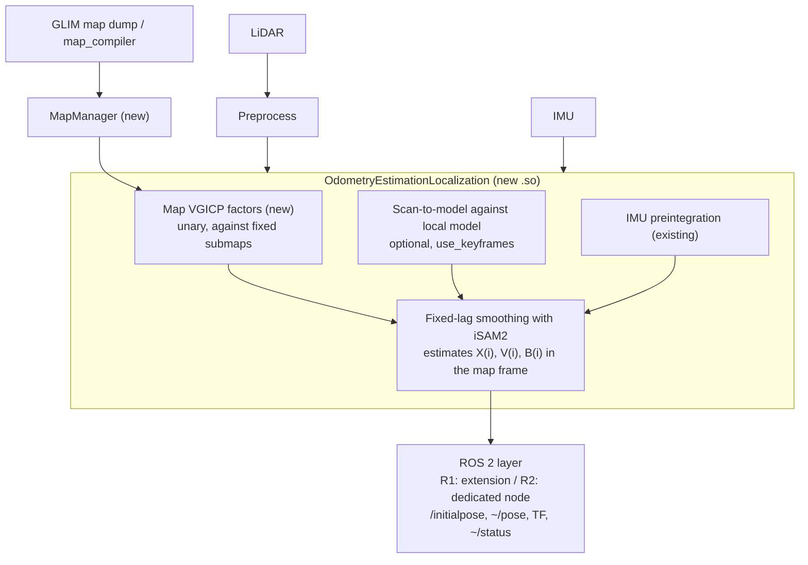
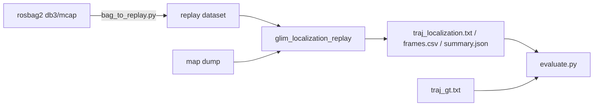

# Design: a localization-only package based on GLIM

Investigated: koide3/glim master (commit `1a197c9`, 2026-10-08, v1.2.2), koide3/glim_ros2 (Docker pins commit `4d4ec52`, 2026-08-14, 1.2.2), koide3/gtsam_points (v1.2.2)

## 1. Conclusion

- The GLIM odometry module is a plugin that can be replaced through the `so_name` setting. The GPU odometry already uses "unary VGICP factors against keyframes with fixed poses".
  Replacing these keyframes with **submaps of the prebuilt map (fixed poses)** gives tightly coupled IMU map-matching localization.
- Approach A (tightly coupled) is adopted: create a new odometry module that inherits `OdometryEstimationIMU`, and disable sub_mapping / global_mapping.
- GLIM itself is not modified. This is a separate repository that links to `glim` / `gtsam_points`.
- glim and gtsam_points are both MIT licensed. Copied parts keep their copyright notice.

## 2. GLIM parts to reuse

| Part | Location | Use |
| --- | --- | --- |
| Odometry replacement | glim_ros2 `src/glim_ros/glim_ros.cpp` L103–111 (`so_name` → `OdometryEstimationBase::load_module`) | Specify our own `.so` in the config |
| Disabling sub/global mapping | same, L113–135 | Empty `sub_mapping.so_name`, `enable_global_mapping:false` |
| Tightly coupled IMU fixed-lag smoothing | `OdometryEstimationIMU` (IMU integration, deskew, covariance estimation, iSAM2 fixed lag, initialization) | Inherit it and implement `create_factors()` |
| Unary matching factor | GPU: `create_unary_factor` in `odometry_estimation_gpu.cpp` (`IntegratedVGICPFactorGPU(fixed_pose, X(i), voxelmap, frame)`), CPU: `IntegratedVGICPFactor(gtsam::Pose3(), X(i), voxelmap, frame)` | Make the target a map submap |
| Initial pose | `odometry_estimation_imu.cpp` L66–69 (setting `init_T_world_imu` / `init_v_world_imu` skips the estimation) | Pass the initial pose in map coordinates |
| Map data | `GlobalMapping::save` → `graph.bin`, `values.bin`, `traj_*.txt`, `%06d/` (`SubMap::save`: `T_world_origin` etc. in `data.txt`, point clouds with `save_compact`) | Read with `SubMap::load()` and overwrite `T_world_origin` with `X(i)` in `values.bin` |
| Voxel map | `gtsam_points::GaussianVoxelMapCPU/GPU`, `iVox` | Multi-resolution voxels per submap |
| Global registration | `gtsam_points/registration/ransac.hpp`, `graduated_non_convexity.hpp` | Relocalization (planned, optional feature) |
| Extension | `ExtensionModuleROS2::create_subscriptions`, `OdometryEstimationCallbacks` | ROS input and output (R1) |

Note for the planned GPU module: the keyframe-related members of `OdometryEstimationGPU` (`keyframes` etc.) are **private**. They cannot be replaced by inheritance, so the implementation has to be copied and modified.

## 3. Architecture



### Factors added for each frame i

| Factor | Connects | Source |
| --- | --- | --- |
| ImuFactor | X(i-1), V(i-1), X(i), V(i), B(i-1) | Existing |
| Bias random walk | B(i-1), B(i) | Existing |
| Relative pose from the local model (only with `use_keyframes`) | X(i-1), X(i) | Derived from the upstream CPU version. `PriorFactor` removed |
| Map VGICP (unary) | X(i) ← fixed T_world_origin_j | **New** |
| Initial pose prior (weak) | X(0), V(0), B(0) | Existing (only the weight changes. The mapping-time `init_pose_damping_scale=1e10` is not used) |

With the CPU default (`use_keyframes: false`), the map factors are the only scan constraints, and outside the map the state is propagated by the IMU alone.

## 4. Modules (new, modified, reused)

| Module | Kind | Source / existing parts used | Role | Status |
| --- | --- | --- | --- | --- |
| Odometry module (`libodometry_localization_cpu.so`) | Modified | Copies `odometry_estimation_cpu.cpp/.hpp`. Inherits `OdometryEstimationIMU` | Adds map factors to `create_factors()`, an option to disable keyframes, a weaker initial prior, adds `reset()` | Implemented |
| GPU odometry module (`libodometry_localization_gpu.so`) | Modified | Would copy `odometry_estimation_gpu.cpp/.hpp` | Same as the CPU module, with GPU voxel maps | Planned (#2). `BUILD_WITH_CUDA=ON` only checks that gtsam_points has CUDA; no GPU sources are built |
| MapManager | New | `SubMap::load`, `GaussianVoxelMapCPU` | Map loading, nearby submap selection, voxel generation | Implemented (CPU, whole map resident). LRU tile management is planned with the GPU module |
| MapFactorBuilder | New | Unary constructor of `IntegratedVGICPFactor` | Map factor generation, overlap and inlier ratios, weight control | Implemented (CPU) |
| Relocalizer | New | GICP, RANSAC / GNC of gtsam_points | Multi-hypothesis yaw refinement for /initialpose, optional global relocalization | Planned (#3) |
| ROS 2 package | New | `ExtensionModuleROS2`, `OdometryEstimationCallbacks`, input handling of `GlimROS` (modified) | R1 (extension) and R2 (lifecycle node) | Implemented (no launch, YAML parameter or RViz files yet) |
| map_compiler | New | `SubMap::load`, `PointCloudCPU::save_compact` | Slimming and indexing GLIM dumps, building maps from PCD | Implemented. PLY input and 2D map export are planned (#4) |
| Tests and evaluation | New | Offline replay tool, evo | Accuracy and processing time evaluation | Implemented. GLIM is pinned to a fixed commit; CI against newer GLIM versions is not set up |
| Config files | Modified | `config.json`, `config_odometry_cpu.json` | Adds map parameters, disables sub/global mapping | Implemented (CPU) |
| glim / gtsam_points / glim_ros2 | Reused | — | Used as is, as dependencies | — |

## 5. Detailed design

### 5.1 MapManager

- Input: a GLIM dump. `%06d/` is read with `SubMap::load()`, and `T_world_origin` is overwritten with `X(i)` from `values.bin`.
- `map_compiler` (offline): strips frame data, keeps the covariances from the dump (recomputation is planned, #4), and writes `map_index.json` (center coordinates, BBox). A mode that splits a PCD into a grid and writes the same format is also provided (PLY input is planned).
- Voxels: multi-resolution `GaussianVoxelMap` per submap (e.g. 0.5 / 1.0 / 2.0 m).
- Selection: get the submaps within radius R (e.g. 60 m) of the predicted pose with a KD-tree, and take up to K (e.g. 5) nearest first. Submaps whose overlap ratio (`gtsam_points::overlap`) is below a threshold are excluded.
- Memory: the whole map is loaded and stays resident. LRU tile management and prefetch on the GPU are planned with the GPU module (#2).
- API: `load(path)`, `query(T_world_imu, radius, k) -> std::vector<MapTile::ConstPtr>`, `MapTile = { id, T_world_origin, points, voxelmaps, bbox_min, bbox_max }`. After loading, the map is shared as an immutable snapshot and is thread-safe.

Points settled by the Phase 2 implementation:

- Exclusion by overlap ratio needs the current scan, so it is done in the Phase 3 map factor generation, not in `query`.
- The slim dump is `map_index.json` and `%06d/{data.txt,points_compact.bin,covs_compact.bin}`. The authoritative pose is in `map_index.json` (`data.txt` is rounded to 6 significant digits).
- Upstream `SubMap::save` writes a format that cannot be read back when frames is empty, so the slim dump also keeps one origin frame.
- Upstream `SubMap::load` dereferences null on a point cloud without covariances, so the covariance file is checked to exist before calling it.
- PCD input: `map_compiler <file.pcd> <output_dir> [--grid-size 20] [--voxel-size 0] [--k-neighbors 10]` reads x, y, z (`DATA ascii` or `binary`; other fields ignored), optionally voxel-downsamples, estimates per-point covariances with `gtsam_points::estimate_covariances` over the whole cloud (k nearest neighbours, so tile edges see their neighbours), and splits the points into a 2D grid along world x and y. Each non-empty cell becomes a submap with identity rotation and its origin at the centroid of its points. The output is the same compiled map (`source: "pcd"` in `map_index.json`), loaded by `load_map` unchanged.
  - Bounds: `--grid-size` >= 1 m, `--voxel-size` 0 (off) or >= 0.01 m, `--k-neighbors` 5 to 1000, all finite. Repeated field names (other than PCL's `_` padding) are rejected, and binary reading requires a little-endian host (`static_assert`). A missing `.pcd` path is reported as "file not found".
  - Downsampling runs around the cloud's bounding-box centre, because `gtsam_points::voxelgrid_sampling` packs voxel coordinates into 21 bits per axis and silently merges points beyond about ±2^20 voxels from the origin (±105 km at 0.1 m) into made-up ones. A cloud wider than about 2^21 voxels fails with an error that asks for a larger voxel size.
  - Tile size and coverage: tiles are disjoint, and MapManager uses at most `map_max_submaps` (default 5) tiles nearest to the robot by centroid (within `map_search_radius`). With the default 20 m grid that is only about 40 x 40 m around the robot, while GLIM submaps usually cover the whole sensor range. For an outdoor LiDAR with a range of 50 to 100 m, use `--grid-size 50` to `100`, or raise `map_max_submaps`. MapManager is unchanged.
- Not implemented: PLY input, 2D OccupancyGrid export, and covariance recomputation for GLIM dumps (#4).

### 5.2 Map factors (create_factors)

- The CPU version has no keyframes. Setting `use_keyframes` (default false) to true solves scan-to-model against the upstream local model and adds only `BetweenFactor(X(i-1), X(i))` (support outside the map). The local model's coordinates drift away from the map, so the upstream `PriorFactor` is not added. The key name is kept to match the GPU version.
- For every resolution of each active submap j, add `IntegratedVGICPFactor(T_world_origin_j, X(i), voxelmap_j, frame)`. Submap poses are constants, and no new variables are created.
- Submaps are selected with the IMU-predicted pose, and those whose overlap ratio at the coarsest voxel is below `map_min_overlap` are excluded.
- The weight is `map_factor_weight` (default 1.0). While DEGRADED and LOST it is multiplied by `degraded_weight_scale` (default 0.1).
- Outliers are suppressed only by VGICP ignoring points without correspondences. `set_enable_surface_validation` does not exist in VGICP and is not used.
- Voxels aggregate the mean and covariance of the points, so both faces of an object thinner than a voxel collapse into one plane in the middle, which biases the result along the wall normal (up to 0.29 m with a 0.4 m wall in the synthetic scene). The effect on real data is checked in #5.

### 5.3 Initialization and relocalization

1. The setting `init_T_world_imu` (map coordinates).
2. `/initialpose`: the given pose is used as the initial guess for scan-to-map registration (no yaw search yet). Planned: x, y, yaw + roll/pitch from the acceleration at rest + height taken from the map, with several hypotheses with yaw varied by about ±15° refined by scan-to-map GICP and the one with the highest score adopted.
3. Global relocalization (planned, optional): FPFH + RANSAC/GNC between a cloud of several accumulated frames and each submap. Candidate generation can be replaced through an interface (ScanContext etc.).

Phase 3 implements 1 and `reset` with an externally given pose. The multi-hypothesis refinement in 2, and item 3, are left to #3. When neither `init_T_world_imu` nor `init_v_world_imu` is set, `insert_frame` returns nullptr until a pose comes through `reset`.

Pose reset at runtime: `reset(T_world_imu, v_world_imu, min_stamp)` (thread-safe). Only the latest request is kept, and it is applied at the start of the next `insert_frame`. It rebuilds the frames, the smoother and the local model, returns the state to INITIALIZING and increments `reset_count`. Frames older than `min_stamp` are dropped. Frame ids go back to 0, so downstream uses `reset_count` to tell runs apart. An invalid pose (non-finite, not a rigid transform) is rejected and the current estimate continues. The IMU bias carries over the previous estimate. Frames in the smoother are discarded without being passed to the marginalization callback. A reset can also be requested from outside through `LocalizationCallbacks::request_reset` (safe from any thread), and the state is received through `on_status`.

### 5.4 Quality monitoring

- Every frame, compute the inlier ratio and the residual of the map factors.
- States: `INITIALIZING → TRACKING → (inlier ratio low for N consecutive frames) → DEGRADED (lower the map factor weight, rely mainly on odometry) → LOST (no pose until an external initialization)`.
- The inlier ratio is the fraction of points that fall in the finest voxels of the tiles in use. The residual is the error per inlier point at the finest resolution (reported only, not used for state transitions).
- Detection of degenerate directions from Hessian eigenvalues and covariance output are not implemented (outside the scope of Phase 3).

### 5.5 Configuration (example)

```json
{
  "odometry_estimation": {
    "so_name": "libodometry_localization_cpu.so",
    "map_path": "/path/to/dump",
    "map_voxel_resolutions": [0.5, 1.0, 2.0],
    "map_search_radius": 60.0,
    "map_max_submaps": 5,
    "map_min_overlap": 0.1,
    "map_factor_weight": 1.0,
    "degraded_weight_scale": 0.1,
    "use_keyframes": false,
    "init_T_world_imu": [0, 0, 0, 0, 0, 0, 1],
    "degraded_inlier_ratio": 0.3,
    "lost_frames": 50,
    "smoother_lag": 5.0
  }
}
```

`so_name` in `config_sub_mapping` is empty, and `config_ros` has `enable_global_mapping: false`.

## 6. ROS 2 support

Two stages: development and evaluation put an extension on the existing `glim_rosnode` / `glim_rosbag` (R1). Real robots and integration with navigation stacks such as Nav2 use a dedicated lifecycle node (R2). Both use the same ROS-independent core and a shared publisher class.

| Aspect | R1: glim_rosnode + extension | R2: `glim_localization_node` |
| --- | --- | --- |
| Implementation | One extension module | A node whose input handling is based on `GlimROS` (point cloud and IMU conversion, TimeKeeper, QoS) |
| Configuration | GLIM JSON only | A few ROS parameters (`config_path`, `map_path`, `max_init_pose_delay`) + GLIM JSON |
| Lifecycle | None | configure loads the map, activate starts processing |
| Pose reset | Through a shared singleton in the core | The node holds the module directly |
| Offline evaluation | Faster than real time with `glim_rosbag` | `ros2 bag play` + `use_sim_time` |

### Package layout (colcon)

```
glim_localization/                  # repository
  glim_localization/                # ROS-independent core (odometry .so, MapManager, map_compiler: GLIM dump or PCD input)
  glim_localization_msgs/           # LocalizationStatus.msg, Initialize.srv
  glim_localization_ros2/
    src/localization_publisher.cpp  # publisher and TF class shared by R1 and R2
    src/localization_extension.cpp  # R1: ExtensionModuleROS2
    src/localization_node.cpp       # R2: rclcpp_lifecycle::LifecycleNode (registered as a component)
    src/map_publisher.cpp           # ~/map, shared by R1 and R2
    config/r1/, config/r2/          # GLIM JSON configs for R1 and R2
    config/localization.param.yaml  # R2 ROS parameters (every one, with comments)
    config/localization_r1.param.yaml  # ROS parameters of GLIM's node in R1
    launch/localization.launch.py   # R2: standalone or as a component, autostart
    launch/localization_r1.launch.py   # R1: glim_rosnode, or glim_rosbag with bag:=
    launch/launch_utils.py          # R1 helpers: typed -p values, JSON with comments, the map_path override
    rviz/localization.rviz          # map frame, ~/map, ~/pose, ~/odometry, TF
```

### Inputs and outputs

| Name | Type | Content |
| --- | --- | --- |
| points / imu (subscribed) | sensor_msgs/PointCloud2, Imu | Topic names and QoS are exposed as parameters, with the same keys as GLIM's `config_ros` |
| /initialpose (subscribed) | geometry_msgs/PoseWithCovarianceStamped | RViz 2D Pose Estimate. Used as the initial guess for scan-to-map registration (no yaw search yet; multi-yaw refinement is planned, #3) |
| ~/initialize (service, R2) | glim_localization_msgs/srv/Initialize | Initialization with a given pose. global_search=true requests global relocalization (returns success=false until #3 implements it). An empty request is rejected. Returns success and score |
| ~/relocalize (service, R2) | std_srvs/Trigger | Relocalization with the current pose as the initial value |
| ~/pose | geometry_msgs/PoseWithCovarianceStamped | base_frame pose in map coordinates (LiDAR rate) |
| ~/odometry | nav_msgs/Odometry | Pose + velocity (LiDAR rate). An IMU-rate predicted version is planned |
| ~/status, /diagnostics | LocalizationStatus, diagnostic_msgs | State, inlier ratio, number of tiles in use, number of map factors, residual, processing time, reset count and the latest reason |
| ~/map | sensor_msgs/PointCloud2 | The loaded map in the map frame, published once and latched (reliable, transient local). One centroid per `map_cloud_voxel` voxel (0.5 m; 0 keeps every point), x/y/z float32; `publish_map: false` turns it off (both in `localization_ros`). R1 publishes it when the extension is loaded, from the map the odometry module already holds (`LocalizationCallbacks::loaded_map()`, so the map is not loaded twice); R2 publishes it at configure, so it is visible while the node is inactive. The build runs there, synchronously: 12 bytes per published point, plus about 40 bytes per occupied voxel while downsampling (with 0 the points go straight into the message). With 0, a map above 10 million points gets a warning; a cloud above 1 GiB (the message limit is 4 GiB, uint32 `row_step`) is not published, with a warning |
| ~/aligned_points | sensor_msgs/PointCloud2 | Not implemented: the aligned scan (downsampled). Deferred: it needs a per-frame copy and conversion of the scan on the odometry callback, plus a rate and downsampling policy, which is more than the launch work needed (#18) |

### TF (`tf_mode`)

| tf_mode | TF published | When to use |
| --- | --- | --- |
| internal_odom (default) | map→odom, odom→base | No other odometry source. map→odom is a fixed anchor that changes only at an external reset, odom→base = anchor · T_map_base ("Publication rules" below) |
| external_odom | map→odom only | Wheel odometry or an EKF publishes odom→base. map→odom = T_map_base · T_odom_base⁻¹ |
| none | None | A downstream estimator (e.g. an EKF) publishes the TF |

#### Publication rules

- **Pairing.** The estimate of a frame is published only together with the status of the same frame. `LocalizationPublisher::on_frame` only stores the frame; `on_status` with `frame_id >= 0` and the same stamp publishes it with that status's state. A stored frame replaced by a newer one is dropped and counted (`unpaired_frames()`). The core emits the frame callback before its status, so the publisher subscribes `OdometryEstimationCallbacks::on_update_new_frame` (the corrected state, not the IMU prediction of `on_new_frame`) and `LocalizationCallbacks::on_status`.
- **State gate.**

  | state of the frame | `~/pose` | `~/odometry` | `map->odom` | `odom->base` (internal_odom) |
  | --- | --- | --- | --- | --- |
  | INITIALIZING, TRACKING, DEGRADED | yes | yes | yes | yes |
  | LOST | no | no | no | yes |

  external_odom publishes nothing in LOST. `~/status` and `/diagnostics` are always published. TF has no covariance and Nav2 ignores it, so only absence is visible to every consumer. `odom->base` continues so that local control keeps a TF; `map->base` goes stale, which is the correct signal. The pose covariance is all zero and means "not estimated"; it is not inflated.
- **Anchor (internal_odom).** `T_odom_base = A * T_map_base` and `map->odom = A^-1`, with `A = I` at the first frame. `A` is recomputed only at the first frame after a status whose `reset_count` changed with reason EXTERNAL, as `A = T_odom_base_last * inverse(T_map_base_new)`, so `odom->base` does not step at an external reset, whatever the pause. An IMU_GAP reset does not re-anchor: the core restarts from its own prediction, bounded by `imu_gap_reset_max`.
  - Guaranteed: no step in `odom->base` at an external reset; `map->odom * odom->base` equals the pose; the motion of `odom->base` between any two frames equals the pose's, also after dropped frames.
  - Not guaranteed: smoothness when the estimate itself moves without a reset (convergence in INITIALIZING, recovery from DEGRADED, a correction). The estimator is tightly coupled, so a correction cannot be separated from motion by pose; such a change enters `odom->base`. This is the definition, not a defect. There is no jump threshold.
- **Stamps.** A frame whose stamp is not newer than the last accepted one is dropped and counted (`stale_frames()`), unless an external reset came since. A status that is not for a frame is stamped with the last accepted frame stamp, or the clock before the first frame. external_odom looks up `odom->base` at the frame stamp floored to 1 us (a double has 238 ns resolution at 1.7e9 s).
- **Twist.** `~/odometry` carries the twist of the base in the base frame: `linear = R_base_imu * (R_map_imu^T * v_map_imu + w_imu x p)` with `p = inverse(T_base_imu).translation()`, and `angular = R_base_imu * w_imu`. `w_imu` is the bias-corrected angular velocity in the IMU frame, supplied with the frame; a frame with a non-finite value is dropped.

#### R2 node: differences from the plan

Where `glim_localization_node` differs from the plan above:

- **Parameters.** Only `config_path` (default `config/r2`; a relative path is taken from the package share), `map_path` (overrides `odometry_estimation.map_path`), `max_init_pose_delay` (default 0.2 s) and `autostart` (default false) are ROS parameters; `config/localization.param.yaml` documents them. Everything else comes from the GLIM JSON files as in R1: topics, QoS and time offsets from `glim_ros` in `config_ros.json` (the GlimROS keys), the publisher and `~/map` settings from `localization_ros`.
- **Autostart.** With `autostart: true` the node configures and activates itself from a one-shot timer once it spins, the same in a process and in a component container. A failed step is logged and leaves the node in the state it reached (unconfigured or inactive); it is not retried.
- **Lifecycle.** configure reads the config, loads the map and creates `~/initialize` and `~/relocalize`; a missing config, a missing or unreadable map, or bad settings fail it and leave the node unconfigured. activate creates the odometry module, `AsyncOdometryEstimation`, the publisher and the subscriptions (input before activate is not seen). deactivate drops the subscriptions and joins the odometry thread; pending input is discarded, and the next activate starts a new run (new anchor, `reset_count` 0). cleanup releases the map and the services. The services exist only while the node is configured (Inactive or Active): while Inactive they answer `success=false`; while Unconfigured (at startup, after cleanup or after a failed configure) they do not exist, so a client waiting for them blocks.
- **Resets.** The node holds the module and calls its `reset()`; `LocalizationCallbacks::request_reset` is not used. `/initialpose` and `~/initialize` take the base pose in the map frame (an empty frame id is taken as the map frame) and are applied exactly; there is no yaw hypothesis search. `~/initialize` returns `success=true` when the pose is accepted (queued), not when it has been applied; `score` is 0. `global_search=true` returns `success=false` ("not implemented", #3). Of several queued requests the latest wins.
- **Relocalize.** `~/relocalize` calls the core's `relocalize(max_init_pose_delay)`: at the next frame, estimation restarts from the newest estimate (pose and velocity), with the position moved to that frame by the velocity and the orientation turned at the rate between the last two estimates (reason EXTERNAL). The first frame after a reset is held near the reset pose, so without the turn a relocalize while turning shows an error of a few degrees in that frame (4.3 deg in `test_r2_node`). The core reads the estimate on the odometry thread when the reset is applied, so it is the newest one, not the one seen at request time. It fails when a reset is still pending (it would silently replace an accepted `~/initialize`), when the state is not TRACKING or DEGRADED (INITIALIZING, also right after any reset, or LOST), and when the newest estimate is more than `max_init_pose_delay` older than the last frame the odometry has taken (frames were dropped since, for example in an IMU gap). Use `~/initialize` in those cases. The state and age are checked again when the reset is applied: if the odometry went LOST after the request (an IMU fault) or the next frame is more than `max_init_pose_delay` after the newest estimate (the input stalled), the request is dropped with a warning in the log and the frame is handled as without it, so LOST and the IMU gap policy stay in force. The service has already answered success by then, and `~/status` does not report the drop: `reset_count` does not change.
- **Late initial pose (online form of the replay rule in 6.5).** A stamped pose applies at the first frame at or after its stamp that the odometry has not taken yet. When the request arrives, the node compares the stamp with the stamp of the last frame the odometry thread took off its input queue (`OdometryEstimationLocalizationCPU::last_input_frame_stamp()`), whatever happened to that frame: estimated, or dropped while waiting for the first pose, before `min_stamp`, in an IMU gap or while LOST. If that frame is more than `max_init_pose_delay` newer, the request is rejected as too late (`~/initialize` returns `success=false`, `/initialpose` is logged and dropped); a shorter delay is accepted with a warning. A stamp of 0 means the next frame and is always accepted. Frames still in the input queue are not counted, because they also get the pending pose. The check is a lower bound taken at request time: a frame that arrives late after it is not caught. The pose stamp is compared without `points_time_offset`, as in R1.
- **One localization per process.** The core reports through static callback slots, so a process (or a component container) runs one localization, R1 or R2.
- **Early messages can be lost.** In the tests, the node sometimes received nothing for about the first second after `ros2 bag play` started (cause unknown; see the R2 node entry in PROGRESS). An `/initialpose` sent right after the sensors start can be lost the same way: set the first pose with `~/initialize`, which answers, or resend it.

- The static base→imu/lidar TF comes from robot_state_publisher. A startup warning when it disagrees with GLIM's `T_lidar_imu` is planned but not implemented yet, so keep the two consistent by hand.

> [!WARNING]
> **Do not load glim_ros2's `librviz_viewer.so` in R1.** It would publish the odometry result (here in map coordinates) as odom→base, and the TF would jump and conflict.

### Threads and integration

- Estimation runs on the `AsyncOdometryEstimation` thread. Publication comes from `OdometryEstimationCallbacks::on_update_new_frame` and `LocalizationCallbacks::on_status` ("Publication rules" above). `use_sim_time` is supported.
- Nav2: `~/pose` and the TF are meant to be usable in place of a 2D particle-filter localizer. Not verified. Exporting a 2D OccupancyGrid from map_compiler is planned (#4).
- External EKF: `tf_mode: none`, remap `~/pose` to the pose input of the EKF, initialize with `~/initialize`. Not verified; the topic names and service types of the target stack need to be checked.
- Launch files. `localization.launch.py` (R2): `params_file`, `config_path` and `map_path` (empty keeps the `params_file` value), `use_sim_time`, `autostart` (default true), `use_composition` (default false; loads the component into a new `component_container` named `container_name`) and `rviz`. `localization_r1.launch.py` (R1): `bag` (empty runs `glim_rosnode`, otherwise `glim_rosbag <bag>`), `config_path` (default the installed `config/r1`; a relative path is taken from the current directory), `map_path` (R1 reads the map path only from JSON, so a non-empty value makes a temporary copy of the config with `odometry_estimation.map_path` set in the file that `global.config_odometry` of `config.json` names; names outside the config directory are rewritten to reach the same files; the copy is removed when the launch process exits), `params_file` (`config/localization_r1.param.yaml`, the GlimROS and glim_rosbag parameters, passed as typed `-p name:=value` by `launch/launch_utils.py` since `glim_rosbag` takes any existing file argument for a bag), `use_sim_time` and `rviz` (the RViz topics remapped to `/glim_ros/...`). `rviz` defaults to false; `rviz2` is not a package dependency, and when it is missing the launch file warns and starts without it.

## 6.5 Offline replay (Phase 4)

Replays bag-equivalent data without ROS and evaluates the trajectory. The format, reader/writer, runner and tools are all in the ROS-independent core library.



### Dataset format (version 1)

- `meta.json`: `format` = `glim_localization_replay`, `version` = 1, `stamp_definition` = `first_point` (the frame stamp is the acquisition time of the first point), `per_point_time`, `num_frames`, `num_imu`.
- `imu.csv`: header `stamp_ns,acc_x,acc_y,acc_z,gyro_x,gyro_y,gyro_z`, real numbers with 17 digits, stamps strictly increasing. Acceleration in m/s^2, angular velocity in rad/s.
- `points/<stamp ns zero-padded to 19 digits>.bin`: a 32-byte header (`GLRP`, u32 version=1, i64 stamp_ns, u32 num_points, u32 flags, u32 point_step=20, u32 reserved), followed by f32 x, y, z, t, intensity per point (little-endian). `t` is seconds from the stamp in [0, 1), and the minimum is 0.
- Optional `traj_gt.txt` (TUM format, T_world_imu).
- Invalid (exit code 3): a negative stamp, a non-integer `version` (such as 1.9), whitespace, hexadecimal or inf/nan real numbers in imu.csv.

### Deterministic insertion order (single thread)

1. Read the frame and call `CloudPreprocessor` synchronously.
2. Insert all IMU samples up to scan_end_time, plus one extra sample.
3. Estimate with `insert_frame`.

Upstream IMU integration integrates from the previously inserted frame to the current frame, needs at least 2 samples, and holds one sample across a gap. So missing IMU data directly becomes estimation error, and skipping cannot recover from it. `ReplayRunner` handles it as follows (`max_imu_gap` defaults to 0.05 s and is changed with `--max-imu-gap`. Measured to meet the Phase 3 accuracy criteria with a 25 Hz IMU: translation max 0.0104 m, rotation max 0.073 deg).

- Before the first pose: a frame after the IMU has ended, a frame with no IMU at its start, and a frame with a large gap in its interval are `skipped_no_imu`.
- The IMU gap is defined in one place, `check_imu_coverage` in `odometry/imu_gap.hpp`, and `ReplayRunner` and the odometry module use the same function: a gap longer than `max_imu_gap` from the stamp of the last estimated frame to scan_end_time, or fewer than 2 samples in (stamp of the last pose, stamp]. The gap length is the missing interval (the difference between the samples on both sides of the gap; with fewer than 2 samples, frame stamp - stamp of the last pose).
- A gap after the first pose follows `--on-imu-gap`. `abort` (default) stops with `InvalidDatasetError` (exit code 3) before the odometry sees the gap. The output so far is kept, and `summary.json` is not written. `reset` makes the frame `skipped_no_imu` if the gap is at most `imu_gap_reset_max` (setting, default 0.5 s), and at the frame where the IMU is clean again the odometry resets itself from the last pose and velocity (counted in `imu_gap_resets` of `summary.json`). A gap longer than `imu_gap_reset_max` gives exit code 3 even with `reset`. The longest gap in the window is measured, and a gap right after recovery is judged by the same rule. The interval checked is the whole span from the previous pose (or the recovered frame) to the current frame, and a dropout with no LiDAR frame in it (recording stopped) also counts. Even if the samples around the recovered frame are normal, if the longest gap so far exceeds `imu_gap_reset_max`, replay gives exit code 3 and the module goes LOST. IMU stamps pass through a gate in `insert_imu` (with `on_imu_gap: reset`. `off` passes everything, as upstream). Only finite stamps strictly greater than the last one passed go to the upstream queue, and the history for the gap check is a copy of it (append only), so it does not disagree with the queue. A single duplicate or old stamp is dropped with a warning (not LOST. If a gap remains, it is judged on the actual sequence). After 5 consecutive drops, this is treated as a fault: the upstream queue and the history are cleared, it restarts from that sample, and if there is a pose it goes LOST (until an external `reset()`). A forward jump (such as +1000 s) is accepted; the next frame sees a huge gap and goes LOST, then 5 of the following real samples are dropped and it restarts. When there is no sample at or before the previous pose (for example after the queue was cleared by a fault), the distance to the first sample also counts as a gap (only when it exceeds `max_imu_gap`. If the history was only trimmed, the actual distance from the newest trimmed stamp is measured). Right after an external `reset()` (`frames` is empty), a frame whose stamp is not newer than the newest frame seen so far is dropped without a pose (this prevents upstream from holding a sample from a point before data it has already consumed. The newest stamp seen so far is never lowered; an IMU fault clears it). Even for a frame the history reports as OK, if the largest interval in (previous pose, frame] of the actual upstream queue exceeds `max_imu_gap`, it goes LOST as an internal inconsistency (`hold_check_trips()`, 0 on a valid stream). `INCOMPLETE` outside a gap episode (the queue does not reach the end of the scan) is not checked and proceeds as before; this is a known limitation and a follow-up task (the end_of_sequence flush, and a `last_imu_time` advanced by samples the gate dropped). It also goes LOST when the frame stamp is not newer than the previous frame (so that `v * dt` of the self reset never has dt <= 0). Automatic recovery from a broken clock (without an external `reset()`), clock offset between LiDAR and IMU, and the upstream async wrapper's queue are separate tasks and are not handled here. When the config has `on_imu_gap: off`, `--on-imu-gap reset` gives exit code 2. An external `reset()` always takes priority over the self reset (the check and the write are done under the same lock), and IMU samples out of order (stamp not newer than the previous one) are excluded from the gap check, as in the upstream integration. Short dropouts can also be avoided with `--start` / `--end`.
- Online (odometry module, setting `on_imu_gap`, default `reset`): if the gap is at most `imu_gap_reset_max`, frames across the gap are dropped, and at the first clean frame it reinitializes from the last pose (position advanced by the velocity) and velocity (INITIALIZING, `reset_count` + 1, `last_reset_reason` = `IMU_GAP`). If it is longer, it goes LOST and gives no pose until an external initialization (`reset()`). `off` ignores the gap as upstream does (not recommended). The module keeps its own IMU stamp history in `insert_imu` (because the upstream queue deletes integrated samples).
- Late initial pose (replay): the pose of `--init-stamp` applies at the first frame at or after that stamp that the IMU covers. If that frame is more than `max_init_pose_delay` (default 0.2 s) late, the pose is rejected with `std::invalid_argument` (exit code 2). A shorter delay, which happens when frames without IMU coverage are skipped, is applied with a warning. A pose with stamp 0 (unstamped) is exempt. Online (R2): see "R2 node: differences from the plan" in section 6.
- A frame whose estimate is non-finite or whose velocity exceeds 1000 m/s is written to frames.csv as `diverged`, and the run stops with a runtime error (exit code 1) (this detects divergence and does not guarantee accuracy).
- If any frame is LOST (state in `frames.csv`), the run writes up to that frame and stops with a runtime error (exit code 1) (`summary.json` is not written).
- Quality gate (in the tool; `ReplayRunner` does not have it): if, among the estimated frames from the first TRACKING on, the fraction of TRACKING is below `--min-tracking-ratio` (default 0.9, 0 disables), the exit code is 1. It is checked after `summary.json` is written, which includes `tracking_ratio` and `min_tracking_ratio`. If the state never became TRACKING, the ratio is 0. Tests that intentionally drive outside the map pass 0.
- Before reading the map, the tool checks the median IMU period, and if it exceeds `max_imu_gap` (a 5 Hz or 10 Hz IMU, for example) the exit code is 3. Fewer than 2 IMU samples also give 3.

`scripts/evaluate.py` rejects a run whose `tracking_ratio` in `summary.json` is below `min_tracking_ratio` (> 0), in the same way as an aborted run (exit code 2; `--allow-incomplete` allows evaluating it).

The result values are `estimated`, `dropped` (before `--init-stamp`, or the estimate is null), `diverged` and `skipped_no_imu`. The replay creates the odometry module directly instead of loading it with dlopen.

### Outputs and exit codes

- `traj_localization.txt` (only frames that were estimated, TUM), `frames.csv` (all processed frames), `summary.json` (only when the run reaches the end. If the output directory has a previous summary.json, it is deleted at start), `replay_args.json`. Flushed every frame. summary.json is deleted before argument validation (right after parsing), so no old summary.json is left even for a rejected run.
- Exit codes: 0 success, 1 runtime error (including divergence, LOST and insufficient tracking ratio), 2 error in arguments, config, map or initial pose (including an initial pose that is too late), 3 invalid data (including an abort due to an IMU gap and an IMU period that is too long), 4 no pose was produced.
- Additional items in `summary.json`: `imu_gap_resets`, `tracking_ratio`, `min_tracking_ratio`. `replay_args.json` has `on_imu_gap`, `imu_gap_reset_max`, `min_tracking_ratio`.
- The core `LocalizationStatus` has `processing_time` (wall time of `insert_frame` [s], 0 at a reset) and `last_reset_reason` (`ResetReason`: `NONE`=0, `EXTERNAL`=1, `IMU_GAP`=2. The same values as `RESET_*` of the ROS msg; the core does not include the msg).

### Bag conversion and evaluation

- `scripts/bag_to_replay.py`: per-point time uses GLIM's `TimeKeeper` auto-detection once, on the first frame, and is fixed after that (relative if max < 1.0, otherwise absolute; ns if min > 1e16). Without a time field, t = 0. Livox CustomMsg is not supported. If the acceleration looks like it is in units of g (median < 5), `--acc-scale` is required. A negative stamp is an error. If a later frame contradicts the mode decided on the first frame, it is an error (max >= 1.0 in relative mode, the first point's time differs from the header stamp by more than 1 s in absolute mode, t >= 1.0 after rounding to float32). If the point times and the header clock are offset (time offset), `--time-mode` cannot fix it, and an error says it must be fixed in the bag. If there are several time fields, the last match is used, as upstream.
- `scripts/evaluate.py`: ATE / RPE with evo (no realignment), processing time statistics, exclusion of `--settle` seconds, exit code 1 when a threshold is exceeded. With `--frames`, the evaluated interval starts `--settle` seconds after the first frame that is not `dropped` (`dropped` before `--init-stamp` is excluded), and `skipped_no_imu`, `diverged` and later `dropped` count as missing. If the fraction of matched poses is below `--min-coverage` (default 0.9), the exit code is 1. Without `--frames` the expected count is unknown, so coverage is not checked (exit code 1 only if estimates without GT exceed (1 - min-coverage)). If there is no `summary.json` next to `--frames`, or `num_frames` does not match the row count (an aborted or truncated run), the exit code is 2. With an explicit `--allow-incomplete` it can be evaluated, and the report gets `incomplete: true`. Missing columns in frames.csv or NaN poses give exit code 2.

### Mapper for evaluation (`glim_localization_mapper`)

A small ROS-independent tool that builds a GLIM map and a reference trajectory from the same replay dataset, for a smoke test on real data. It is for evaluation and is not a supported mapper (maps for real use are built with GLIM itself). It is written only with GLIM's public headers and does not use `glim_ros2` code.

- Arguments: `--data --config --out [--start s] [--end s]` (stamps are absolute [s]). The exit codes are the same as replay (0 / 1 / 2 / 3). The config is `config/mapping_cpu/` (upstream GLIM's CPU config copied from the base commit. `T_lidar_imu` is the OS1 value).
- The insertion order is the same as `ReplayRunner` (preprocessing is synchronous, and IMU up to the one sample after scan_end_time is inserted before the frame). The modules are loaded by `so_name` in the config and wrapped in `AsyncOdometryEstimation`, `AsyncSubMapping` and `AsyncGlobalMapping`. While the odometry workload exceeds 5 frames, insertion stops to limit memory.
- Shutdown: join the odometry and pass the remaining frames to sub mapping, join sub mapping and pass the remaining submaps to global mapping, join global mapping and save to `<out>/dump`.
- Outputs: `traj_glim.txt` (TUM, T_world_imu, after global optimization), `mapper_summary.json` (number of frames, number of submaps, trajectory coverage, elapsed time, max RSS). The frames of a submap stay in the world frame of the submap's own optimization, and global mapping moves only `T_world_origin`, so the world pose is `T_world_origin * inv(pose of origin_frame) * pose of the frame`. The first few seconds used to initialize the odometry have no poses.
- `scripts/smoke_os1_128.sh <dataset>` is run manually (not in CI). It builds a map and a reference trajectory over the whole range and checks whether the tail revisits the first part. If it does, it localizes the tail on a map of the first part only (scans not used for the map). If not, it runs self-localization over the whole range. The reference is GLIM's own trajectory, so the numbers are agreement with GLIM, not accuracy.

## 7. Risks

| Risk | Mitigation |
| --- | --- |
| Local minimum from an initial pose error | Multiple yaw hypotheses (planned), coarse-to-fine multi-resolution voxels, judging initialization success by inlier ratio |
| Differences between the map and the environment | Keep inter-frame constraints and IMU, outlier removal, lower the weight in DEGRADED |
| Degenerate environments | Tight IMU coupling holds for a few seconds. Output degenerate directions as covariance (planned) |
| Processing delay | Tune K and the number of resolution levels. The CPU version is the only implemented backend; a GPU version is planned (#2). Also consider integrated iVox for the CPU version |
| GPU memory shortage (with the planned GPU version) | LRU tile management and prefetch (planned) |
| Changes in GLIM internal APIs | GLIM is pinned to a fixed commit (`1a197c9`, v1.2.2). Tracking newer versions in CI is not set up |

## 8. Open questions

- Target sensors (LiDAR model, with or without IMU) and whether a GPU is available. Without an IMU, an extension of the `OdometryEstimationCT` family is needed.
- Map size, and whether the robot drives outside the map.
- Output targets (Nav2, external EKFs, etc.) and the required TF layout.
