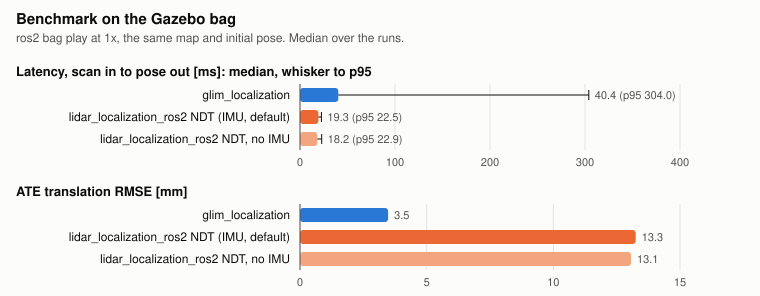

# Benchmark against other localization packages

A manual comparison of glim_localization with other LiDAR localization packages on the same data and the same map ([#80](https://github.com/atinfinity/glim_localization/issues/80)). It does not run in CI. Step 1 covers one baseline, [rsasaki0109/lidar_localization_ros2](https://github.com/rsasaki0109/lidar_localization_ros2) (NDT scan-to-map registration on a PCD map), on the Gazebo bag of [`scripts/sim_eval.sh`](sim_eval.md).

> [!NOTE]
> The Gazebo bag is the easy case: the scans are instantaneous and almost noise-free, the motion is planar and slow, the map matches the scene exactly, and the initial pose is the ground truth (see [Simulation evaluation](sim_eval.md)). The conditions where the methods should differ most are absent, and the defaults of both methods are used without tuning. The results say little about real data ([#5](https://github.com/atinfinity/glim_localization/issues/5)).

## Results (Gazebo bag)

Three runs per method, `ros2 bag play` at 1x, one run at a time. Median over the runs, with the range in brackets when the runs differ. Host: Intel i7-9800X (8 cores, 16 threads), Docker, amd64, CPU only.

| Method | Runs | ATE trans RMSE [mm] | ATE rot RMSE [deg] | RPE trans RMSE [mm/m] | RPE rot RMSE [deg/m] | Latency median [ms] | Latency p95 [ms] | Latency max [ms] | CPU per scan [ms] | CPU [% of a core] | Peak RSS [MiB] | Scans with a pose |
|---|---|---|---|---|---|---|---|---|---|---|---|---|
| glim_localization | 3 | 3.5 | 0.038 | 2.0 | 0.027 (0.027 to 0.028) | 40.4 (40.2 to 40.5) | 304.0 (292.5 to 314.0) | 563.8 (535.4 to 574.2) | 137.6 (136.8 to 137.8) | 138 (137 to 138) | 805 (805 to 809) | 0.972 (0.968 to 0.980) |
| lidar_localization_ros2 NDT (IMU, default) | 3 | 13.3 (13.2 to 13.3) | 0.069 (0.069 to 0.070) | 7.6 | 0.082 (0.076 to 0.086) | 19.3 (19.2 to 19.7) | 22.5 (22.0 to 22.8) | 25.4 (25.4 to 25.5) | 145.3 (145.2 to 146.2) | 145 (145 to 146) | 100 (99 to 100) | 0.995 (0.990 to 0.998) |
| lidar_localization_ros2 NDT, no IMU | 3 | 13.1 (13.0 to 13.1) | 0.065 (0.064 to 0.067) | 6.8 (6.7 to 7.4) | 0.079 (0.068 to 0.080) | 18.2 (18.1 to 18.5) | 22.9 (22.0 to 23.1) | 27.9 (27.5 to 29.3) | 169.8 (168.9 to 169.9) | 170 (169 to 170) | 99 (99 to 100) | 0.992 (0.987 to 0.995) |



In short, on this bag:
- **Accuracy:** glim_localization is about 4 times more accurate (3.5 mm against 13 mm ATE, and 2.0 against 7 mm/m RPE). Both are in the millimeter range, far below what matters for most robots.
- **Latency:** NDT answers in half the time at the median (19 ms against 40 ms), and has no tail. glim_localization stalls for about 0.5 s every 3 to 5 s (p95 304 ms, max 564 ms), then catches up within about 6 scans. This is the CPU odometry's known spike (max 507 ms per frame in the [GPU profile](progress/2026-11-28-gpu-profile.md)); its cause is not investigated yet.
- **CPU:** about the same CPU time per scan (138 ms against 145 to 170 ms, that is 1.4 to 1.7 cores at 10 Hz), with each method's own thread defaults (glim_localization 2, NDT 4).
- **Memory:** glim_localization uses 8 times as much (805 MiB against 100 MiB).
- **Scans with a pose:** glim_localization gives no pose for 2 to 3 % of the scans, NDT for 0.2 to 1.3 %. Every method misses the first scan (stamp 0); the other misses are spread over the run, sometimes several in a row, and not at the stalls. The cause is not established. Both nodes subscribe best effort (sensor data QoS), so a scan may be dropped before it reaches the method.
- **The IMU** makes no difference to NDT's accuracy on this bag; it lowers its CPU time by 15 %.

## Run

```bash
scripts/sim_eval.sh            # once: bag, map, map_export.pcd and config in out/sim_eval
scripts/sim_benchmark.sh       # out/sim_eval/bench/benchmark.md, benchmark.json, benchmark.svg
scripts/sim_benchmark.sh my_run 5   # another sim_eval.sh output, 5 runs per method
```

| Step | Image | What |
| --- | --- | --- |
| 1. images | | Builds `glim_localization:baseline-lidarloc` ([`docker/baseline/Dockerfile`](https://github.com/atinfinity/glim_localization/blob/main/docker/baseline/Dockerfile), the `baseline` service of `docker/sim/compose.yaml`) and refreshes the sim image. |
| 2. restamp | sim | `sim/scripts/restamp_bag.py` copies the bag to `bench/bag` with the log time of each message set to its header stamp, once for all runs. |
| 3. build | dev | `scripts/build_core.sh` and `scripts/build_colcon.sh` in the `loc` build volume (`bench/build.log`). |
| 4. runs | dev, baseline | `sim/scripts/bench_run.sh` for `glim`, `lidarloc` and `lidarloc_noimu`, interleaved: run 1 of every method, then run 2, and so on. |
| 5. compare | dev | `scripts/compare_methods.py` writes the table, `benchmark.json` (every run) and the chart. |

`bench/host.json` records the CPU, `nproc`, the image IDs and the commit. One benchmark with 3 runs per method takes about 15 minutes once the images exist. The baseline image takes about 20 minutes to build the first time.

### One run

`bench_run.sh` runs the node, a recorder and the player in one container (`ROS_AUTOMATIC_DISCOVERY_RANGE=LOCALHOST`), so the node and the recorder share `/proc`:
1. It starts the node and waits until it is ready: `active: waiting for` in the log of glim_localization, `ros2 lifecycle get /lidar_localization` = `active` for the baseline.
2. It starts `sim/scripts/bench_recorder.py` (rclpy) and waits 2 s for discovery.
3. It plays the bag with `--clock`, at 1x, after a 2 s delay. The player publishes reliable with deep queues ([`sim/config/bench_play_qos.yaml`](https://github.com/atinfinity/glim_localization/blob/main/sim/config/bench_play_qos.yaml)). The nodes keep their own subscription QoS.
4. 3 s after the end it stops the recorder, then the node.

The output is in `bench/<method>/run<k>`: `launch.txt` (the exact command), `node.log`, the config or parameters, and the recorder files.

### Metrics

- **Accuracy:** ATE and RPE (over 1 m) against `traj_gt.txt` with the functions of [`scripts/evaluate.py`](replay.md), without alignment. The window starts 2 s after the first cloud. Both methods publish the pose of the IMU frame in the map frame, which is what the ground truth gives.
- **Latency:** the time the recorder receives the pose minus the time it receives the cloud with the same header stamp (within 1 ms), on its monotonic clock. Both methods stamp the pose with the stamp of the cloud. It includes the transport to the recorder, the same for both.
- **Scans with a pose:** the share of the clouds that the recorder received (all 601 in every run: its subscription is reliable) that got a pose.
- **CPU:** `utime + stime` of the node process (`/proc/<pid>/stat`) at the first and the last cloud, divided by the number of scan periods, and as a mean percentage of one core.
- **Memory:** `VmHWM` (peak RSS) of the node process at the end. The recorder also samples `VmRSS` at 1 Hz.

## Fairness

- **The same map.** `sim/scripts/localize.sh` exports the compiled map with `map_compiler --export-pcd` as `map_export.pcd` (235193 points, the 0.1 m voxel map of glim_localization). The baseline loads it as one PCD and builds its NDT target at its default 1.0 m resolution, with the scans downsampled at 0.2 m. glim_localization uses the same points in 50 m tiles, with its default VGICP voxel maps at 0.5, 1.0 and 2.0 m.
- **The same inputs:** the same topics (`/sim_eval/lidar/points`, `/sim_eval/imu`), the same LiDAR extrinsic (0.10, 0, 0.20 m from the IMU), and the initial pose at the first ground truth pose.
- **The IMU:** glim_localization always uses it. The baseline's documented default uses it (`use_imu_preintegration: true`), which is the headline row; the second row turns it off.
- **Defaults only.** Each method keeps its shipped defaults, with only the overrides that the data needs (below). Tuning is a follow-up.
- **Threads:** each method keeps its own default (NDT `ndt_num_threads` 4, glim_localization `num_threads` 2). The CPU column compares the CPU time per scan.

### Overrides of the baseline

`sim/scripts/bench_params.py` writes the parameters: the shipped `param/localization.yaml` of lidar_localization_ros2 with these overrides, recorded with their reasons in `params/overrides.json` of every run.

| Parameter | Value | Why |
| --- | --- | --- |
| `map_path` | `map_export.pcd`, converted to float32 | The same map. `map_compiler --export-pcd` writes float64 fields, which `pcl::loadPCDFile` into `PointXYZ` does not read ("Failed to find match for field 'x'"): every point ends up at the origin and no scan matches. The conversion rounds the coordinates (at most 35 m here) to float32. |
| `initial_pose_x` ... `initial_pose_qw` | the first ground truth pose | The same initial pose as glim_localization. |
| `base_frame_id` | `imu_link` | The pose of the IMU frame, as the ground truth and glim_localization. |
| `use_sim_time` | `true` | The bag is played with `--clock`. |
| `use_imu_preintegration` | `false` | Only for the "no IMU" row. |

The launch arguments of `lidar_localization.launch.py` set the topics, `lidar_frame_id` (the frame of the clouds, `rig/imu_link/lidar`) and the LiDAR extrinsic (`lidar_tf_x/y/z`). Nothing else was needed. For example, `use_continuous_time_deskew` stays on: it falls back to the raw scan because the clouds have no per-point time.

glim_localization runs `localization.launch.py` of glim_localization_ros2 with the config that `sim/scripts/ros_config.py` writes, the helper that [`scripts/sim_viz.sh`](sim_eval.md#rviz2-capture) also uses: the Gazebo topics, `global_shutter_lidar`, and the initial pose. Nothing else is changed (the benchmark leaves `map_cloud_voxel` at its default; sim_viz.sh coarsens it for the display).

## Baselines

| Package | Version | License | Built from |
| --- | --- | --- | --- |
| [rsasaki0109/lidar_localization_ros2](https://github.com/rsasaki0109/lidar_localization_ros2) | v1.12.0 (`6f6cf9a348db2f2a9cf37acffd5e90199ba46248`) | BSD-2-Clause | `docker/baseline/Dockerfile`, Release |
| [rsasaki0109/ndt_omp_ros2](https://github.com/rsasaki0109/ndt_omp_ros2) | `17ce1e19831447a1f5bc5a68a4522fa8087f8933` | BSD-2-Clause | the same |

Both are cloned at these commits when the image is built. They are not vendored, nothing of them is shipped, and the image is not part of CI. The image uses the same pinned `ros:jazzy-ros-base` as the other images.

## Not covered yet

The rest of [#80](https://github.com/atinfinity/glim_localization/issues/80):
- other baselines (Autoware's `ndt_scan_matcher` with its pose predictor, hdl_localization);
- a real bag ([#5](https://github.com/atinfinity/glim_localization/issues/5)) and hard cases: fast rotation, a degenerate corridor, a map that differs from the scene, a wrong initial pose;
- one tuned setting per method, throughput (playback as fast as possible) and the GPU mode.

Measurements and decisions are in the [progress entry](progress/2026-11-28-benchmark-lidarloc-gazebo.md).
