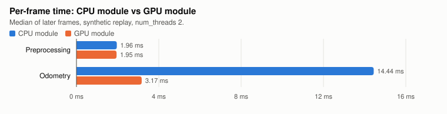
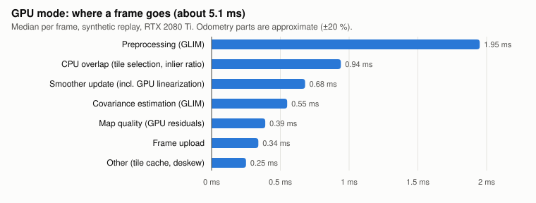
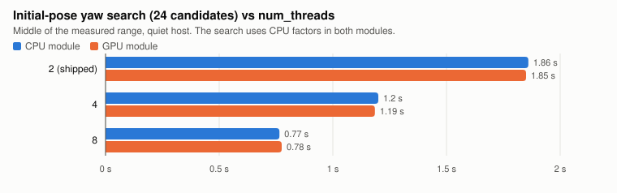

# GPU profile of main for custom kernels ([#35](https://github.com/atinfinity/glim_localization/issues/35))

- **Change**: no code change. This is the first step of [#35](https://github.com/atinfinity/glim_localization/issues/35): a profile of main at 4cfc5ae (after [#78](https://github.com/atinfinity/glim_localization/pull/78)) in GPU mode and in CPU mode, to re-rank the issue's candidates from a measurement. [#79](https://github.com/atinfinity/glim_localization/pull/79), merged since, adds only the one-localization-per-process claim (`util/process_claim.cpp` and the ROS 2 package). It does not touch the replay tool, the odometry modules or the map code that were measured.
- **Method**:
  - Host: RTX 2080 Ti (11 GB, driver 595.99.02) and an Intel i7-9800X (8 cores, 16 threads).
  - Image: the CUDA image (`docker/Dockerfile.cuda`, CUDA 13.1, `CUDA_ARCHITECTURES=75`), built under its own tag (`glim_localization:cuda-prof`) and compose project. `build_core.sh` in CUDA mode passed 392 of 392 tests, and the GPU tests ran on the GPU (the only skip is `GpuNeedsACudaBuild`).
  - Data: the synthetic replay data of `test_replay_e2e.sh`.
    - `synthetic_replay_dataset` with 12 s and 121 estimated frames, about 4200 points per frame after preprocessing.
    - The default map: 5 tiles, 8.5 MB on the GPU.
    - The e2e initial pose: ground truth plus (0.3, -0.2, 0.1) m and 3 deg.
    - The shipped configs `glim_localization/config` (CPU) and `glim_localization/config/gpu` (GPU), with `num_threads` 2.
  - Timing: `frames.csv` (`t_preprocess_ms`, `t_odometry_ms`) and `summary.json` (`init_search.seconds`). There were 5 runs per backend for tracking and 3 per case for the search. "Later frames" leaves out the first frame.
  - Breakdown: Nsight Systems 2025.5.2 (`cuda-nsight-systems-13-1`).
    - It was installed only in a throwaway container started with `--cap-add SYS_ADMIN --cap-add PERFMON`, not in the image.
    - Command (inside the container, wrapping the replay command below):
      `nsys profile -o <name> -t cuda,osrt --sample=cpu --sampling-period=281250 --backtrace=dwarf --cpuctxsw=none --force-overwrite=true <replay command>`,
      then `nsys export --type sqlite <name>.nsys-rep`. The first yaw-search profile used `-t cuda,nvtx,osrt` and the default sampling period.
    - CUDA tables (kernels, copies, API calls) and CPU samples came from the exported sqlite. `nsys stats` failed in this container, so these are plain SQL queries:
      - kernels: `CUPTI_ACTIVITY_KIND_KERNEL` grouped by `demangledName` (count, sum of `end - start`);
      - copies: `CUPTI_ACTIVITY_KIND_MEMCPY` grouped by `copyKind`, and copies of 400 kB or more joined to `CUPTI_ACTIVITY_KIND_RUNTIME` on `correlationId` for the issuing thread;
      - API calls: `CUPTI_ACTIVITY_KIND_RUNTIME` grouped by `nameId`;
      - CPU samples: `COMPOSITE_EVENTS` (`id`, `globalTid`) joined to `SAMPLING_CALLCHAINS` (`id`, `symbol`, `stackDepth`) and `StringIds`. A sample counts for a function when the function is anywhere on its stack (inclusive), or when it is the top frame (self).
    - CPU shares are the share of the odometry (main) thread's samples under `OdometryEstimationLocalization::insert_frame`, not counting the constructor. They are multiplied by the measured median to give rough ms. Sampling runs under nsys overhead, and about a quarter of the stacks are broken, so treat these values as approximate to about ±20 %.
  - Runs (inside the container, with `/ws/build/core`):
    - Data: `synthetic_replay_dataset <out>/input 12`.
    - Initial pose: the first row of `traj_gt.txt`, position plus (0.3, -0.2, 0.1) m, and rotation `Rotation.from_euler("z", yaw, degrees=True) * r0` (scipy) with yaw 3 or 90 deg. It goes to `--init-pose x y z qx qy qz qw`.
    - Replay: `glim_localization_replay --data <out>/input/data --config <cfg> --map <out>/input/map --out <dir> --init-pose ...`, where `<cfg>` is a copy of `glim_localization/config` (CPU) or its `gpu` subdirectory (GPU).
    - Yaw search: the shipped default is `init_yaw_search: false`. The search cases set it to `true` in `config_odometry_localization_cpu.json` and `config_odometry_localization_gpu.json` of the copy.
    - Thread counts: `sed 's/"num_threads": 2/"num_threads": N/'` on the same two files of the copy (search cases), or on `config_preprocess.json` (preprocessing case).
  - Host load: the first batch of runs shared the host with another project's container (load average 7 to 10). The numbers below are from a second batch on a quiet host (load 0.4 to 2). The two batches agree within 5 %, except the 16-thread case below.

- **Results: totals** (quiet host; median, with p95 in parentheses):

  

  | | CPU module | GPU module |
  | --- | --- | --- |
  | Preprocessing per frame (GLIM, outside the odometry) | 1.96 (2.08) ms | 1.95 (2.10) ms |
  | Odometry per frame, later frames | 14.44 (16.73) ms, max 507 ms | 3.17 (3.58) ms, max 12.3 ms |
  | Odometry, first frame | 15.3 to 17.1 ms | 22.2 to 22.8 ms |
  | Wall time of the 12 s replay | 2.52 s | 0.68 s |
  | Initial-pose yaw search, 24 candidates (`init_yaw_search=true`) | 1.84 to 1.88 s | 1.83 to 1.87 s |

  The yaw search accepted -3.0 deg in every run. With a 90 deg initial error it accepted -90.0 deg in the same time: 1.89 to 1.95 s on the CPU and 1.98 to 2.05 s on the GPU (first batch).

- **Results: where the GPU-mode frame goes** (about 5.1 ms per frame: 1.95 ms preprocessing plus 3.17 ms odometry):

  

  | Part | Share of odometry samples | Approx. ms per frame | Runs on |
  | --- | --- | --- | --- |
  | `gtsam_points::overlap` on the CPU tiles, in total | 29.7 % | 0.94 | CPU, our code |
  | - in `select_map_tiles` (overlap filter per queried tile, coarsest level) | 20.6 % | 0.65 | |
  | - in `map_inlier_ratio` (the status inlier ratio, kept on the CPU for CPU/GPU parity) | 9.2 % | 0.29 | |
  | Smoother update (`update_smoother`) | 21.4 % | 0.68 | |
  | - linearization of the GPU factors (`NonlinearFactorSetGPU::linearize`), mostly waiting in `cudaStreamSynchronize` | 18.2 % | 0.58 | GPU |
  | Covariance estimation in `OdometryEstimationIMU::insert_frame` (GLIM) | 17.5 % | 0.55 | CPU |
  | `evaluate_map_quality` without `map_inlier_ratio` (GPU residual factors) | 12.4 % | 0.39 | GPU |
  | Frame upload (`PointCloudGPU::clone` in `create_frame`) | 10.6 % | 0.34 | host |
  | Tile cache `acquire`, deskewing and other work | about 8 % | 0.25 | |

  - **GPU kernels**:
    - 10979 launches over 121 frames, about 91 per frame.
    - 142 ms of kernel time, about 1.17 ms per frame.
    - They are small CUB or Thrust kernels. Three groups give 136.3 ms of the 141.9 ms:
      - `DeviceSelectSweepKernel`: 54.4 ms over 1813 launches, 30 us each;
      - `LinearizedSystem6` reductions: 62.2 ms over 4958 launches, 12.5 us each (`DeviceReduceKernel` 38.2 ms over 2479, 15.4 us; `DeviceReduceSingleTileKernel` 24.0 ms over 2479, 9.7 us);
      - float reductions: 19.7 ms over 507 launches, 39 us each.
    - The rest is 4.9 ms of 1.3 to 1.4 us helpers launched with each select (`DeviceCompactInitKernel` and a `for_each` kernel, 1813 each) and 0.7 ms of voxel insertion kernels (75 launches).
    - So the GPU is idle for most of the frame. The work is bound by launches and syncs: 7127 `cudaStreamSynchronize` calls and 6553 `cudaMallocAsync` calls.
  - **Copies**:
    - Host to device: 905 copies, 36.6 MB in 4.8 ms. Of these, 900 are frame-sized copies: 33.8 MB in 4.4 ms, about 37 us of copy per frame. The 0.34 ms of `clone` is mostly allocation and sync, not bandwidth.
    - Device to host: 1.2 MB in 0.5 ms.
  - **Tile upload**:
    - 5 tiles, 3 in the foreground and 2 on the prefetch thread.
    - The point copy of each tile is 0.57 MB in about 75 us (7.6 GB/s from pageable memory).
    - Voxel insertion kernels total 0.7 ms for the 5 tiles (the `for_each` and `transform` kernels above).
    - Uploads do not show in the per-frame time on this map.
  - **One-time startup**: 129 `cudaStreamCreateWithFlags` calls take 147 ms of host time, and the first frame is 22 ms against 16 ms on the CPU. Neither recurs.
  - **CPU module, for comparison**: CPU VGICP linearization is 75.5 % of the odometry samples. Of the odometry time, the smoother update is 48.0 % and `evaluate_map_quality` 35.9 %, since it linearizes the CPU factors again. `gtsam_points::overlap` is 9.6 %.

- **Results: the yaw search** (nsys, GPU module):

  

  - The shares below are of the 384 samples whose stack contains `score_candidate`, on all threads (the main thread and its OpenMP workers). Inclusive shares of nested functions overlap; shares of disjoint functions add up.
    - 95.8 % are inside `LevenbergMarquardtOptimizerExt::optimize`, and 97.9 % have a CPU `IntegratedVGICPFactor` frame. The second can be larger because some broken stacks lose the optimizer frame.
    - That 97.9 % splits into two disjoint parts (no sample has both): `evaluate` 74.5 % and `update_correspondences` 23.4 % (inclusive).
    - Self time: `evaluate` 70.6 %, `GaussianVoxelMapCPU::lookup_voxel_index` 9.4 % (called from `update_correspondences`), `update_correspondences` 7.6 %, an Eigen 4x4 product 4.7 %, and `scan_matching_reduce_omp` 1.8 %.
  - The search uses CPU factors in both modules, so the GPU module gains nothing. Each candidate costs about 77 ms.
  - It scales with the odometry `num_threads` (2 as shipped). The search reads `map_factors.num_threads`, which is copied from it (`odometry_estimation_localization.cpp`, line 156). The cases below ran on a quiet host:

    | `num_threads` | CPU module | GPU module |
    | --- | --- | --- |
    | 2 (shipped) | 1.84 to 1.88 s | 1.83 to 1.87 s |
    | 4 | 1.19 to 1.21 s | 1.17 to 1.20 s |
    | 8 | 0.76 to 0.77 s | 0.77 to 0.78 s |

  - **16 threads**: on the loaded host (the first batch), 16 threads (all logical cores) took 5.9 s on the CPU module. On the same loaded host, 2 threads took 1.89 to 1.96 s (CPU) and 1.96 to 2.04 s (GPU), and 8 threads 0.88 to 1.05 s (CPU) and 0.99 to 1.04 s (GPU). So 16 threads was about 3 times slower than 2 threads and 6 times slower than 8. It was not rerun on the quiet host. On the GPU module it ran out of the 10 s budget after 4 candidates, so the search was rejected. Do not use all cores.
  - **Preprocessing with `num_threads` 8** (`config_preprocess.json`): 1.13 to 1.22 ms per frame, down from 1.95 ms. GPU odometry stayed at 3.18 ms.

- **Re-ranked candidates** (from the measurement above, highest first):
  1. **Initial-pose yaw search** (one-time, 1.85 s, CPU-only in both modules). It is still the largest single cost. A custom kernel is **not yet worth it** for the 24 yaw candidates:
     - Two levers come first, and neither needs a kernel: run the search with gtsam_points' existing `IntegratedVGICPFactorGPU` on the GPU tiles in the GPU module, and give the search its own thread count (8 threads already give 2.4x).
     - A batched scoring kernel becomes worth it for global search ([#3](https://github.com/atinfinity/glim_localization/issues/3)). There the candidate count reaches hundreds (155 in the challenger spike), and one registration at a time with about 90 small launches per iteration would be launch-bound.
     - Measure the GPU-factor search first; it sets the baseline the kernel has to beat.
  2. **Preprocessing (GLIM)**: 1.95 ms of downsampling and kNN, plus 0.55 ms of covariance estimation inside the odometry. That is about 2.5 ms, half of the GPU-mode frame and now the largest per-frame cost. A custom kernel is **possibly worth it later**:
     - Raising `num_threads` first already removes 0.8 ms.
     - A GPU kNN and covariance would need our own preprocessing module, since GLIM is not modified.
     - At about 4000 points per frame the gain is a few ms at most. Re-check on real data, which has more points per frame.
  3. **New, not in the issue: CPU overlap in the GPU module**, about 0.94 ms (30 % of the GPU odometry), split between `select_map_tiles` and `map_inlier_ratio`. **No custom kernel needed**:
     - `gtsam_points::overlap_gpu` exists. The inlier ratio could also come from the GPU factors' inliers.
     - Caveats: `map_inlier_ratio` is on the CPU on purpose, so that both modules report the same ratio. `select_map_tiles` runs on the CPU tiles so that only the selected tiles are uploaded.
     - Fixing this is a design change, not a kernel.
  4. **GPU factor linearization**: about 1.17 ms of kernel time per frame in about 91 launches, and the GPU is mostly idle. A fused correspondence-and-reduction kernel could cut the launches. The gain would be at most about 0.6 ms per frame, and it needs our own factor class, because the kernels are inside gtsam_points. **Low priority**. Tracking at about 3.2 ms per frame is already well under the 100 ms frame period.
  5. **Tile upload**: 75 us per 0.57 MB tile, partly prefetched, and not visible per frame. **Not a kernel target**, as the issue already says. Real tiles of tens of MB would take a few ms per upload at this bandwidth. That belongs to pinned memory and streaming in [#23](https://github.com/atinfinity/glim_localization/issues/23).
  6. **One-time startup** (147 ms of stream creation, and a 22 ms first frame): **not a kernel target**.

- **Charts**: the three SVGs in `docs/media/gpu_profile_*.svg` plot the medians of the tables above (the yaw search at the middle of each measured range). They are plain SVG, written by hand from the tables, not by a tool in the repo.
- **Open**:
  - **Real data**: not measured. Real data has more points per frame and larger tiles, and both move items 2 and 5.
  - **Global search**: [#3](https://github.com/atinfinity/glim_localization/issues/3) is not implemented, so a batched search could not be measured.
  - **A yaw search with the existing GPU factors**: it needs code, so it is the next step before any kernel.
  - **Kernel-level metrics**: occupancy and memory throughput need Nsight Compute, which is not in the image.
  - **R1 and R2**: the ROS paths were not profiled, only the replay tool.

- **Review** (PR [#81](https://github.com/atinfinity/glim_localization/pull/81)), fixed in a follow-up commit:
  - Kernel averages: the old "every kernel ... 14 to 30 us" was wrong. The averages are now per group (30, 12.5 and 39 us), with the 5.6 ms not in those groups, and the voxel insertion time is corrected from 0.07 ms to 0.7 ms.
  - Yaw search shares: the shares are now named as inclusive shares of the search's samples on all threads. `evaluate` and `update_correspondences` are disjoint and add up to the 97.9 % with a VGICP frame, not to the 95.8 % inside the optimizer.
  - Reproducibility: added the nsys command line, the replay command, how the initial pose (3 and 90 deg) was built, how `init_yaw_search` and the thread counts were changed from the shipped config, and the SQL queries.
  - The user-facing key is the odometry `num_threads`, copied into `map_factors.num_threads`.
  - The 16-thread "3 times slower" now gives its loaded-host baselines.
  - The GPU config path is `glim_localization/config/gpu`.
  - The profiled commit is 4cfc5ae, and #79, merged since, does not touch the measured paths.
