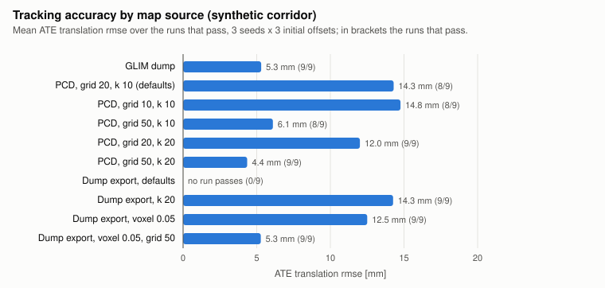
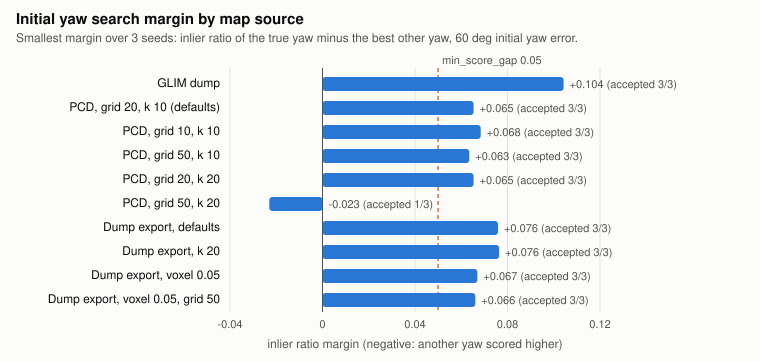

# Map source measurement and PCD export ([#61](https://github.com/atinfinity/glim_localization/issues/61))

- **Change**:
  - `map_compiler --export-pcd <file>` writes the points of the compiled map as one PCD file, from any input: `DATA binary`, x, y, z as F8 in the map frame, no covariances. The file is refused if it exists, is written to a temporary name and renamed. It is written last, after the compiled map and the occupancy grid, so a failed export leaves the other outputs complete. A filesystem error in the existence check is reported as such, not as "already exists". The writer is `write_pcd` in `map/pcd_map.hpp`. Documented in [Map preparation](../maps.md#exporting-a-point-cloud).
  - `synthetic_replay_dataset` takes an optional seed (a decimal number below `UINT_MAX`). It seeds the noise of the map points, and seed + 1 the noise of the LiDAR ranges; the geometry of the scene is fixed (`SyntheticMapParams::seed` only drives the per-point noise). Without it, the output is unchanged. Seed 42 is not the default dataset of `test_replay_e2e.sh`: the map noise seed is the same (42), but the LiDAR seed is 43 instead of the default 11.
  - `scripts/compare_map_sources.py` compiles one synthetic scene in several ways, replays the same frames on each map and writes `results.md` and `results.json`. It only reports; it is not part of CI.
  - [Which map to keep](../getting_started.md#which-map-to-keep) now gives the measured result instead of "not measured yet".
- **Decisions**:
  - **Export:** cheap to add and useful for viewing or editing a map in other tools, so it is in. It writes doubles, so UTM-sized maps keep their precision. A point in the overlap of GLIM submaps is written once per submap. Thinning it inside the export would change the points without telling the user, so the guide says to compile an export with `--voxel-size` or `--k-neighbors 20` instead.
  - **Variants** (scene: the synthetic corridor of `test_replay_e2e.sh`, point spacing about 0.2 m):
    - `dump`, `dump_recov_k10`, `dump_recov_k20`: the GLIM dump as is, and with `--recompute-covariances`.
    - `scene_g<grid>_k<k>`: the generated scene cloud (`map.pcd`, no duplicates) as PCD input. This is the case "same scene as a point cloud".
    - `export_g<grid>_k<k>[_v<voxel>]`: the dump's `--export-pcd` output compiled again. Its submap overlap points are exact copies, because the synthetic submaps share points. Real GLIM submaps overlap with separate scans, so their copies are near rather than exact; how that changes the result is not measured.
    - `scene_g20_k10_max12`: `map_max_submaps` 12 instead of 5, to check whether the tile limit causes the gap. It does not; the result is the same.
  - **Cases** per seed: three tracking runs with the yaw search off (initial error (0.3, -0.2, 0.1) m and 3 deg; (1.0, -0.5, 0) m and 8 deg; (-0.6, 0.6, 0.05) m and -6 deg), and one with `init_yaw_search` on and a 60 deg yaw error. Pass: replay exit 0 and `evaluate.py` within 0.1 m and 1 deg. Seeds 42, 43 and 44 are 3 noise draws of one geometry, not different scenes. The three offsets of one seed converge to the same trajectory, so they are not independent samples either.
- **Verification** (amd64, Docker image of `docker/compose.yaml`):

  ```bash
  scripts/docker_run.sh bash -c 'env -u PYTHONPATH $GLIM_LOC_PYTHON scripts/compare_map_sources.py --out /ws/out/map_sources --jobs 6'
  ```

  About 3 minutes. ATE and the inlier ratio are over the tracking runs that pass (rmse and the inlier ratio are means, max the largest). The yaw search columns: accepted at the true yaw, mean inlier ratio of the true yaw and of the best other yaw, and the smallest margin between them (negative: another yaw scored higher).

  | map | tiles | points | tracking pass | ATE rmse [mm] | ATE max [mm] | inlier ratio | yaw accepted | true yaw | best other | min margin |
  |---|---:|---:|---:|---:|---:|---:|---:|---:|---:|---:|
  | dump | 5 | 79103 | 9/9 | 5.3 | 12.7 | 0.997 | 3/3 | 0.996 | 0.891 | 0.104 |
  | dump_recov_k10 | 5 | 79103 | 9/9 | 5.3 | 12.7 | 0.997 | 3/3 | 0.996 | 0.891 | 0.104 |
  | dump_recov_k20 | 5 | 79103 | 9/9 | 5.3 | 13.2 | 0.997 | 3/3 | 0.995 | 0.891 | 0.104 |
  | scene_g20_k10 (defaults) | 11 | 44264 | 8/9 | 14.3 | 30.9 | 0.923 | 3/3 | 0.884 | 0.818 | 0.065 |
  | scene_g10_k10 | 19 | 44264 | 8/9 | 14.8 | 43.4 | 0.857 | 3/3 | 0.813 | 0.743 | 0.068 |
  | scene_g50_k10 | 6 | 44264 | 8/9 | 6.1 | 15.0 | 0.945 | 3/3 | 0.885 | 0.818 | 0.063 |
  | scene_g20_k20 | 11 | 44264 | 9/9 | 12.0 | 28.3 | 0.926 | 3/3 | 0.884 | 0.818 | 0.065 |
  | scene_g10_k20 | 19 | 44264 | 8/9 | 13.6 | 37.9 | 0.857 | 3/3 | 0.813 | 0.743 | 0.068 |
  | scene_g50_k20 | 6 | 44264 | 9/9 | 4.4 | 8.9 | 0.945 | 1/3 | 0.885 | 0.881 | -0.023 |
  | scene_g20_k10_max12 | 11 | 44264 | 8/9 | 14.3 | 30.9 | 0.923 | 3/3 | 0.884 | 0.818 | 0.065 |
  | export_g20_k10 | 8 | 79103 | 0/9 | - | - | - | 3/3 | 0.890 | 0.814 | 0.076 |
  | export_g10_k10 | 16 | 79103 | 0/9 | - | - | - | 3/3 | 0.823 | 0.755 | 0.066 |
  | export_g50_k10 | 6 | 79103 | 2/9 | 44.4 | 77.3 | 0.945 | 2/3 | 0.857 | 0.815 | -0.010 |
  | export_g20_k5 | 8 | 79103 | 0/9 | - | - | - | 3/3 | 0.893 | 0.804 | 0.084 |
  | export_g20_k20 | 8 | 79103 | 9/9 | 14.3 | 40.3 | 0.928 | 3/3 | 0.890 | 0.814 | 0.076 |
  | export_g20_k10_v0.05 | 8 | 37384 | 9/9 | 12.5 | 30.1 | 0.924 | 3/3 | 0.882 | 0.815 | 0.067 |
  | export_g10_k10_v0.05 | 16 | 37384 | 6/9 | 15.3 | 44.2 | 0.855 | 3/3 | 0.812 | 0.742 | 0.065 |
  | export_g50_k10_v0.05 | 6 | 37384 | 9/9 | 5.3 | 13.0 | 0.956 | 3/3 | 0.893 | 0.824 | 0.066 |
  | export_g20_k20_v0.05 | 8 | 37384 | 9/9 | 11.3 | 26.9 | 0.924 | 3/3 | 0.882 | 0.814 | 0.067 |

  

  

  Findings:
  - **Dump:** passes every run at 5.3 mm rmse with an inlier ratio of 0.997. Recomputing its covariances (k 10 or 20) changes nothing, so GLIM's covariances are not what makes the dump better.
  - **Same scene as PCD:** at the defaults (20 m tiles, k 10) the ATE is about 2.7 times that of the dump (14.3 against 5.3 mm) and the inlier ratio drops to 0.92; one of nine runs (the 1.1 m, 8 deg offset) fails. 50 m tiles bring the ATE to the dump's level (4.4 to 6.1 mm); 10 m tiles make it worse. k 20 made the 20 m map pass 9/9.
    - **Cause, a hypothesis:** the ATE is lower with 50 m tiles than with 20 or 10 m tiles, which points at the tiling. It is not the covariances at tile edges: `build_pcd_submaps` estimates them over the whole cloud before it splits the points. Candidate causes are the per-tile voxel maps (a scan point near an edge finds its correspondence only in the voxel map of one tile), matches of one scan split across several tile factors, and point density. Confounders: y = 0 is a grid line for every grid size, so 10, 20 and 50 m tiles all split the corridor lengthwise; and the dump has more points (79103 against 44264, its overlaps hold the same surfaces several times) and full-range submaps that overlap. Isolating the cause needs a dump and a PCD with the same points, or a grid offset off the corridor.
    - **Noise:** the single-run differences (8/9 against 9/9, 14.8 against 14.3 mm, k 20 passing 9/9) are within run-to-run noise of 3 noise draws, and do not support changing a default.
  - **Yaw search:** on PCD maps the true yaw scores about 0.88 instead of 0.996, and the margin over the next yaw is about 0.065 instead of 0.104, just above `init_yaw_search_min_score_gap` 0.05. With 50 m tiles the 180 deg flip of the symmetric corridor sometimes scores higher; the search then rejects the pose as ambiguous, which is the safe outcome, but it does not localize.
  - **Dump export:** with the exact copies of this synthetic dump in the overlap, k 5 and k 10 give degenerate covariances and every run fails (0.4 to 5 m ATE). Here `--voxel-size 0.05` (about a quarter of the point spacing) or k 20 fixed it, after which the export behaves like the PCD of the scene. A real export has near-duplicates instead; the guide says to use a voxel at least as large as their spacing, which is not measured.
  - **Limits:** one synthetic geometry (a corridor along the y = 0 grid line), three noise draws, CPU only. Whether real maps show the same gap is not known.
- **Open** ([#61](https://github.com/atinfinity/glim_localization/issues/61)):
  - an isolating experiment for the gap (a dump and a PCD with the same points, a grid offset off the corridor, other geometries);
  - the same comparison on a real GLIM dump and its export;
  - changing the default `--k-neighbors` or `--grid-size` for point cloud input only after both of the above.
