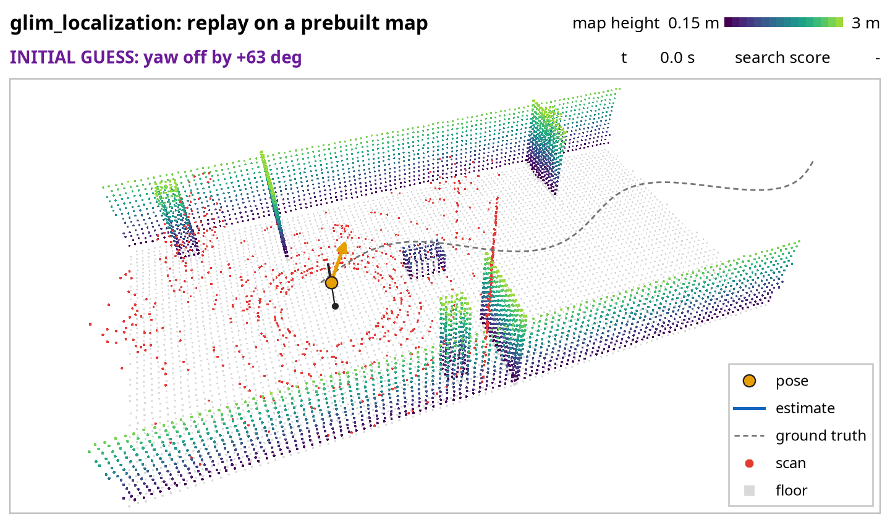

# Offline replay and evaluation

No ROS is needed. The replay reads a simple dataset (`meta.json`, `imu.csv`, `points/*.bin`, optional `wheel_odom.csv`; format in [DESIGN 6.5](DESIGN.md#65-offline-replay-phase-4)). Python tools run from the venv in the image:

```bash
alias py='env -u PYTHONPATH $GLIM_LOC_PYTHON'
```

Unless prefixed with `scripts/docker_run.sh`, the commands below run inside the container after the build (see [Build and test](build.md#build-and-test)). A map comes from [Map preparation](maps.md).

## Synthetic end to end

```bash
scripts/docker_run.sh scripts/test_replay_e2e.sh
```

Generates a 12 s synthetic map and dataset, localizes from an offset initial pose on the GLIM dump and on a PCD map, and checks accuracy (0.1 m, 1 deg after 3 s), determinism and exit codes, and runs the quick suite of [Robustness on synthetic data](#robustness-on-synthetic-data). Results are in `out/phase4_e2e/`.

## Robustness on synthetic data

`scripts/replay_robustness.py` replays the synthetic data from perturbed initial poses and against changed maps:

- **Initial pose:** the ground truth at the first frame, moved by a translation along the xy diagonal (1, -1)/sqrt(2) and rotated about the world z axis. Each pose is replayed with the yaw search (`init_yaw_search`) off and on.
- **Map change:** the scans stay the same. The map PCD is changed and compiled with `map_compiler`: points removed at random, pillars and low boxes removed, boxes added beside the path, or all of these together. The replay starts from the offset of the end-to-end test.
- **Pass:** the replay exits 0 and `evaluate.py` meets 0.1 m and 1 deg after 3 s.
- **Outcome:** each case is classified as one of the following:
  - `pass`;
  - `inaccurate`: exit 0 but outside the limits, which is a wrong convergence;
  - `lost`;
  - `rejected_<reason>`: the yaw search rejected the pose, as `ambiguous`, `low_score`, `truncated`, `no_candidate` or `out_of_range`;
  - `low_tracking`;
  - `timeout`: each replay and each evaluation gets `--timeout`, 120 s by default;
  - `error`: an exception in the script, recorded for that case only;
  - `exit<N>`: any other replay exit code.
- **Quick suite:** each case has an expected outcome, not just pass or fail, so a crash or a bad argument does not count as the expected failure. The cases are:
  - 0.5 m and 10 deg without the search: pass;
  - 0 m and 90 deg without the search: lost or inaccurate;
  - 0.5 m and 90 deg with the search: pass;
  - 8 m with the search: `rejected_low_score`;
  - 4 m with the search and `init_yaw_search_max_translation` 2.5 m: `rejected_out_of_range` (a wrong convergence without the bound);
  - 50 % of the points removed: pass;
  - 12 boxes added: pass.

  All of them are far from the measured boundary.

> [!WARNING]
> A wrong convergence is not detected online. A given pose 45 deg or 4 m off without the search, or 4 m off with the search, can converge to a wrong pose: the replay exits 0 with a high tracking ratio and a pose up to 36 m off; only `evaluate.py` against the ground truth shows it. No threshold on the inlier ratio, the residual or the map correction separates these cases from passing ones across the sweep ([measurement](progress/2026-11-26-wrong-convergence-signals.md)), and neither does a challenger search around the estimate ([spike](progress/2026-11-27-challenger-spike.md)). Keep the initial pose within about 2 m, and enable `init_yaw_search` when the yaw is uncertain. With the search, `init_yaw_search_max_translation` (2.5 m on this corridor) rejects the 4 m cases as `rejected_out_of_range` instead ([measurement](progress/2026-11-27-init-search-max-translation.md)); the cases without the search are not covered.

```bash
# quick: the cases above; test_replay_e2e.sh runs it, so CI does too (about 15 s)
scripts/docker_run.sh bash -c 'env -u PYTHONPATH $GLIM_LOC_PYTHON scripts/replay_robustness.py --suite quick'
# full: the whole grid, reported only (about 9 min with --jobs 3 on 8 arm64 cores)
scripts/docker_run.sh bash -c 'env -u PYTHONPATH $GLIM_LOC_PYTHON scripts/replay_robustness.py --suite full --jobs 3 --out /ws/out/robustness_full'
```

The results are in `<out>/results.md` and `<out>/results.json`, written even when a case fails. Other options: `--input` (reuse a `synthetic_replay_dataset` output), `--search-max-translation` (`init_yaw_search_max_translation` of the cases with the search, 0 by default), `--keep-runs`, `--settle`, `--max-trans`, `--max-rot-deg`, `--timeout`. The measured boundary is in [the progress entry](progress/2026-11-25-real-data-prep.md).

> [!NOTE]
> The numbers in the progress entry are from arm64. amd64 gives slightly different errors for the same case. For example, the combined map change has an ATE max of 0.072 m on arm64 and 0.086 m on amd64. For this reason the quick suite uses only cases with a wide margin.

## Demo animation

The animation in the README (`docs/media/replay_synthetic.gif`) is rendered offscreen from the synthetic end-to-end run above. To regenerate it after `test_replay_e2e.sh`:

```bash
scripts/docker_run.sh bash -c 'env -u PYTHONPATH $GLIM_LOC_PYTHON scripts/render_demo.py \
  --data /ws/out/phase4_e2e/input/data --run /ws/out/phase4_e2e/run1 --map /ws/out/phase4_e2e/input/map.pcd \
  --out docs/media/replay_synthetic.gif'
```

> [!NOTE]
> The default view is `--view oblique`, a fixed 3D camera above and beside the run; the README uses it. `--view top` draws the earlier top-down 2D view, and `--view chase` a camera that follows the pose.

- `render_demo.py` draws, per estimated frame, the map points, the current scan moved to the map frame by the estimate, the current pose (an orange dot with a thin dark edge, and a heading arrow), the estimated trajectory so far, the ground truth (`<data>/traj_gt.txt` when it exists; `--gt`, `--no-gt`), and the state and inlier ratio from `frames.csv`. Frames that are not `estimated` are skipped.
- 3D views (`oblique`, `chase`): the map is cropped to the trajectory plus `--margin` (default 6 m) and the scan is drawn in red. The floor (map points up to 0.15 m above the floor level, which is the 0.5th percentile of the cropped map heights rounded to 0.1 m) is drawn as smaller light gray points, so the scan keeps its contrast on it. The points above are colored by height in 16 levels of viridis without its yellow end. The key in the header starts at the floor cut, and the floor is in the legend. The pose also has a dark up axis (its tilt) and a stem to the surface below, and thin blue lines drop from the estimate to the surface below it every 0.6 m of path (the surface is the most common height of the map points within 0.35 m in x y, so a wall or pillar next to the path is not taken for it): they show the height of the path above the floor, and that it passes over the low boxes in the corridor. Points are projected by a pinhole camera in numpy and drawn far to near; points behind the camera are dropped. `--azimuth` (default -110 deg), `--elevation` (default 42 deg) and `--distance` (default 0.9 times the box diagonal, at least 0.5) place the oblique camera, which keeps the whole trajectory in view even where it leaves the map, and `--aspect` (default 0.5) sets the plot height to width.
- Top view (`--view top`): the map in gray from above. `--z-min` and `--z-max` draw only the map and scan points in a map-frame height band, for example `--z-min 1.0 --z-max 3.0` to hide the floor and the low boxes, which the path passes over and would otherwise seem to drive through. The band also applies to the 3D views.
- The map is a PCD file (ascii or binary); non-finite points are dropped. Pass `--t-lidar-imu` with the value of `config_sensors.json` when it is not the identity.
- The output is a GIF or WebP, chosen by the extension. The layout is `--width` px wide (default 720) and is rendered at `--scale` times that (default 2, so 1440 px); the README shows it at `width="720"`, so it stays sharp on high-density screens and in a column wider than 720 px. A GIF uses one palette of `--colors` entries (default 256) that holds black, white, the text, state, plot and height colors exactly, plus adaptive colors from the first, middle and last frames; frames are mapped to it without dithering. Other options: `--fps`, `--stride`, `--max-frames`, `--max-map-points`, `--max-scan-points` (default 4000 for top, 1000 for the 3D views), `--title`.
- Text uses `--font` (default `Noto Sans`). The image installs it (`fonts-noto-core`) and builds the matplotlib font cache after it, so the README GIF uses Noto Sans when rendered in the image. Where the font is missing, the script warns on stderr and uses DejaVu Sans, which ships with matplotlib.
- The published image therefore includes `fonts-noto-core` under the SIL Open Font License 1.1; the license text is in `/usr/share/doc/fonts-noto-core/copyright` in the image. No font file is in this repository.
- Keep each committed file at about 2 MB or less, and commit only the image: never a bag, dataset or map.

### Yaw search clip

`docs/media/replay_yaw_search.gif` shows the initial yaw search ([#3](https://github.com/atinfinity/glim_localization/issues/3)) on the same data: the replay starts from a pose with the yaw about 60 deg off, the search finds the right yaw on the first scan, and tracking starts. `--init-search` adds two held images before the run: the first scan placed by the given pose ("INITIAL GUESS"), then by the pose the search picked ("YAW SEARCH", with the yaw correction and the number of candidates). It reads `replay_args.json` and the `init_search` record of `summary.json`, so the run needs `init_yaw_search: true` in a copied config; without an accepted search the script exits 2.

```bash
scripts/docker_run.sh bash -c '
  rm -rf /ws/out/config_yaw /ws/out/run_yaw &&
  cp -r glim_localization/config /ws/out/config_yaw &&
  sed -i "s/\"init_yaw_search\": false/\"init_yaw_search\": true/" /ws/out/config_yaw/config_odometry_localization_cpu.json &&
  /ws/build/core/tools/glim_localization_replay --data /ws/out/phase4_e2e/input/data --config /ws/out/config_yaw \
    --map /ws/out/phase4_e2e/input/map --out /ws/out/run_yaw --init-pose 5.3 -0.2 1.1 0 0 0.5225 0.8526 &&
  env -u PYTHONPATH $GLIM_LOC_PYTHON scripts/render_demo.py \
    --data /ws/out/phase4_e2e/input/data --run /ws/out/run_yaw --map /ws/out/phase4_e2e/input/map.pcd \
    --init-search --max-frames 60 --out docs/media/replay_yaw_search.gif'
```



## Real bag

```bash
# 1. Convert a rosbag2 (sqlite3 or mcap) to a replay dataset
py scripts/bag_to_replay.py <bag_dir> --out /ws/out/dataset [--points-topic /points] [--imu-topic /imu] [--acc-scale 9.80665] [--point-clock-offset <s>|estimate] [--wheel-odom-topic /odom] [--gt traj.txt]

# 2. Localize
/ws/build/core/tools/glim_localization_replay --data /ws/out/dataset --config glim_localization/config \
  --map /ws/out/map --out /ws/out/run --init-pose x y z qx qy qz qw [--init-stamp <s>]

# 3. Evaluate against a reference trajectory (TUM, T_world_imu); traj_gt.txt is written only by --gt in step 1
py scripts/evaluate.py --est /ws/out/run/traj_localization.txt --gt /ws/out/dataset/traj_gt.txt \
  --frames /ws/out/run/frames.csv --out /ws/out/run [--settle 3] [--max-trans 0.1] [--max-rot-deg 1] [--plot]
```

- `bag_to_replay.py`: per-point time is detected as GLIM does (override with `--time-field`, `--time-mode`, `--time-scale`). `--acc-scale` is required when the accelerations look like units of g. Livox `CustomMsg` is not supported.
- Clock offset: with absolute per-point times, the first point of every frame must be within 1 s of the header stamp. By default a bag whose per-point times use another clock (for example the sensor clock, while the header and the IMU use the host clock) is rejected. If the header and IMU stamps share one clock and only the per-point times are offset, pass `--point-clock-offset`:
  - `--point-clock-offset <seconds>` adds the offset to every per-point time (header clock = point clock + offset). Use the `=` form for a value like `-inf` that argparse would take for an option; a plain negative number such as `-7.5` works.
  - `--point-clock-offset estimate` takes it from the first frame as header stamp - first point time.
  - After the offset there are two checks on the residual (first point after the offset - header). Each frame must be within 1 s of its header, which catches a wrong offset and large jumps. The residual may spread (max - min over all frames) over at most one scan period, taken as the median interval of the header stamps, which catches drift and smaller jumps. Changes below one scan period pass.
  - The value must be finite and at most 1e9 s (about 32 years). The option is refused for relative per-point times, `--time-mode relative`, and clouds without a time field.
  - The offset is printed, and `meta.json` records it under `conversion.point_clock_offset`: `source` (`given` or `estimated`), `offset_ns`, `offset_s`, `estimated_from_frame`, `definition` (`header clock = point clock + offset`), and the residual as min, median and max (`residual_s`). Without the option the field is `null`.
- Wheel odometry (optional): `--wheel-odom-topic` writes the twist of a `nav_msgs/Odometry` topic to `wheel_odom.csv`, as the ROS nodes take it. Messages with another `child_frame_id` than `--wheel-odom-child-frame` (default `base_link`, the base of `wheel_odom_T_imu_base`; `''` accepts any), a zero stamp or a non-finite value are excluded. `--wheel-odom-time-offset` is added to the header stamps. `meta.json` records the topic, the frame, the offset and the counts under `conversion.wheel_odom`. No usable message is an error. Replay it with `--wheel-odom on` and a config whose `wheel_odom_T_imu_base` is set for your robot.
- `glim_localization_replay`: `--init-pose` is `T_world_imu` in the map frame. Other options: `--init-vel`, `--start`, `--end`, `--max-frames`, `--max-imu-gap` (default 0.05 s), `--on-imu-gap abort|reset`, `--min-tracking-ratio` (default 0.9), `--wheel-odom on|off` (feed `wheel_odom.csv`; default: `wheel_odom_enabled` of the config). Outputs: `traj_localization.txt` (TUM), `frames.csv`, `summary.json`, `replay_args.json`. Exit codes: 0 ok, 1 runtime failure (including LOST or a low tracking ratio), 2 bad arguments, config, map or initial pose, 3 invalid dataset (including IMU gaps), 4 no pose.
- `evaluate.py`: ATE and RPE with evo (no realignment) and processing time statistics; writes `eval.json` and `eval.txt`, and exits 1 when a threshold or the pose coverage (`--min-coverage`, default 0.9) is not met.
- Set `T_lidar_imu` in `config_sensors.json` of a copied config for your sensor; the shipped configs use identity. Then pass `--config` your copied config instead of `glim_localization/config`.

> [!WARNING]
> `--point-clock-offset estimate` assumes that the header stamp is the time of the first point. If the driver stamps the end or the middle of the scan, every frame is shifted by the same error, up to one scan period, against the IMU. The residual in `meta.json` cannot show this: the estimate comes from frame 0, so the residual is near 0 by construction. Only an offset that you know (given as `--point-clock-offset <seconds>`) avoids it.

The GPU module is selected with `--config glim_localization/config/gpu` in the CUDA image; see [CUDA variant](build.md#cuda-variant).

## Evaluation mapper

`glim_localization_mapper` and `scripts/smoke_os1_128.sh` build a GLIM map and a reference trajectory from a replay dataset for a real-data consistency check. They are evaluation tools, not a supported mapper; build maps for real use with GLIM.

```bash
scripts/docker_run.sh scripts/smoke_os1_128.sh [--force] <replay dataset dir> [out dir]
```

The smoke test caches its two maps (`map_full` and `map_prefix`) in `/ws/out/smoke_os1_128/cache`, or `cache-cuda` in the CUDA image, so a second run skips the mapper and only localizes again. On the host, `/ws/out` is the git-ignored `out/`.

- **Rebuilds:** a map is rebuilt when its key changes. The key covers the dataset, the mapping config and extrinsics, the mapper arguments, the binaries, GLIM modules and libraries, and the split.
- **Checks:** a cached map is checked against its manifest before use. A bad entry is rebuilt, and the log names the cause.
- **Options:** `--force` rebuilds both maps.
- **Other cache directory:** `SMOKE_CACHE_DIR` sets one. It must be new, empty, or one the script created before, and it must not be inside the dataset or overlap the out dir.
- **One run at a time:** only one run uses a cache at a time.

The script header in `scripts/smoke_os1_128.sh` and section 6.5 of the [design](DESIGN.md) have the details.
